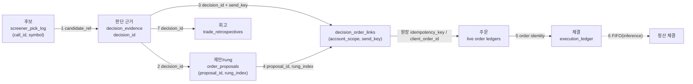

# #4154 — 후보 → 판단 근거 → 주문 → 체결 → 회고 연결 설계

hk 3718(후보→전략→주문→체결→회고 전향 연결)과 hk 3871(Factortrail P1-T4, dots C1 포함)이 요구한 같은 설계 문서다.
기준 SHA는 `6407a73e7`이고, 모든 `path:line` 인용은 그 SHA 기준이다. 코드·마이그레이션·계약(openapi)·MCP 도구·스케줄러는 이 문서의 범위가 아니다.
이 문서는 hk 3737(주문 없는 US 지정가 깊이·분할 진입 shadow)이 읽는 입력이기도 하다(§7).

운영자 결정(원문은 hk doc):

- `decision/2026-11-09/dots-kr-retro-1109` §2·§3: 설계 문서 먼저, 전향(prospective)만, 과거 NULL 소급 없음(ROB-1488 / ROB-1283), KR 체결 시각은 이 문서의 한 절.
- `decision/2026-11-09/dots-kr-retro-1109` §4: 전략 대안(얕은·분할 지정가, 매도 하한 vs 위험 축소)은 연구 전용 반사실이고, 가격 터치는 체결로 세지 않는다.
- `decision/2026-11-11/factortrail-p1` 결정 2·4: 새 기능은 AT 소유 읽기 전용 reader를 가진 새 retro/v1 operation이고, 판단 근거 연결(dots C1)은 이 설계에 합쳐 먼저 쓴다.

## 1. 목적과 범위

### 1.1 목적

한 건의 판단이 후보, 판단 근거, 제안(rung), 주문, 체결, 회고로 이어지는 사슬을 **전송·기록 시점에 남긴 키**로 잇는다. 지금은 사슬의 여러 고리가 읽기 시점의 추론(`basis=inference`)이다. 이 설계는 다음을 정한다.

1. 단계 경계마다 상류와 잇는 내구 키, 그 키가 놓일 테이블·컬럼(기존/신규), 쓰는 writer, 전송 전/후, reader가 보고할 링크 basis.
2. 위험 금액(risk amount), MFE/MAE, 수수료·세금의 정의.
3. KR 체결 시각의 출처와 basis 기록 방식.
4. hk 3737이 필요로 하는 연구 반사실 입력.
5. 이를 드러낼 retro/v1 operation·필드 제안(계약 수정 아님)과 PR 단위 티켓.

### 1.2 소급(backfill) 없음

**소급(backfill) 없음.** 새 키와 새 컬럼은 이 설계가 구현된 시점 이후에 생기는 행에만 쓴다.

- 과거 행의 NULL은 그대로 둔다. 어떤 writer도 과거 행을 UPDATE하지 않는다. 마이그레이션은 컬럼 추가(nullable)만 하고 값을 채우지 않는다.
- reader는 새 키가 없는 과거 행을 `unknown` 또는 `inference`로 표시하고, 추론에 성공했다는 이유로 값을 만들어 저장하지 않는다.
- `execution_ledger`의 같은 키 재전송이 과거 행을 `updated`로 바꾸지 못하도록 §6.5의 비교 규칙을 둔다.

### 1.3 범위 밖

코드, 마이그레이션 파일, `contracts/retro/v1/openapi.yaml` 수정, MCP 도구, 스케줄러 등록, 과거 행 소급, hk 3737 shadow 자체, 하드 룰·가드 변경.

### 1.4 지키는 하드 룰

| 규칙 | 이 설계의 처리 |
|---|---|
| in-process LLM 금지(AGENTS 하드룰 1) | 판단 근거는 out-of-process 세션이 넘긴 값을 기록할 뿐 생성하지 않는다. |
| 레저 쓰기는 서비스 경유(하드룰 5) | 새 테이블마다 유일한 writer 서비스를 둔다. `execution_ledger` 변경은 기존 repository 경유다. |
| 스케줄러 등록 금지(하드룰 6) | 계산 레버는 CLI/scheduleless 태스크다. 등록은 이 설계가 하지 않는다. |
| kis_mock 귀속(하드룰 7) | mock 경로는 건드리지 않는다. 판단 근거 연결은 live 계정(`kis_live`/`toss_live`/`upbit`)에만 적용한다(`app/services/retro_v1/chain.py:61`). |
| pick log no-write(하드룰 13) | `discover_buy_candidates_fanout` 안에서는 쓰지 않는다. 바깥 관찰자 wrapper만 쓴다(`app/mcp_server/tooling/buy_candidate_fanout_registration.py:55-61`). |
| 주문 게이트 완화 금지(하드룰 4) | 새 쓰기는 주문 게이트를 추가하거나 완화하지 않는다. 전송 직전 쓰기는 fail-open이다(§4.3). |
| retro/v1 reader는 읽기 전용 | `REPEATABLE READ READ ONLY` 트랜잭션과 import 가드를 유지한다(`docs/agent-contracts/mcp-and-analysis-contracts.md:306`). |

### 1.5 용어

- **단계(stage)**: candidate · decision evidence · proposal/rung · order · fill · retrospective. 현재 retro/v1 chain의 `stage` 열거는 `candidate, proposal, rung, order, fill, markout, lot`이며 회고 단계는 없다(`contracts/retro/v1/openapi.yaml:819-828`, `app/services/retro_v1/chain.py:69-77`).
- **값 basis**: 행의 값이 어디서 왔는지. 기존 `EvidenceBasis = broker | inference | unknown`(`contracts/retro/v1/openapi.yaml:659-664`). 이 설계는 이 열거를 바꾸지 않는다.
- **링크 basis**: `linked_ref`가 어떻게 만들어졌는지. 이 설계가 새로 정의한다.
  - `recorded`: 상류·하류 중 한쪽 writer가 자기 이벤트 시점에 남긴 내구 키를 reader가 **정확 일치**로 확인했다.
  - `inference`: 심볼·시각·최신 등 휴리스틱으로 이었다. 쓰기 시점에 서버가 휴리스틱으로 보강하고 그 사실을 컬럼에 라벨로 저장한 경우도 `inference`다.
  - 링크가 없으면 `linked_ref=null`이고 사유(`no_linked_*`)를 둔다. `recorded`와 `inference`만 있고 `unknown` 링크 basis는 없다.

## 2. 현재 상태

### 2.1 단계 경계별로 이미 이어진 것과 추론인 것

| 경계 | 현재 연결 | 상태 | 근거 |
|---|---|---|---|
| 후보 → 판단 | 없음. 후보 행의 `call_id`는 세션에 돌려주지 않는다. | 끊김 | `app/services/screener_pick_log.py:337`, `app/services/screener_pick_log.py:468-495`, `app/mcp_server/tooling/buy_candidate_fanout_registration.py:55-61` |
| 후보 → 제안 | 같은 심볼에서 제안 시각 이전의 가장 늦은 후보. 시간 상한이 없다. | 추론 | `app/services/retro_v1/chain.py:591-598`, `app/services/retro_v1/chain.py:626-628` |
| 판단 → 제안 | 자유 텍스트 `thesis`/`strategy`, JSONB `rationale`/`source_asof`. 후보·보고서 항목·판단 시점 가격 필드가 없다. | 끊김 | `app/models/order_proposals.py:120-128`, `app/models/order_proposals.py:143`, `app/mcp_server/tooling/order_proposal_tools.py:694-719` |
| 제안 → rung | `proposal_pk` FK + `(proposal_pk, rung_index)` 유니크 | 기록 | `app/models/order_proposals.py:184-190`, `app/models/order_proposals.py:207-213` |
| rung → 주문 | rung의 `broker_order_id`·`idempotency_key`·`correlation_id`는 **전송 후** `record_ack`/`record_resting`/`record_unverified`가 쓴다. 전송 직전에는 `submitting` 전이만 있다. | 기록(전송 후) | `app/services/order_proposals/revalidation.py:1445-1448`, `app/services/order_proposals/revalidation.py:2376-2398`, `app/services/order_proposals/service.py:4140-4162` |
| 주문 ↔ 원장 | 원장 행의 `idempotency_key`(KIS·US·Upbit) 또는 `client_order_id`(Toss). chain은 key 일치 **또는** correlation 일치 + ROB-1379 identity 일치로 잇는다. | 기록 + 약한 추론 | `app/services/retro_v1/chain.py:710-759`, `app/models/review.py:504`, `app/models/review.py:733` |
| 주문 → 체결 | ROB-1379 order identity. 행 `source`가 `reconciler`면 값 basis `broker`, 아니면 `inference`. | 기록 | `app/services/execution_ledger/supersede.py:89-112`, `app/services/retro_v1/chain.py:820-851` |
| 체결 → 회고 | 회고는 `(correlation_id, account_mode)`로 upsert하고 `journal_id`를 선택적으로 가진다. 체결 행과의 직접 키는 없다. | 약한 추론 | `app/models/review.py:1194-1197`, `app/models/review.py:1253-1254`, `app/services/trade_journal/trade_retrospective_service.py:321-389` |
| 매수 → 매도(청산 짝) | 브로커 lot id가 없어 FIFO로 짝짓는다. | 추론 | `app/services/execution_ledger/kis_lots.py:437`, `app/mcp_server/tooling/kis_live_ledger.py:997-1008` |

### 2.2 끊김과 함정(사실)

1. **후보 id가 세션에 전달되지 않는다.** `call_id`는 `extract_pick_rows` 안에서 `uuid.uuid4()`로 만들어지고(`app/services/screener_pick_log.py:337`), `maybe_record_fanout_picks`는 결과를 바꾸지 않는다(`app/services/screener_pick_log.py:476`). wrapper는 `result`를 그대로 반환한다(`app/mcp_server/tooling/buy_candidate_fanout_registration.py:58-61`).
2. **후보 생산이 멈춰 있다.** `review.screener_pick_log` 마지막 행은 KR 2026-09-28, US 2026-10-30이다(hk 3871 comment). 게이트 `SCREENER_PICK_LOG_ENABLED`의 기본은 false다(`app/core/config.py:1405`, `app/services/screener_pick_log.py:79-82`).
3. **후보→제안 추론은 시간 상한이 없다.** 같은 심볼의 더 이른 후보면 몇 달 전 행이라도 잇는다(`app/services/retro_v1/chain.py:593-598`).
4. **손절 가격의 소재가 흩어져 있다.** 제안 생성 시 `exit_plan`은 `source_asof["exit_plan"]`에 들어가고(`app/mcp_server/tooling/order_proposal_tools.py:852-858`), 매수 수락 후 `lot_exit_plans`에 `(proposal_id, rung_index)`와 함께 쓰인다(`app/models/mechanical_loss_cut.py:84`, `app/models/mechanical_loss_cut.py:97-98`, `app/services/mechanical_loss_cut/plans.py:87-101`, `app/services/order_proposals/revalidation.py:1591`). 제안 경로의 주문은 `target_price`/`stop_loss`/`min_hold_days`/`indicators_snapshot`을 `place_order`에 넘기지 않으므로(`app/services/order_proposals/revalidation.py:1464-1496`) 원장·저널의 `stop_loss`는 NULL이다(`app/mcp_server/tooling/kis_live_ledger.py:981-985`).
5. **rung의 correlation과 원장의 correlation이 다를 수 있다.** rung은 `live_correlation_id(... rung=rung_index)`로 만든 값을 쓴다(`app/services/order_proposals/revalidation.py:944-955`). KIS 원장은 같은 함수로 `rung=0`을 박아 다시 만든다(`app/mcp_server/tooling/kis_live_ledger.py:288-296`). US·crypto 원장도 같다(`app/mcp_server/tooling/live_order_ledger.py:743-751`). Toss 원장만 override를 받는다(`app/mcp_server/tooling/toss_live_ledger.py:105-118`). 그리고 correlation은 심볼·방향·가격·수량·날짜·rung의 해시라서 제안에 고유하지 않다(`app/services/live_correlation.py:15-37`). 그래서 correlation만 일치한 매칭은 `recorded`가 될 수 없다.
6. **KIS는 제안·rung에 묶인 결정적 전송 키가 없다.** Toss·Upbit는 `(proposal_id, rung_index)`의 해시로 클라이언트 주문 ID를 만든다(`app/services/order_proposals/revalidation.py:448-451`, `app/services/order_proposals/revalidation.py:462-464`). KIS에는 `None`이다(`app/services/order_proposals/revalidation.py:843-849`). KIS 전송 키는 내용·날짜·rung 해시로 `place_order` 안에서 정해지고(`app/mcp_server/tooling/order_execution.py:2240-2247`), 전송 직전 `review.order_send_intents`에 예약된다(`app/mcp_server/tooling/order_execution.py:1128-1146`, `app/mcp_server/tooling/order_execution.py:1175-1180`). 이 예약 행에는 제안·rung 열이 없다(`app/models/review.py:660-667`).
7. **체결 행의 correlation은 대개 쓸모없다.** websocket 모니터는 `str(event.get("correlation_id") or "n/a")`를 넘긴다(`websocket_monitor.py:326`, `websocket_monitor.py:496`). KIS reconciler는 correlation을 넘기지 않는다(`app/services/execution_ledger/reconciler.py:176-180`). Toss reconciler만 주문 원장의 값을 싣는다(`app/services/toss_execution_ledger.py:87`).
8. **이름이 겹친다.** `order_proposals.retrospective_id`는 손절 매도의 **사전조건**으로 붙은 회고다(`app/mcp_server/tooling/order_validation.py:568-570`). 체결 후 회고와 다른 개념이므로 이 설계의 `decision_id` 연결에 쓰지 않는다.
9. **KIS 저널은 체결 시점에 만들어진다.** 매수 저널은 reconcile이 체결 증거를 본 뒤 원장 행의 thesis·strategy·stop을 복사해 만든다. 값이 없으면 문구 `"reconciled fill"`로 채운다(`app/mcp_server/tooling/kis_live_ledger.py:968-996`).
10. **수수료·체결 시각의 함정**은 §5.3과 §6에서 다룬다.

### 2.3 기존에 쓸 수 있는 것

- 직접 주문(`place_order`) 원장은 `thesis`·`strategy`·`target_price`·`stop_loss`·`indicators_snapshot`·`report_item_uuid`를 이미 가진다(`app/models/review.py:487-500`). 직접 주문에서는 원장 행이 곧 판단 근거의 사본이다.
- 판단 시점 가격은 지정가 rung이면 `limit_price`, 시장가이면 자동 승인 결정의 `source_asof["auto_approved"]["eligibility"][i].current_price`뿐이고, 수동 승인은 가격을 저장하지 않는다(`app/services/execution_ledger/fill_intent_lookup.py:47-72`, `app/services/execution_ledger/fill_intent_lookup.py:87-96`).
- 기각(negative class) 판단은 `trade_forecasts` 한 행에 bucket·대상·review_date·결과가 함께 있어 보고서 항목 없이도 채점 가능하다(`app/models/review.py:1548-1554`). chain은 이를 후보 단계 행으로 읽지만 `linked_ref`는 항상 null이다(`app/services/retro_v1/chain.py:566-585`).
- 전략 슬리브는 제안에 `sleeve_id`를 한 번 묶고 규칙 id를 가진다(`app/models/order_proposals.py:124-127`, `app/models/strategy_sleeves.py:82`, `app/models/strategy_sleeves.py:144`).
- 호가 터치 증거(KR/US live 래더)는 `review.ladder_touch_events`가 주문 원장 행 id(`order_ledger`, `order_ledger_id`)와 함께 따로 기록한다(`app/models/quotes_consumer.py:112-167`).

## 3. 단계별 연결 키 표

키 이름 정의:

- `decision_id`: 판단 한 건의 uuid. `DecisionEvidenceService`(신규)가 판단을 기록할 때 만든다.
- `candidate_ref`: `(call_id, symbol)`. `review.screener_pick_log`에서 한 호출·한 심볼은 소스 수만큼 행이 있고 모두 같은 후보다(`app/models/screener_pick_log.py:34-39`).
- `send_key`: 주문 전송 키. KIS·US는 `place_order`가 정하는 `idempotency_key`, Toss는 `clientOrderId`(`tosprop-…`), Upbit는 `identifier`(`oprop-…`)다. `account_scope`는 `kis_live | toss_live | upbit_live`다(원장·저널의 기존 어휘: `app/models/review.py:557`, `app/services/retro_v1/chain.py:110-114`).
- `order identity`: ROB-1379 튜플 `(broker, account_mode, instrument_type, symbol, side, currency, normalized order number, trading day)`(`app/services/execution_ledger/supersede.py:100-112`).
- `attempt_id`: 브로커 전송 시도 한 번의 uuid. `place_order`/`toss_place_order`가 전송 직전에 만든다. 같은 `send_key`로 여러 시도가 있을 수 있다(아래 해소 규칙).

| # | 상류 단계 | 하류 단계 | 키 | 저장 위치 | writer | 기록 시점 | basis |
|---|---|---|---|---|---|---|---|
| 1 | candidate | decision evidence | `candidate_ref = (candidate_call_id, candidate_symbol)` | 신규: `review.decision_evidence.candidate_call_id`, `candidate_symbol`, `candidate_link_basis`. 후보 쪽은 기존 `review.screener_pick_log.call_id`(`app/models/screener_pick_log.py:121`)이고 불변 | 신규 `DecisionEvidenceService.record`(링크 컬럼). 후보 writer는 기존 `maybe_record_fanout_picks` | 판단 기록 시점. 브로커 전송보다 앞서고, 제안 INSERT와 같은 트랜잭션이다 | 세션이 넘긴 ref는 `recorded`. 서버가 쓰기 시점에 같은 KST 거래일의 `admission='admitted'` 후보로 보강한 ref는 `inference`이고 컬럼 `candidate_link_basis`에 저장한다. 둘 다 없으면 링크 없음(`no_candidate_ref`) |
| 2 | decision evidence | proposal/rung | `decision_id`. rung은 `(proposal_id, rung_index)` | 신규 컬럼 `review.order_proposals.decision_id`(nullable uuid, 인덱스, INSERT 때만 설정). rung은 기존 `(proposal_pk, rung_index)` 유니크(`app/models/order_proposals.py:184-190`) | 기존 `OrderProposalsService`(제안 생성 서비스) | 제안 INSERT와 같은 트랜잭션. 판단 행이 먼저 INSERT되고 제안이 `decision_id`를 담는다 | `recorded` |
| 3 | decision evidence | order(직접 주문, 제안 없음) | `decision_id` + `attempt_id` + `(account_scope, send_key)` | 신규 `review.decision_order_links`의 `attempt_id`, `decision_id`, `account_scope`, `send_key`, `proposal_id=NULL`, `rung_index=NULL` | 신규 `DecisionEvidenceService.link_order`, `place_order`/`toss_place_order`가 호출 | 브로커 POST **전**. 별도 짧은 트랜잭션으로 커밋한 뒤 전송한다. 전송 안 됨이 증명되면 `review.decision_order_link_outcomes`에 추가한다 | `recorded`(아래 "전송 시도 해소 규칙"을 통과할 때만) |
| 4 | proposal/rung | order | `attempt_id` + `(account_scope, send_key)` | 신규 `review.decision_order_links.(attempt_id, account_scope, send_key, proposal_id, rung_index)`와 `review.decision_order_link_outcomes`. 주문 쪽은 기존 원장 `idempotency_key`(`app/models/review.py:504`) 또는 `client_order_id`(`app/models/review.py:733`) | 시도 행은 `place_order`/`toss_place_order` 안의 `link_order`(전송 전), 결과 행은 같은 함수의 `proven_not_sent` 분기. 원장 행은 기존 `_record_kis_live_order`·`_record_live_order`·`TossLiveOrderLedgerService.record_send`(전송 후) | 시도 행은 POST 전, 원장 행은 POST 후 | 해소 규칙으로 그 `send_key`의 살아 있는 시도가 **한 판단에만** 속하고 키가 원장 키와 정확히 일치하면 `recorded`. 살아 있는 시도가 둘 이상의 판단에 걸치면 링크 없음(`ambiguous_attempts`). 링크 행이 없는 과거 행은 기존 규칙인 rung `idempotency_key` = 원장 키 일치(`recorded`), correlation만 일치(`inference`)다 |
| 5 | order | fill | order identity | 기존 `review.execution_ledger`의 `broker`, `account_mode`, `instrument_type`, `symbol`, `side`, `currency`, `broker_order_id`, 날짜(`filled_at`에서 유도)(`app/models/execution_ledger.py:88-108`) | 기존: reconciler, websocket 모니터, fillwire ingest | 체결 후(전송보다 늦다) | 정확한 identity 일치는 `recorded`. 일치하는 주문이 없으면 `linked_ref=null`, `no_linked_order`. 값 basis는 기존 규칙을 유지한다(`app/services/retro_v1/chain.py:847`) |
| 6 | fill(매수) | fill(매도, 청산 짝) | 브로커 lot id가 없으므로 authoritative 행의 FIFO | 읽기 시 계산만 한다. 저장 없음. 기존 `kis_lots.fifo_position` 규칙 | 없음(reader) | 읽기 시점 | `inference` |
| 7 | decision evidence(및 fill) | retrospective | `decision_id`(호출자 제공). 기존 `(correlation_id, account_mode)`·`journal_id`는 그대로 | 신규 컬럼 `review.trade_retrospectives.decision_id`(nullable uuid, 인덱스). 기존 `app/models/review.py:1194-1197`, `app/models/review.py:1253-1254` | 기존 `TradeRetrospectiveRepository.upsert`(`app/services/trade_journal/trade_retrospective_service.py:321-389`)에 `decision_id` 필드 추가 | 회고 작성 시점(사후). 과거 회고는 쓰지 않는다 | 호출자가 준 `decision_id`가 저장돼 있고 판단 행의 `symbol`·`market`·`account_mode`와 회고가 일치하면 `recorded`. 저장돼 있지 않으면 reader가 `correlation_id` → 원장 → 링크 행으로 유도할 수 있어도 `inference`이고 저장하지 않는다. 유도가 둘 이상의 판단이나 여러 원장 행에 걸치면 링크 없음(`ambiguous_decision`). KIS 원장 correlation은 `rung=0`으로 다시 만들어지고 send key는 rung을 구분하므로(`app/mcp_server/tooling/kis_live_ledger.py:288-296`, `app/mcp_server/tooling/order_execution.py:2241-2246`) correlation 일치는 판단 귀속의 증거가 아니다 |

표 아래의 약속:

- 링크 행은 **시도(attempt) 단위**로 append-only이며 `attempt_id`가 유니크이고 `(account_scope, send_key)`는 유니크가 아니다. 같은 키에 다른 판단의 시도가 생길 수 있기 때문이다. KIS 전송 키는 내용·거래일·rung 해시라 같은 내용의 두 제안이 같은 키를 얻고(`app/mcp_server/tooling/order_execution.py:2232-2247`), 전송 직전 신선도 차단은 예약을 풀고 주문을 보내지 않는다(`app/mcp_server/tooling/order_execution.py:1219-1259`, `app/mcp_server/tooling/order_execution.py:1396-1400`). 첫 시도가 키를 계속 점유하면 같은 키로 나중에 실제 전송된 다른 제안의 주문이 첫 판단으로 읽힌다.
- **전송 시도 해소 규칙.** 전송 안 됨이 증명된 시도는 `review.decision_order_link_outcomes`(append-only, `attempt_id`당 한 행, 값은 `proven_not_sent`뿐)에 쓴다. 쓰는 곳은 위 신선도 차단과 같은 `proven_not_sent=True` 분기다. reader는 한 `send_key`에 대해 `proven_not_sent`가 없는 시도의 `decision_id` 집합을 만든다. 크기 1이면 `recorded`, 2 이상이면 링크 없음(`ambiguous_attempts`), 0이면 링크 행이 없는 것으로 취급한다. 결과 기록이 유실된 시도는 해소되지 않은 채 남으므로 보수적으로 모호함이 된다. 같은 판단의 재시도(Toss·Upbit의 결정적 키)는 판단이 하나라 모호하지 않다.
- L4 테스트: 같은 내용의 제안 A·B에서 A의 시도가 신선도 차단되고 B가 전송되는 순서를 재현해 reader가 B의 판단을 `recorded`로 읽는지, 결과 기록이 유실되면 `ambiguous_attempts`가 되는지 확인한다.
- 4행에서 `send_key`가 어떻게 정해지는지 때문에 링크 행은 `place_order` 안에서 쓴다. 제안 경로가 미리보기에서 받은 키는 자정을 넘기면 실제 전송 키와 다를 수 있다(`app/mcp_server/tooling/order_execution.py:2240-2247`은 호출 시점의 `now_kst()`로 키를 만든다). 실제 전송 키는 전송 직전에만 확정된다.
- KR 6행(FIFO)의 `inference`는 브로커가 lot id를 주지 않는 한 바뀌지 않는다. 같은 한계가 저널 청산에도 있다(`app/mcp_server/tooling/kis_live_ledger.py:997-1008`).



## 4. 기록 시점과 writer

### 4.1 단계별 writer와 시점

| 단계 | writer(유일) | 전송 전/후 | 트랜잭션 | 실패 정책 |
|---|---|---|---|---|
| candidate | 기존 `maybe_record_fanout_picks`(바깥 관찰자) | 해당 없음(주문 없음) | 자기 세션 | 기존대로 fail-open |
| decision evidence | 신규 `DecisionEvidenceService.record` | 전송 전 | 제안 경로는 제안 INSERT와 같은 트랜잭션. 직접 주문은 전송 전 짧은 트랜잭션. 기각(negative class)은 `forecast_save`와 같은 트랜잭션 | 제안 경로: 원자적(판단 행이 실패하면 제안도 만들지 않는다. 주문이 나가지 않으므로 안전하다). 직접 주문: fail-open |
| proposal/rung | 기존 `OrderProposalsService` | 전송 전 | 기존 | 기존 그대로. `decision_id`는 INSERT 때만 설정되고 트리거가 변경을 거부한다(`sleeve_id` 선례: `docs/agent-contracts/approval-and-shadow-contracts.md:299`) |
| order(전송 전 링크) | 신규 `DecisionEvidenceService.link_order`(시도 행), `record_attempt_outcome`(`proven_not_sent`) | 전송 **전**(결과 행은 전송 안 됨이 증명된 뒤) | 별도 짧은 트랜잭션을 커밋한 뒤 POST | fail-open(§4.3) |
| order(원장) | 기존 원장 writer들 | 전송 **후**(accepted-only) | 기존 | 기존 그대로(`app/mcp_server/tooling/order_execution.py:1582-1604`) |
| fill | 기존 reconciler·websocket 모니터·ingest(`execution_ledger` repository) | 체결 후 | 기존 | 기존 그대로. 신규 컬럼(§5.3·§6)만 추가 |
| retrospective | 기존 `TradeRetrospectiveRepository.upsert` | 사후 | 기존 | 기존 그대로 |
| 지표(위험·MFE/MAE·비용) | writer 없음. reader가 읽는 시점에 계산 | 사후 | 읽기 전용 | 값이 없으면 `null` + 사유 |

### 4.2 시점 순서(제안 경로)

1. 세션이 후보를 본다(후보 행 기록, 응답에 `call_id` 포함: Q2).
2. 세션이 `order_proposal_create`를 `candidate_ref`·판단 시점 가격·손절과 함께 호출한다. 한 트랜잭션에서 `decision_evidence` INSERT → `order_proposals`(+`decision_id`) INSERT → rung INSERT가 커밋된다.
3. 승인 후 revalidation이 `submitting`으로 전이하고 `place_order`를 호출한다. `place_order`가 `send_key`를 확정한 직후, 브로커 POST **전에** 시도 행(`attempt_id`)을 `decision_order_links`에 커밋한다. 신선도 차단처럼 전송 안 됨이 증명되면 같은 분기에서 `decision_order_link_outcomes`에 `proven_not_sent`를 추가한다.
4. 브로커 응답 후 기존 writer가 rung(`record_ack` 등)과 주문 원장을 쓴다.
5. 체결 후 reconciler·ingest가 `execution_ledger`를 쓴다.
6. 사후 회고가 `decision_id`를 담아 쓰인다.

직접 주문은 2번이 없고 `place_order`가 3번 직전에 `decision_evidence`와 링크 행을 함께 쓴다(Q14).

### 4.3 fail-open 근거

전송 직전 쓰기를 fail-closed로 만들면 **라이브 주문 경로에 새 차단 게이트**가 생긴다. 관측 쓰기 때문에 주문을 막지 않는 것이 ROB-1460 계획 쓰기와 pick log의 선례다(`docs/agent-contracts/broker-and-ledger-contracts.md:482`, `docs/agent-contracts/market-data-and-screener-contracts.md:92`). 링크 쓰기가 실패하면 ERROR 로그와 닫힌 사유 코드를 남기고 주문은 진행한다. reader는 링크 행이 없는 주문을 기존 규칙으로 읽고 `inference`로 표시하고, 시도가 모호하면 링크 없음으로 표시하므로 틀린 `recorded`가 생기지 않는다.

### 4.4 신규 테이블·컬럼의 마이그레이션 모양(파일 아님)

#### 4.4.1 `review.decision_evidence`

append-only, 판단 한 건당 한 행.

```text
id                   bigserial PK
decision_id          uuid NOT NULL UNIQUE
decision_kind        text NOT NULL CHECK IN ('proposal','direct_order','declined')
decided_at           timestamptz NOT NULL DEFAULT now()
decided_by           text NOT NULL            -- proposer / 세션 라벨, 비밀 아님
market               text NOT NULL CHECK IN ('equity_kr','equity_us','crypto')
account_mode         text NULL CHECK IN ('kis_live','toss_live','upbit')   -- declined 는 NULL
symbol               text NOT NULL            -- DB 표기(BRK.B)
side                 text NULL CHECK IN ('buy','sell')
strategy             text NULL
sleeve_id            bigint NULL REFERENCES review.strategy_sleeves(id) ON DELETE RESTRICT
candidate_call_id    uuid NULL
candidate_symbol     text NULL
candidate_link_basis text NULL CHECK IN ('recorded','inference')
currency             text NULL CHECK IN ('KRW','USD')
stop_price           numeric(24,8) NULL
stop_basis           text NULL CHECK IN ('support','pct_floor','volatility')   -- 기존 어휘(app/models/mechanical_loss_cut.py:58-61)
stop_source          text NULL CHECK IN ('exit_plan','order_argument')
target_price         numeric(24,8) NULL
horizon_sessions     integer NULL CHECK (horizon_sessions > 0)
forecast_ids         uuid[] NULL
report_item_uuid     uuid NULL
policy_version       text NULL
policy_content_hash  text NULL
evidence_hash        text NOT NULL CHECK (evidence_hash ~ '^[0-9a-f]{64}$')
CHECK (candidate_call_id IS NULL OR candidate_symbol IS NOT NULL)
CHECK (candidate_call_id IS NULL OR candidate_link_basis IS NOT NULL)
CHECK (stop_price IS NULL OR stop_source IS NOT NULL)
```

- `evidence_hash`는 위 타입 필드의 정규화 JSON의 sha256이다. 판단 행의 불변성과 중복 쓰기 판정에 쓴다.
- 트리거: 모든 역할에 대해 UPDATE/DELETE/TRUNCATE 거부(ROB-1460·ROB-1470 선례: `docs/agent-contracts/broker-and-ledger-contracts.md:482`, `docs/agent-contracts/approval-and-shadow-contracts.md:299`). `at_app`은 SELECT·INSERT만, 조건부 GRANT를 마이그레이션에 넣는다(AGENTS 하드룰 18). downgrade는 행이 있으면 거부한다.
- 후보 가격 문자열은 `decision_price_text`처럼 정확한 decimal 텍스트로 받아 변환한다(`app/models/screener_pick_log.py:60-64`). float 경유 금지.

#### 4.4.1a `review.decision_evidence_rungs`

rung(직접 주문·기각은 단일 항목 `rung_index=0`)별 계획값. 판단 한 건에 rung이 여러 개이고 각 rung의 지정가·수량이 다르므로(`app/mcp_server/tooling/order_proposal_tools.py:694-701`, `app/models/order_proposals.py:213-217`) 판단 단위 단일 가격으로는 위험을 계산할 수 없다.

```text
id               bigserial PK
decision_id      uuid NOT NULL
rung_index       integer NOT NULL
side             text NOT NULL CHECK IN ('buy','sell')
planned_quantity numeric(24,8) NULL CHECK (planned_quantity > 0)
planned_notional numeric(28,8) NULL
limit_price      numeric(24,8) NULL CHECK (limit_price > 0)
UNIQUE (decision_id, rung_index)
```

판단 행과 같은 트랜잭션에서 쓰고, 같은 불변 트리거·권한 규칙을 따른다.

#### 4.4.1b `review.decision_reference_prices`

참조 가격 관측. 승인 시점의 가격은 판단 행이 쓰인 뒤에 생기므로 판단 행에 컬럼으로 둘 수 없다. append-only 행으로 `decision_id`에 붙인다.

```text
id          bigserial PK
decision_id uuid NOT NULL
rung_index  integer NULL            -- NULL = 판단 전체 단위
kind        text NOT NULL CHECK IN ('limit','approval_price','quote_at_decision','candidate_price')
price       numeric(24,8) NOT NULL CHECK (price > 0)
asof        timestamptz NULL
recorded_at timestamptz NOT NULL DEFAULT now()
UNIQUE (decision_id, COALESCE(rung_index, -1), kind)
```

- `limit`·`quote_at_decision`: 판단 행과 같은 트랜잭션에서 쓴다(`limit`은 rung별, `quote_at_decision`은 세션이 넘긴 값).
- `candidate_price`: 후보 ref가 해소됐을 때 후보 행의 `decision_price_text`를 같은 트랜잭션에서 복사한다(`app/models/screener_pick_log.py:134`).
- `approval_price`: 자동 승인 결정이 `source_asof["auto_approved"]["eligibility"][i].current_price`를 저장하는 기존 writer가(`app/services/execution_ledger/fill_intent_lookup.py:47-72`가 읽는 값) 그 쓰기와 **같은 트랜잭션**에서 rung별 한 행을 더한다. 호출 지점은 구현 티켓이 확정한다. 수동 승인은 가격을 저장하지 않으므로 행이 없다.

#### 4.4.2 `review.decision_order_links`와 `review.decision_order_link_outcomes`

```text
decision_order_links
id             bigserial PK
attempt_id     uuid NOT NULL UNIQUE
decision_id    uuid NOT NULL
account_scope  text NOT NULL CHECK IN ('kis_live','toss_live','upbit_live')
send_key       text NOT NULL
proposal_id    uuid NULL
rung_index     integer NULL
linked_at      timestamptz NOT NULL DEFAULT now()
CHECK ((proposal_id IS NULL) = (rung_index IS NULL))
INDEX (account_scope, send_key)
INDEX (decision_id)
INDEX (proposal_id, rung_index) WHERE proposal_id IS NOT NULL

decision_order_link_outcomes
id          bigserial PK
attempt_id  uuid NOT NULL UNIQUE REFERENCES review.decision_order_links(attempt_id)
outcome     text NOT NULL CHECK (outcome = 'proven_not_sent')
recorded_at timestamptz NOT NULL DEFAULT now()
```

두 테이블 모두 append-only, 같은 트리거·권한 규칙. 제안의 `account_mode`는 `upbit`, 원장·회고는 `upbit_live`라서(`app/services/retro_v1/chain.py:61`, `app/services/retro_v1/retro_trades.py:38`) 링크 행은 원장 어휘(`upbit_live`)로 통일하고 변환 함수를 한 곳에 둔다.

#### 4.4.3 기존 테이블에 더하는 nullable 컬럼

- `review.order_proposals.decision_id uuid NULL`(+인덱스, INSERT 때만 설정하는 트리거).
- `review.trade_retrospectives.decision_id uuid NULL`(+인덱스).
- `review.execution_ledger.filled_at_basis`, `fee_basis`, `tax_amount`: §5.3·§6.4. 이 테이블의 격리 트리거는 격리된 행의 모든 UPDATE를 거부하므로 새 컬럼은 INSERT 때만 채운다(`app/models/execution_ledger.py:113-119`).

모든 컬럼 추가는 값을 채우지 않는다(§1.2). 마이그레이션 파일은 이 문서에서 만들지 않는다.

## 5. 지표 정의

세 지표 모두 **reader가 읽는 시점에 계산**하는 파생값이다. 입력(판단 시점 값·체결·봉)은 기록된 것이고, 계산 결과를 원장에 쓰지 않는다. 입력이 없으면 값은 `null`이고 사유 코드를 둔다. 0으로 채우지 않는다.

### 5.1 Risk amount(위험 금액)

**정의.** 매수 판단 한 건이 손절까지 가면 잃는 금액이다. 매수(long) 진입에만 정의하고 매도·축소는 `null`, `not_applicable`이다.

```text
risk_per_unit_i      = reference_entry_price_i − stop_price          (rung i, > 0 이어야 한다)
planned_risk_amount  = Σ_i ( risk_per_unit_i × planned_quantity_i )   (주문 통화, rung별 합)
risk_pct_of_notional = planned_risk_amount / Σ_i ( reference_entry_price_i × planned_quantity_i )
risk_pct_of_budget   = planned_risk_amount / budget_cap              (sleeve_id 가 있을 때만; 컬럼: app/models/strategy_sleeves.py:144)
```

- 예: 1단위를 100에, 1단위를 90에 지정가로 걸고 손절이 80이면 `20 + 10 = 30`이다. 한 가격을 전체 수량에 적용하지 않는다.
- 한 rung이라도 참조 가격이 없으면 합계는 `null`이고 사유는 `no_reference_price`다(부분합 금지).
- 계획 값은 `decision_evidence`(손절), `decision_evidence_rungs`(수량·지정가), `decision_reference_prices`(참조 가격)의 기록된 입력으로만 계산한다. `approval_price`는 판단 행이 쓰인 뒤 append되므로 읽는 시점에 따라 그 rung의 선택된 `kind`가 달라질 수 있다. 결과에 사용한 `kind`를 싣는다.
- 사후에는 체결 평균가로 `realized_entry_risk = (avg_entry_fill − stop_price) × filled_quantity`를 따로 보인다. 부분 체결이면 체결 수량만 쓴다.

**rung별 reference_entry_price 우선순위**(`decision_reference_prices`의 `(decision_id, rung_index)` 행을 고르고, 그 rung 행이 없으면 `rung_index IS NULL` 행을 쓴다).

1. `limit`: 지정가 rung의 `limit_price`(`recorded`)(`app/models/order_proposals.py:216`).
2. `approval_price`: 시장가 + 자동 승인이면 승인 결정의 `current_price`(`app/services/execution_ledger/fill_intent_lookup.py:47-72`).
3. `quote_at_decision`: 세션이 판단 시점 가격을 시각과 함께 넘긴 값.
4. `candidate_price`: 후보 행의 `decision_price_text`(더 오래된 값이므로 `risk_basis=inference`)(`app/models/screener_pick_log.py:134`).
5. 없으면 그 rung은 `no_reference_price`.

**stop_price 우선순위.**

1. 제안 생성 때의 `exit_plan.stop_price`(`stop_source=exit_plan`, `risk_basis=recorded`)(`app/mcp_server/tooling/order_proposal_tools.py:666-691`, `app/services/mechanical_loss_cut/rules.py:265-275`).
2. 직접 주문의 `stop_loss` 인자(`stop_source=order_argument`, `recorded`)(`app/models/review.py:490`).
3. `lot_exit_plans`의 `backfilled=true` 정책 기본 손절(`risk_basis=inference`). 이는 판단자가 정한 손절이 아니라 정책 기본값이므로 `recorded`로 표시하지 않는다(`app/models/mechanical_loss_cut.py:67`).
4. 없으면 `risk_amount=null`, 사유 `no_stop_recorded`. 임의 기본 손절을 만들어 넣지 않는다.

**R 배수(회고).** 닫힌 거래에서만 `r_multiple = (exit_avg_price − entry_avg_price) / risk_per_unit_at_entry`를 계산한다. 비용 차감 변형은 별도 필드이고 §5.3 규칙으로 `recorded`/`estimated`를 구분한다. 청산 짝은 FIFO(`inference`)이므로 `r_multiple`의 값 basis는 `inference`다.

**물타기(add)·다중 lot.** 판단은 add마다 따로 기록되고 lot 계획은 버전별이다(`app/models/mechanical_loss_cut.py:82`). 포지션 전체의 합산 위험은 이 설계에 넣지 않는다(§9 Q19).

### 5.2 MFE / MAE

**대상.** 매수 진입 주문 하나(order identity)의 체결 묶음. 매도·청산 체결은 `not_applicable`이다(청산 후 움직임은 기존 markout이 있다: `app/services/retro_v1/chain.py:62`, `app/services/retro_v1/chain.py:871-928`).

**진입가·진입 시각.** 진입가는 그 주문의 in-effect 체결 행들의 수량 가중 평균이다(`execution_ledger_in_effect()`와 ROB-1379 supersede 적용: `app/models/execution_ledger.py:131-139`, `app/services/execution_ledger/supersede.py:129`). 주문이 여러 번에 나눠 체결되면 평균에 늦은 체결이 들어 있으므로 이 평균을 첫 체결 이전 구간에 적용하지 않는다. 기준 시각은 **마지막 체결**의 `filled_at`이고(`window_start_basis=after_last_fill`), 첫 체결과 마지막 체결 사이의 가격 움직임은 측정하지 않는다. 이 한계는 결과에 `partial_fill_window_gap=true`로 표시한다(체결이 하나면 `false`). 체결별 excursion은 같은 정의를 체결 한 건씩 적용하는 확장이며 이 설계의 기본이 아니다. 시각의 신뢰도는 §6의 `filled_at_basis`가 정한다.

**창(window).**

- 시작: `filled_at_basis=broker_fill_time`이면 마지막 체결이 속한 분(1분봉)의 **다음 분봉**부터, 일봉 계산이면 마지막 체결이 속한 세션의 **다음 세션**부터다. 체결이 일어난 분·세션의 봉은 체결 이전 가격을 포함하므로 쓰지 않는다. 시각 basis가 `broker_order_time` 또는 `observed_at`이면 결과의 `window_start_basis`를 `order_time_proxy`로 표시하고 값 basis를 `inference`로 낮춘다.
- 끝: **완전히 포함된 봉만** 쓴다. 일봉 계산에서 청산이 일어난 세션의 봉은 청산 이후 가격을 포함하므로 쓰지 않는다. 창은 `시작 세션의 다음 세션`부터 `min(청산 세션의 직전 세션, 시작 세션 + H 세션)`까지다. 완전한 세션이 하나도 없으면(당일 청산, 다음 세션 청산) `status=unknown`, 사유 `no_complete_session`이다. 1분봉 계산은 체결 다음 분봉부터 청산 분의 직전 분봉까지로 같은 규칙이다. 보고하는 H는 `1`, `5`, `20` 세션과 `to_exit`이다. 20은 기존 markout 기준과 같다(`app/services/retro_v1/chain.py:62`). 청산 시각의 basis가 `broker_order_time`이면 `exit_boundary_basis=order_time_proxy`로 표시하고 값 basis를 `inference`로 낮춘다.
- H 세션이 모두 마감되기 전에는 값을 내지 않는다(`status=pending`, 사유 `window_open`). 미완성 구간의 중간값을 확정값처럼 보이지 않는다.
- 세션은 시장 거래 달력 기준이다. crypto는 24시간 단위다.

**가격 출처와 봉.**

- 봉 테이블: 1분 `public.kr_candles_1m`·`public.us_candles_1m`·`public.crypto_candles_1m`, 일봉 `*_candles_1d`(`app/services/retro_v1/daily_bars.py:22-74`). 극값은 `high`/`low`를 쓰고 종가를 쓰지 않는다.
- 한 번에 한 venue의 봉만 쓴다. KR은 KRX가 있으면 KRX, 그 밖의 다중 venue는 `source_mixed`로 `null`이다(`app/services/retro_v1/chain.py:854-868`).
- **1분봉은 90일 보존이다**(KR: `alembic/versions/d31f0a2b4c6d_add_kr_candles_retention_policy.py:21-24`, US: `alembic/versions/f8b6c4d2e1a3_add_us_candles_retention_policy.py:21-24`). 일봉 테이블에는 보존 정책이 없다(보존 정책 마이그레이션은 1분·5분·15분·30분·1시간 테이블에만 있다. 이 부분은 마이그레이션 검색 결과 기반이고 운영 DB는 확인하지 않았다 `[INFERENCE]`). 그래서 기본 계산은 **일봉 high/low**로 해서 시간이 지나도 같은 값이 나오게 하고, 1분봉 정밀화는 Q7에서 정한다.
- 1분 단위 US 봉은 KIS 보유 ∪ 수동 보유 심볼만 동기화된다(`app/services/us_candles_sync_service.py:466-479`). 판단 후보 전체의 1분봉은 DB에 없다.

**정의.**

```text
MFE = max(0, max(high over window) − entry_price)  (≥ 0, 단위 가격 및 비율, R 배수는 ÷ risk_per_unit)
MAE = max(0, entry_price − min(low over window))   (≥ 0, 같은 단위; 손실 방향의 크기)
```

- 창 안 모든 high가 진입가 이하이면 MFE는 0이고, 모든 low가 진입가 이상이면 MAE는 0이다. 음수 값은 만들지 않는다.

- 일봉 계산에서는 같은 날 high와 low의 선후를 알 수 없으므로 `first_extreme=unknown`으로 둔다. MFE가 손절보다 먼저인지는 주장하지 않는다.
- 갭으로 손절 가격을 건너뛰면 MAE가 `risk_per_unit`을 넘는다. 이는 정상이다.
- 값 basis는 항상 `inference`다. 시장 데이터이며 계좌 증거가 아니다. 봉이 없으면 `null`, 사유 `missing_data`다.
- 기업행위(분할·배당락)를 이 저장소에서 확인할 근거는 찾지 못했다(KR 일봉은 조정 여부를 저장하지 않고 `adjusted=null`: `docs/agent-contracts/mcp-and-analysis-contracts.md:323`). 결과에 `adjusted` 필드를 두고 모르면 `null`로 둔다(Q8).

### 5.3 수수료·세금

**현재 기록 사실.**

| 출처 | `fee_amount` | `tax` | 근거 |
|---|---|---|---|
| KIS 국내 reconciler(REST) | 응답에 `fee`/`tot_fee`가 없으면 `float(None or 0)` = **0.0이 측정값처럼 저장된다** | 없음 | `app/services/execution_ledger/normalizers.py:309`, `app/services/execution_ledger/normalizers.py:380-383` |
| KIS 해외 reconciler(REST) | 같은 규칙으로 0.0 | 없음 | `app/services/execution_ledger/normalizers.py:339` |
| KIS websocket 모니터 | `NULL` | 없음 | `websocket_monitor.py:492` |
| KIS 주문 원장 `fee` | 전송 시점 기본값 0.0이다. 체결 reconcile은 이 값을 `review.trades.fee`로 옮긴다 | 없음 | `app/mcp_server/tooling/kis_live_ledger.py:124`, `app/mcp_server/tooling/kis_live_ledger.py:144`, `app/mcp_server/tooling/kis_live_ledger.py:955-966` |
| Upbit | 주문 수준 `paid_fee`. 체결별 행은 수량 비례 배분, 집계 행은 주문 전체 | 없음 | `app/services/execution_ledger/normalizers.py:152`, `app/services/execution_ledger/normalizers.py:198`, `app/services/execution_ledger/normalizers.py:235` |
| Toss | `execution.commission + execution.tax`가 `fee_amount` 한 값으로 합쳐진다 | 주문 원장에는 `commission`·`tax` 열이 있으나 `execution_ledger`에는 열이 없다 | `app/mcp_server/tooling/toss_live_evidence.py:112-116`, `app/services/toss_execution_ledger.py:83`, `app/models/review.py:770-771` |

`execution_ledger`에는 세금 열이 없다(`app/models/execution_ledger.py:103-104`). 정책 파일 주석은 KIS·Upbit 수수료의 실측 근거가 없다고 적고 있으나(`config/trading_policy.yaml:423-427`) Upbit는 현행 코드가 `paid_fee`를 쓰므로 주석이 코드보다 오래됐을 가능성이 있다 `[INFERENCE]`.

**설계(전향만).**

1. `review.execution_ledger.tax_amount numeric(20,4) NULL`(행의 `currency` 단위)과 `fee_basis text NULL CHECK IN ('broker_reported','not_provided')`를 더한다. 새 행에서:
   - 브로커가 수수료를 준 경우 `fee_amount`+`fee_basis='broker_reported'`.
   - 주지 않은 경우(KIS REST) `fee_amount=NULL`+`fee_basis='not_provided'`. 0.0을 쓰지 않는다.
   - 모든 새 행은 `fee_basis`를 반드시 채운다(쓰기 경로가 NULL을 쓰지 못하게 한다). 따라서 `fee_basis IS NULL`은 과거 행의 표지다(§6.5).
   - Toss는 `commission`을 `fee_amount`, `tax`를 `tax_amount`로 나눠 쓴다.
   - Toss 과거 행의 `fee_amount`는 commission+tax 합이다. 새 Toss 행은 commission만 `fee_amount`에 둔다. 열의 의미가 달라지므로 reader는 `fee_basis IS NULL`인 Toss 행을 `fee_includes_tax=true`(합계)로, `fee_basis='broker_reported'` 행을 `false`로 읽는다.
2. 과거 행은 바꾸지 않는다. reader 규칙: `broker=kis`·`source=reconciler`이고 `fee_basis IS NULL`이며 `fee_amount=0`인 행은 `fee=null`, 사유 `not_provided`(`basis=inference`)로 읽는다. 0으로 합산하지 않는다.
3. 추정 비용은 **저장하지 않고** 읽을 때 계산한다. 정책 `round_trip_cost_bps`(KR 47.4, US 90, crypto 10: `config/trading_policy.yaml:419-441`)는 판정 게이트용 보수적 최댓값이지 측정 요율이 아니다. 다른 후보는 `FEE_RATES`의 레그별 요율(KR 매수·매도 0.015%, 매도세 0.18%, US 0.07%+최소 1달러, crypto 0.05%: `app/services/paper_trading_service.py:32-36`)이다. 어느 쪽을 기준으로 삼을지는 Q11이다.
4. reader 출력은 `costs = {recorded: {fee, tax, currency}|null, estimated: {amount, rate_source, policy_version, policy_content_hash}|null}`로 나눈다. 순손익은 `recorded`만으로 계산한 값을 `net_basis=broker`, 추정을 섞으면 `net_basis=inference`로 표시한다.

## 6. KR 체결 시각의 출처와 basis

### 6.1 현재 사실

| 경로 | `filled_at`이 되는 값 | 근거 |
|---|---|---|
| KIS 국내 REST reconciler(TTTC8001R) | 주문일 `ord_dt` + **주문시각** `ord_tmd`(KST). `ord_tmd`가 없을 때만 `ccld_tmd`. REST 응답에 체결 시각 필드는 없다(운영자 결정 `decision/2026-11-09/dots-kr-retro-1109` 정정 2) | `app/services/execution_ledger/normalizers.py:297-298`, `app/services/execution_ledger/normalizers.py:313`, `app/services/execution_ledger/normalizers.py:247-255` |
| KIS 해외 REST reconciler | 같은 방식(주문시각) | `app/services/execution_ledger/normalizers.py:329`, `app/services/execution_ledger/normalizers.py:343` |
| 알림용 fillwire 프레임 해석 | 프레임 필드 11(체결시각 `HHMMSS`)을 수신 시각의 날짜와 결합하고, 수신보다 늦으면 하루 전으로 보정 | `app/services/fill_notification_kis_frame.py:77-99` |
| in-app websocket 모니터 | `FillOrder.filled_at` = `filled_at`/`timestamp`/`exec_time`/`ord_tmd`/`ccld_time` 중 첫 값을 `_parse_timestamp`로 변환 | `app/services/fill_notification.py:383-387`, `websocket_monitor.py:494` |
| fillwire HTTP ingest | 생산자(Go)가 보낸 `filled_at`을 그대로 저장한다. 이 저장소에서 그 파생을 확인할 수 없다 | `app/schemas/execution_ledger.py:52`, `app/schemas/execution_ledger_ingest.py:47-52` |
| Upbit 체결별 행 | 체결 `created_at`(체결 시각). 체결 상세가 없으면 주문 `created_at`(주문 시각) | `app/services/execution_ledger/normalizers.py:212-214`, `app/services/execution_ledger/normalizers.py:239` |
| Toss reconciler | `execution.filledAt`/`lastFilledAt`, 없으면 `orderedAt`, 그것도 없으면 `now()` | `app/services/toss_execution_ledger.py:21-44` |

추가 사실.

- `_parse_timestamp`는 값이 없으면 **현재 UTC 시각**으로 대체하고(`app/services/fill_notification.py:245-247`, `app/services/fill_notification.py:258-259`), 14자리 숫자는 시간대 없는 값으로, 6자리 `HHMMSS`는 **UTC 오늘 날짜**와 결합한다(`app/services/fill_notification.py:263-269`). KST 00:00–09:00(UTC 전날)에 들어오는 NXT 프리마켓 체결은 날짜가 하루 어긋날 수 있다 `[INFERENCE: 이 경로를 쓰는 모니터 행에 한정되고, fillwire ingest 경로는 생산자 값을 쓰므로 해당하지 않는다. 구현 티켓에서 테스트로 확인한다.]`
- ROB-1379 order identity의 KIS 거래일은 행의 `filled_at`에서 유도한다(`app/services/execution_ledger/supersede.py:89-97`). 따라서 `filled_at`의 날짜가 틀리면 체결→주문 링크(표 5행)가 끊긴다.
- reconciler 행이 주문을 덮으면 같은 주문의 websocket 행(진짜 체결 시각을 가진 행)은 lot·순수량에서 빠진다. 행은 디스크에 남고 `execution_ledger_in_effect()`(격리 아님)로는 계속 읽힌다(`app/services/execution_ledger/supersede.py:129`, `app/models/execution_ledger.py:131-139`). 즉 진짜 시각은 DB에 남아 있으나 현재 reader는 쓰지 않는다.
- 같은 규칙으로 REST 응답에서 체결 시각을 얻을 방법은 이 저장소에 없다. 만들어 넣지 않는다(`docs/agent-contracts/broker-and-ledger-contracts.md:751`).

### 6.2 설계 결정

1. **출처 우선순위.** 진짜 체결 시각은 websocket/fillwire 행의 `filled_at`이다. REST 행의 `filled_at`은 주문 시각 대용값이다. 둘을 한 행으로 합치거나 한쪽 행을 덮어쓰지 않는다. 키가 다르고 ROB-1379의 authority 규칙이 있기 때문이다.
2. **basis 어휘**(새 컬럼 `filled_at_basis`):
   - `broker_fill_time`: 브로커가 준 체결 시각. KIS 알림 프레임 필드 11, Upbit 체결 `created_at`, Toss `filledAt`/`lastFilledAt`.
   - `broker_order_time`: 브로커의 주문 시각을 대용으로 쓴 값. KIS REST `ord_dt`+`ord_tmd`, Upbit 집계 행의 주문 `created_at`, Toss `orderedAt`.
   - `observed_at`: 우리 시계의 대체값(`now()` 폴백). 창 계산에서는 unknown으로 취급한다.
3. **서버가 도출·검증한다.** fillwire ingest는 항목에 `raw_payload_json`이 있으면 `decode_fillwire_kis_frame`으로 프레임을 해석해 그 `filled_at`이 항목의 `filled_at`과 같을 때만 `broker_fill_time`을 쓴다(`app/services/fill_notification_kis_frame.py:17-104`). 프레임이 없거나 값이 다르면 `filled_at_basis=NULL`로 두고 카운터를 올린다. 생산자 선언을 신뢰하지 않는다. `raw_payload_json`은 선택 항목이라(`docs/agent-contracts/broker-and-ledger-contracts.md:320`) 없는 경우가 있다.
4. **reader 규칙.** 체결 행의 `event_at` 옆에 `fill_time_basis`를 둔다. 컬럼이 NULL인 과거 행은 `(broker, source)` 규칙으로 도출한다(KIS reconciler → `broker_order_time`) — 단 이 도출은 읽기 시점의 `inference`이고 행에 쓰지 않는다. 주문 하나의 시각 해석은 in-effect websocket 행들이 `broker_fill_time`이고 수량 합이 권위 행(reconciler)의 수량과 같을 때만 그 시각들을 쓴다. 합이 다르면 전체를 `broker_order_time`으로 취급한다.
5. **시각이 필요한 소비자.** MFE/MAE 창 시작(§5.2), markout, 슬리피지, 3737의 `prediction_at`~체결 간격은 `broker_fill_time`일 때만 정밀 값을 낸다. `broker_order_time`이면 결과에 `order_time_proxy`를 붙이고 값 basis를 `inference`로 낮춘다. KR 당일 주문에서 주문 시각은 진짜 체결 시각보다 늦지 않다. 오차 상한은 그 세션 마감까지다.
6. **미국 KIS.** fillwire 해외 구독은 별건(hk 2680)이라 이 설계 범위에서는 `broker_order_time`만 있다(`docs/agent-contracts/broker-and-ledger-contracts.md:331`).

### 6.3 기존 행

기존 행은 건드리지 않는다. `filled_at_basis`는 새 컬럼이며 과거 행은 NULL이다.

### 6.4 `execution_ledger` 컬럼 추가

- `filled_at_basis text NULL CHECK IN ('broker_fill_time','broker_order_time','observed_at')`.
- writer 변경: `to_execution_ledger_upsert`(`app/services/execution_ledger/normalizers.py:352-394`), `build_toss_execution_ledger_upsert`(`app/services/toss_execution_ledger.py:70-96`), websocket 모니터(`websocket_monitor.py:477-499`), ingest 라우터(위 3번).
- `ExecutionLedgerUpsert`는 `extra="forbid"`이므로 새 필드를 선택 필드로 추가하고(`app/schemas/execution_ledger.py:35-57`) fillwire가 아직 보내지 않는 동안은 서버 도출만 쓴다(Q12).

### 6.5 같은 키 재전송이 과거 행을 바꾸지 않게 하는 규칙

`COMPARE_COLUMNS`는 같은 키 재전송이 `updated`일지 정하고, `upsert_fill`의 conflict 갱신은 payload의 비키 필드를 모두 쓴다(`app/services/execution_ledger/repository.py:61-79`, `app/services/execution_ledger/repository.py:229-241`). reconciler는 30분마다 같은 주문을 다시 보내므로 재전송은 예외가 아니라 일상이다. KIS REST 과거 행은 `fee_amount=0`이고(`app/services/execution_ledger/normalizers.py:309`), 새 writer는 같은 입력에서 `fee_amount=NULL`과 새 컬럼 값을 내보낸다. 규칙이 없으면 모든 과거 행이 `updated`로 덮인다. 규칙:

1. 레거시 표지: 기존 행의 `fee_basis IS NULL`(모든 새 행은 채운다. §5.3).
2. 기존 행이 레거시이면 비교에서 `fee_amount`, `fee_currency`, `filled_at_basis`, `fee_basis`, `tax_amount`를 제외한다. 나머지 열이 같으면 `unchanged`다.
3. 나머지 열이 달라 `updated`가 되더라도 conflict 갱신 payload에서 위 5개 열을 뺀다. 과거 행의 수수료 0과 새 컬럼의 NULL은 그대로 남는다.
4. 기존 행이 새 행(`fee_basis`가 채워짐)이면 일반 규칙으로 비교하고 갱신한다.
5. 이 규칙은 `upsert_fill`이 갱신 payload를 만드는 한 곳에서 구현해 모든 재전송 경로(reconciler, websocket 모니터 sink, HTTP ingest)에 적용한다.

L5 테스트 둘: (a) 레거시 행에 경제 필드가 같은 재전송을 하면 `unchanged`이고 행이 바이트 단위로 같다. (b) 레거시 행에 다른 열(예: 가격)이 다른 재전송을 하면 그 열만 갱신되고 위 5개 열은 그대로다.

## 7. 연구 반사실 입력 (hk 3737용)

hk 3737은 이 문서 다음에 설계한다. 이 절은 그 설계가 읽을 입력과 약속만 정한다. 3737 자체(shadow 구현)는 범위 밖이다.

### 7.1 전제(운영자 결정)

- 주문 없는 shadow다. ROB-1474 시장가 실험은 그대로 둔다(hk 3737 comment).
- 가격 터치는 체결로 세지 않는다(`decision/2026-11-09/dots-kr-retro-1109` §4).
- 실체결과 반드시 따로 라벨한다. 연구 레지스트리(`research/experiments/`) 등록이 먼저다.

### 7.2 입력 표

| 입력 | 출처 | 현재 있는가 | 3737이 해야 할 일 |
|---|---|---|---|
| 후보 목록(신호 세션, 심볼, 방향, 계획 금액) | ROB-1474 일일 입력 `candidates.csv`와 `review.mock_strategy_orders`의 `strategy_id`·`episode_id`·`symbol`·`side`·`qty`/`notional`·`client_order_id`(`app/models/mock_strategy.py:46-64`) | 있음 | `episode_id`로 읽는다. 판단 근거 행은 만들지 않는다(Q15) |
| 판단 시각 `prediction_at` / 데이터 마감 `data_cutoff` | 연구 하네스 어휘 `prediction_at`·`data_cutoff`·`label_kind=statistical_close_to_close`·`execution_label=null`(`docs/agent-contracts/market-data-and-screener-contracts.md:531`의 "종목 선별 연구 하네스") | 어휘만 있음 | 같은 필드명을 쓴다 |
| 기준 가격과 종류 | 설계된 `decision_reference_prices`의 `price`+`kind`(§4.4.1b). ROB-1474 시장가 진입은 진입가가 `entry_price`에 있다(`app/models/mock_strategy.py:61`) | 부분 | 종류를 반사실 입력 레코드에 그대로 복사한다 |
| 진입 형태(단일 시장가/깊이 사다리) | 3737이 정의 | 없음 | 형태 id와 레벨(가격 오프셋·수량 비율)을 입력 레코드에 둔다 |
| 판단 이후 1분봉 | 공개 데이터 공급자에서 GET로 불변 파일로 받는다. DB `us_candles_1m`은 보유 심볼만 동기화하고 90일 보존이라 쓸 수 없다(`app/services/us_candles_sync_service.py:466-479`, `alembic/versions/f8b6c4d2e1a3_add_us_candles_retention_policy.py:21-24`) | 없음 | `scripts.mock_data_refresh` 같은 GET 전용 파일 생산자(`docs/runbooks/rob1474-mock-data-refresh.md`)를 3737 소관으로 설계한다 |
| 체결 규칙 | 기존 paper 시뮬레이터는 매수 `low <= limit`, 매도 `high >= limit`이고 체결가는 지정가다(`app/services/paper_fills.py:37-56`). 봉 시작이 주문 시각 이후여야 한다(`app/services/paper_limit_order_service.py:159-191`) | 있음(paper용) | 반사실은 **터치≠체결**이므로 더 엄격한 규칙이 필요하다(Q16) |
| 비용 모델 | §5.3의 추정 비용 | 정책값 있음 | 모델 id를 입력 레코드에 둔다 |
| 실체결 대조 | `mock_strategy_orders`의 `entry_price`·`status`(journal, 브로커 증거 아님: `app/services/retro_v1/mock_experiments.py:1-6`) | 있음 | 값 basis를 `inference`로 읽는다 |
| 호가 터치 증거(KR/US live 래더) | `review.ladder_touch_events`(`approach`/`touch`/`fill`, `fill_ledger_id`)(`app/models/quotes_consumer.py:112-167`) | live 주문에 한함 | ROB-1474 후보에는 없다. 참고만 한다 |

### 7.3 반사실 입력 레코드(데이터 모양, 코드 아님)

```text
counterfactual_input:
  decision_ref        불투명 ref (decision_id 해시 또는 episode_id 해시)
  market, symbol, side
  signal_session, prediction_at, data_cutoff
  reference_price (decimal 문자열), reference_price_kind
  planned_notional, currency
  entry_shape_id, entry_levels[]  (가격 오프셋, 수량 비율)
  horizon_sessions
  cost_model_id
  fill_rule_id         (예: counterfactual_trade_through_v1)
  real_outcome_ref     실체결이 있으면 그 episode 의 ref, 없으면 null
```

- 출력은 `execution_ledger`·`review.*` 주문 테이블에 쓰지 않는다. 라벨은 기존 `fill_basis="simulated_bar_touch"`(`app/services/paper_limit_order_service.py:306`)와 구분되는 별도 값(예: `counterfactual_trade_through`)을 쓴다.
- 반사실 체결 보고는 `touched_unfilled`와 `filled`를 분리해 센다.
- 이 입력 모양은 3737의 설계 대상이다. 여기서 정하는 것은 필드 이름과 약속이고, 3737이 바꾸려면 이 문서의 해당 절을 갱신하는 후속 PR을 낸다.

## 8. 노출 (retro/v1 제안)

모두 **제안**이다. `contracts/retro/v1/openapi.yaml`은 이 PR에서 수정하지 않는다. 구현 PR은 호환 확장 절차(`docs/runbooks/retro-consumer-pin.md:41-69`)를 따르고, 깨는 변경은 v1을 직접 바꾸지 않는다(`docs/runbooks/retro-consumer-pin.md:73-84`).

### 8.1 기존 operation에 더하는 선택 필드(additive)

| operation | 필드 | 의미 |
|---|---|---|
| `retro_day`/`retro_symbol` 등 chain 행(`ChainRow`) | `link_basis` (`recorded` \| `inference` \| null) | `linked_ref`의 만든 방식(§1.5). 기존 `basis`는 값 basis이고 바꾸지 않는다 |
| `ChainRow` | `decision_ref` (불투명 ref \| null) | `proposal`·`rung`·`order` 행이 가리키는 판단 근거 |
| `retro_trades`(`TradeRow`) | `decision_ref`, `fill_time_basis`, `costs`(`recorded`/`estimated`) | 회고→판단 링크와 시각·비용 basis |
| `retro_positions` | 없음 | 변경 없음 |

`ChainRow.stage` 열거는 닫혀 있으므로(`contracts/retro/v1/openapi.yaml:819-828`) `retrospective`나 `decision` 단계를 chain에 더하지 않는다. 회고·판단은 아래 새 operation과 `retro_trades`로 노출한다. `FunnelRow.stage`는 문자열이라 단계 건수 행을 더하는 것은 호환 확장이지만(`contracts/retro/v1/openapi.yaml:842-870`), 새 단계 의미는 소비자 pin 갱신과 함께 정한다.

### 8.2 새 operation 제안: `retro_decisions`

판단 한 건당 한 행. reader는 `app/services/retro_v1/`의 읽기 전용 모듈이고 AT 소유다(`decision/2026-11-11/factortrail-p1` 결정 2).

| 행 필드 | 설명 |
|---|---|
| `decision_ref`, `decided_at`, `market`, `symbol`, `side`, `strategy` | 판단 식별 |
| `candidate_ref`, `candidate_link_basis` | 후보와 링크 basis |
| `reference_price`, `reference_price_kind`, `stop_price`, `stop_source`, `risk_basis` | 판단 시점 입력 |
| `planned_quantity`, `planned_risk_amount`, `risk_pct_of_budget` | §5.1 |
| `proposal_ref`, `order_count`, `order_states`(닫힌 어휘) | 주문 이행 |
| `entry_avg_price`, `filled_quantity`, `fill_time_basis` | 체결 요약(§6) |
| `costs.recorded`, `costs.estimated` | §5.3 |
| `mfe`, `mae`(H별 `{amount, pct, r, status, reason}`) | §5.2 |
| `retrospective_ref`, `retrospective_link_basis`, `r_multiple` | 회고 연결 |

- `total`은 전체 모집단이고 읽지 못한 경우 `null`+`unknowns`의 `count_unavailable`이다(`docs/agent-contracts/mcp-and-analysis-contracts.md:310`).
- 계좌번호·브로커 주문번호·원문 payload는 응답에 없다. ref만 쓴다.
- MCP 도구는 만들지 않는다(retro/v1은 HTTP, 결정 2).

### 8.3 `data_gaps` 제안

선택 데이터셋 행 `decision_evidence.link_coverage`: 기간 내 제안 중 `decision_id`가 없는 비율. 값이 없는 과거 행을 "문제"로 만들지 않도록 기준 시점을 새 키 적용일 이후로 한다.

### 8.4 소비자 pin

pin은 `contracts/retro/v1/consumers.lock`이 정하고(`docs/runbooks/retro-consumer-pin.md:21-35`), 새 필드는 호환 확장 → 소비자 커밋 → pin 갱신 → 구버전 정리 순서다. Factortrail 쪽 변경은 이 저장소 밖(소비자 repo)이다.

## 9. 결정이 필요한 점

각 항목은 코드와 운영자 결정만으로 정할 수 없는 점이다. 권고안은 이 문서가 기본으로 가정한 값이다.

1. **후보 ref를 누가 채우나.** (A) 세션이 `candidate_ref`를 넘긴다 (B) 서버가 쓰기 시점에 보강한다 (C) 둘 다. **권고 C**: 세션 값은 `recorded`, 서버 보강은 같은 KST 거래일의 `admission='admitted'` 후보로 한정하고 `candidate_link_basis='inference'`로 저장한다. reader는 다시 추론하지 않는다.
2. **fanout 응답에 `pick_log_call_id`를 싣나.** 지금은 세션이 후보 id를 볼 수 없다(§2.2-1). wrapper가 `call_id`를 만들어 기록하고 응답 최상위에 선택 키로 싣는다. MCP 출력이 바뀐다(추가 키). `maybe_record_fanout_picks`의 "결과를 바꾸지 않는다"(`app/services/screener_pick_log.py:476`)는 wrapper 쪽에서만 바뀐다. **권고: 싣는다**, 게이트가 켜지고 행이 실제로 쓰였을 때만. 부수로 `SCREENER_PICK_LOG_ENABLED`가 꺼져 있어 후보 생산이 멈춘 점(§2.2-2)은 운영 조치이며 누가 켤지는 운영자가 정한다.
3. **쓰기 실패 정책.** 제안 경로의 판단 행은 원자적(실패 시 제안 생성 실패, 주문 없음), 직접 주문의 판단 행과 전송 전 링크는 fail-open. **권고: 이 조합**. 전송 직전을 fail-closed로 하면 라이브 주문 경로에 새 게이트가 생긴다(§4.3). 시도는 시도 단위로 기록하고 전송 안 됨이 증명된 시도는 outcome 행으로 해소한다(§3).
4. **JSONB 확장 vs 신규 테이블.** `source_asof`/`rationale` JSONB에 더할 수도 있다. **권고: 신규 타입 테이블 5개**(§4.4: 판단, rung별 계획값, 참조 가격, 주문 시도 링크, 시도 결과). 쓰기 한 번, 불변 트리거, 조회 가능한 컬럼이 이유다. 비용은 마이그레이션 1건(테이블 5개 추가)과 컬럼 추가 3건이다.
5. **`recorded`를 어디에 두나.** 기존 `EvidenceBasis`에 값을 더하면 고정된 소비자가 열거 검증에서 깨질 수 있다(`contracts/retro/v1/openapi.yaml:659-664`). **권고: 별도 선택 필드 `link_basis`**(§8.1).
6. **`strategy` 어휘.** 제안의 `strategy`는 자유 텍스트다(`app/models/order_proposals.py:121`). 슬리브의 `rule_id`는 별도다(`app/models/strategy_sleeves.py:82`). **권고: 지금은 자유 텍스트를 그대로 기록하고 슬리브가 있으면 `sleeve_id`를 함께 기록. 닫힌 어휘는 쓰지 않는다**(필요하면 별도 설계).
7. **MFE/MAE의 정밀도와 저장.** 기본은 일봉 high/low를 읽을 때 계산한다(재현 가능). 일봉은 시작·청산 세션을 빼고 완전한 세션만 쓰므로 당일·익일 청산은 `no_complete_session`이 된다. 1분봉 정밀화는 90일 보존 때문에 성숙 시점에 쓰기 한 번 저장해야 한다. **권고: 일봉 계산만 먼저 구현**하고 1분봉 저장은 수요가 확인되면 별도 티켓(scheduleless 레버)으로 둔다. 보고 H는 `1/5/20`과 `to_exit`.
8. **기업행위 처리.** MFE/MAE 창 안의 분할·배당락을 판별할 근거를 이 저장소에서 찾지 못했다. **권고: `adjusted`를 `null`로 두고 값 basis를 `inference`로 표시**하며, 판별 소스는 후속 조사 티켓으로 분리한다.
9. **`execution_ledger` 컬럼 추가 범위.** `filled_at_basis`·`fee_basis`·`tax_amount`를 더한다. **권고: 더한다.** 대안(Toss 주문 원장의 `commission`/`tax`만 읽기)은 KIS·Upbit를 설명하지 못한다.
10. **KIS 실현 비용의 출처.** KIS가 읽기 전용으로 실현 수수료·세금을 주는 엔드포인트가 있는지 이 저장소에서 확인하지 못했다(검색 결과 없음 `[INFERENCE]`). **권고: 별도 조사 티켓.** 그동안 KIS 비용은 `not_provided` + 읽기 시 `estimated`.
11. **추정 비용의 기준.** `round_trip_cost_bps`는 게이트용 보수적 최댓값, `FEE_RATES`는 paper 요율이다. **권고: 레그별 요율을 정책에 새 키로 두는 것은 운영자 정책 PR**로 하고, 그전까지 reader는 `round_trip_cost_bps`를 `rate_source`와 함께 `estimated`로만 보인다.
12. **fillwire에 `filled_at_basis`를 더하나.** 생산자(Go) 변경이 필요하다. **권고: 서버 도출만 먼저**(§6.2-3). fillwire가 `filled_at`을 프레임 필드 11에서 만드는지 소스로 확인하는 것을 티켓 0단계에 둔다. 이 저장소에는 그 소스가 없다.
13. **REST 전용 KR 체결의 `event_at`.** **권고: 주문 시각을 대용으로 쓰되 `fill_time_basis=broker_order_time`과 `order_time_proxy`를 항상 붙인다.** 체결 시각으로 표시하지 않는다.
14. **직접 주문의 판단 근거 행.** **권고: live 계정의 직접 주문은 항상 쓴다**(thesis·strategy 유무와 무관). mock·paper는 쓰지 않는다(귀속은 기존 `kis_mock_signal_ledger`).
15. **ROB-1474 기계식 에피소드에 판단 근거 행을 쓰나.** **권고: 쓰지 않는다.** 3737은 `mock_strategy_orders`를 `episode_id`로 읽는다.
16. **반사실 체결 규칙의 엄격도.** **권고: 매수는 `low < limit`(엄격한 통과), 매도는 `high > limit`로만 `filled`, 같으면 `touched_unfilled`로 따로 센다.** 세부 규칙은 3737 설계가 정한다.
17. **티켓 tier 정의.** 이 문서는 T1=문서·순수 함수·읽기 테스트, T2=주문 경로 밖의 추가형 코드·마이그레이션·읽기 reader, T3=라이브 주문·원장 쓰기 경로를 건드리는 변경으로 썼다. 이 정의는 `hk` 3871 제목의 T0과 결정 문서의 T2 사용례에서 추정했다(운영 정의 문서를 찾지 못했다). **권고: 운영자가 정의를 확인한다.**
18. **회고의 `decision_id` 채움.** **권고: 호출자가 준 `decision_id`만 저장**하고 판단 행의 `symbol`·`market`·`account_mode`와 일치하는지 검증한다. correlation 유도는 reader 시점의 `inference`이며 저장하지 않는다. 모호하면 링크 없음이다(휴리스틱으로 채우지 않는다).
19. **포지션 합산 위험.** add·다중 lot의 포지션 전체 위험은 범위 밖이다. **권고: 별도 설계**(`lot_exit_plans` 버전 이력이 입력이다).
20. **기존 추론의 상한.** 새 키가 없는 제안에 대한 후보→제안 추론이 지금은 무제한이다(§2.2-3). **권고: 읽기 규칙을 같은 KST 거래일로 제한하고 넘는 경우는 링크 없음.** 기존 출력이 바뀌므로 소비자 영향을 확인한 뒤 적용한다.
21. **기각(negative class) 판단 연결.** 기각은 `forecast_save(decision_bucket=...)`가 정본이다(`app/models/review.py:1548-1554`). **권고: `decision_kind='declined'` 판단 행이 `forecast_ids`로 forecast를 가리키고 `trade_forecasts` 스키마는 바꾸지 않는다.**

## 10. 티켓 분해

한 티켓은 PR 하나다. 모든 구현 PR은 AGENTS 유지 규약에 따라 관련 분야 계약(`docs/agent-contracts/`)을 같은 PR에서 갱신한다. tier 정의는 Q17을 따른다.

| ID | 티켓 | tier | 선행 | 내용·Acceptance 요지 |
|---|---|---|---|---|
| L0 | 이 설계 문서 병합 | T1 | 없음 | `docs/design/4154-candidate-to-retro-linking.md`. 구현 티켓 입력 |
| L1 | 판단 근거·주문 링크 테이블과 서비스 | T2 | L0 | `review.decision_evidence`, `review.decision_evidence_rungs`, `review.decision_reference_prices`, `review.decision_order_links`, `review.decision_order_link_outcomes` 마이그레이션(추가형, 트리거, 조건부 GRANT), `DecisionEvidenceService`(호출자 없음). 단위 테스트: 불변 트리거·유니크·hash. 소급 없음 |
| L2 | 후보 id 노출과 pick log 호출 id | T2 | L0 | fanout wrapper가 `pick_log_call_id`를 선택 키로 반환(게이트 on·기록 성공 시). impl의 무쓰기 계약 유지(정적 가드 테스트 통과). 운영: `SCREENER_PICK_LOG_ENABLED` 켜는 일은 운영자 몫(별도 기록) |
| L3 | 제안 생성에 판단 근거 기록 | T2 | L1, (L2 선택) | `order_proposals.decision_id` 컬럼(set-once 트리거), `order_proposal_create`가 `candidate_ref`·판단 시점 가격·`exit_plan`을 받아 같은 트랜잭션에서 기록. 기각용 `forecast_save` 경로 연결. 서버 보강(`candidate_link_basis='inference'`)은 같은 거래일 admitted 한정 |
| L4 | 전송 전 주문 링크 기록 | T3 | L1, L3 | `place_order`(KIS·Upbit)·`toss_place_order`가 `send_key` 확정 직후·POST 전에 시도 행을 커밋하고, 전송 안 됨이 증명된 분기에서 outcome 행을 추가. fail-open. 테스트: 링크 쓰기 실패 시 주문이 그대로 나간다, 같은 키의 A 차단·B 전송 순서에서 reader가 B로 해소한다, outcome 유실 시 `ambiguous_attempts`, 주문 동작 바이트 동일 |
| L5 | `execution_ledger` 시각·비용 basis | T3 | L0 | `filled_at_basis`·`fee_basis`·`tax_amount` 컬럼. writer(normalizers·Toss·모니터·ingest 도출) 변경. `upsert_fill` 갱신 payload의 레거시 보호(§6.5): 레거시 행 재전송이 `unchanged`, 다른 열이 달라도 5개 열 불변. KIS REST 새 행은 `fee_amount=NULL`. 선행 확인: fillwire 소스에서 `filled_at` 파생 |
| L6 | 회고에 `decision_id` | T2 | L1 | `trade_retrospectives.decision_id` 컬럼, `TradeRetrospectiveRepository.upsert`와 저장 도구 인자. 호출자 제공만 저장하고 판단 행과 일치를 검증 |
| L7 | retro/v1 reader: 링크 basis·판단 ref | T2 | L1, L3, L4, L6 | chain의 `link_basis`/`decision_ref`(선택 필드), `retro_trades` 확장. 후보→제안 기존 추론 상한(Q20). `trade_retrospectives.decision_id`를 읽으므로 L6 이후에만 배포. 소비자 게이트(`retro-consumer-gate`) 통과, pin 갱신은 별도(소비자 repo) |
| L8 | 지표 계산 모듈 | T2 | L1 | 순수 함수: risk amount·MFE/MAE(일봉)·비용 `recorded`/`estimated`. 읽기 전용, 저장 없음. 값이 없으면 `null`+사유 |
| L9 | retro/v1 `retro_decisions` operation | T2 | L7, L8, L6, L5(시각 basis 필드는 L5 이후 채워짐) | 새 reader·라우트·합성 예제. 계약 수정은 이 티켓에서(호환 확장). `total: null` 규약 |
| L10 | Factortrail 소비자 갱신과 pin | T2 | L9 | 소비자 repo 변경 + `contracts/retro/v1/consumers.lock` 갱신(소비자 쪽 티켓과 한 쌍) |
| L11 | KIS 실현 비용 출처 조사 | T1 | L0 | 읽기 전용 엔드포인트 존재 여부 조사 메모. 코드 없음(Q10) |
| L12 | 3737 설계 | T1 | L0 | 이 문서 §7을 입력으로 반사실 shadow 설계. 1분봉 GET 파일 생산자 포함 |

의존 순서: L0 → (L1, L2, L5, L11, L12 병렬 가능) → L3 → L4 → L6 → L7·L8 → L9 → L10. L4와 L5는 라이브 주문·원장 쓰기 경로를 건드리므로 각자 단독 PR로 두고 운영자 배포 승인 규칙(`.mergewake/policy.yaml`의 `deploy_approval`: `docs/agent-contracts/developer-reference-contracts.md` "Content-based rollout approval")을 따른다.
