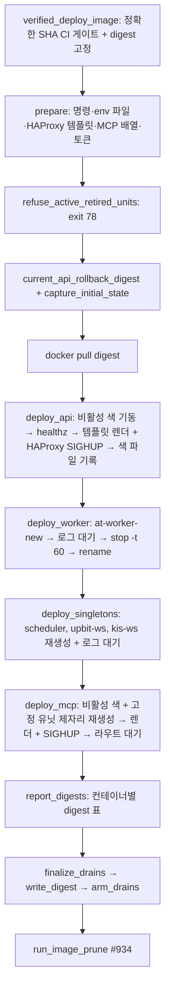
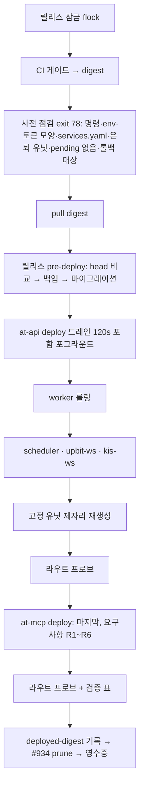

# 4155 — auto_trader NCP 배포를 shiftgate 로 옮기는 설계

- hk task: 4155 (부모 hk 2710, 중복으로 닫힌 hk 2502 의 여섯 가지 공백 코멘트 승계). 운영자 결정 hk:doc `decision/2026-11-11/model-routing-escalation` A59 항목 107 = "auto_trader 이전을 시작한다, 설계 먼저".
- 상태: 설계 문서. 코드·스크립트·compose·HAProxy 템플릿·services.yaml 은 바뀌지 않는다. 결정이 필요한 점(11절)이 닫히면 12절 티켓으로 실행한다.
- 인용 규칙: auto_trader 사실은 base `6407a73e7` 의 `path:line`, shiftgate 사실은 `shiftgate@847ed56 path:line` 이다(`v0.1.0` 태그가 이 커밋 이전의 `4f8347a` 를 포함한다). 코드로 확인하지 못한 것은 `[INFERENCE]`, NCP 의 실제 값이 필요한 것은 **[live check]** 로 표시한다. 이 문서는 NCP 의 `/etc/shiftgate/services.yaml` 을 읽지 못한 채 shiftgate 의 문서화된 스키마만으로 설계했다.
- 이 파일에는 비밀, 토큰, 계좌번호, IP 주소를 쓰지 않는다. 주소는 `LOOPBACK`, `TAILNET` 으로 표기한다.

## 목적과 범위

목적은 auto_trader 의 NCP 배포(`scripts/deploy-ncp-pull.sh`)를 shiftgate 로 옮길 때 컴포넌트마다 무엇이 옮겨가고 무엇이 어댑터 스크립트에 남는지, 어떤 순서로 옮기는지를 확정해 이후 컷오버를 번호 단계로 실행할 수 있게 하는 것이다.

범위:

- 컴포넌트 이전 방식과 순서, 가드 보존, pre_deploy(백업·마이그레이션) 계약, HAProxy 권한 이전, 롤백과 영수증, 단계별 컷오버와 티켓 분해.

범위 밖(이 PR 에서 하지 않는 것):

- 코드, 스크립트, compose, HAProxy 템플릿, `services.yaml` 의 변경과 NCP 에서의 실행.
- shiftgate 자체의 변경. 필요한 변경은 12절에 shiftgate 저장소 티켓으로만 적는다.
- 어떤 배포 가드의 완화. 7절의 모든 행은 "이동하거나 같은 강도로 유지"이며, `삭제` 행은 그 가드가 지키던 위험을 다른 장치가 더 강하게 지키는 이유를 적었다.

설계 원칙:

1. **한 번에 한 가지만 바꾼다.** 컷오버 단계의 첫 shiftgate 배포는 지금 실행 중인 digest 와 같은 digest 로 한다. 버전 변경과 배포 도구 변경을 섞지 않는다.
2. **가드는 이동할 뿐 사라지지 않는다.** 컨트랙트가 "제거·완화하지 마라"고 한 것은(MCP 유닛 은퇴 exit 78, `MCP_PROFILE` 필수, 정확한 SHA CI 게이트) 이전 후에도 같은 종료 코드와 같은 시점(첫 변경 전)에 남는다. `docs/agent-contracts/mcp-and-analysis-contracts.md:23`, `:82`, `docs/agent-contracts/developer-reference-contracts.md:124`.
3. **AT 서비스에 `shiftgate follow` 를 쓰지 않는다.** `follow` 는 태그가 가리키는 digest 를 그대로 배포하므로 정확한 SHA CI 게이트와 mergewake 의 `deploy_approval` 보류 뒤에 올 수 없다(`shiftgate@847ed56 README.md:228-244`, `docs/design.md:173-184`). 배포 진입점은 계속 어댑터 스크립트 하나다.
4. **배포는 사람이 승인한 뒤 NCP 에서 실행한다.** CI 에서 마이그레이션이나 라이브 배포를 하지 않는다는 규칙을 유지한다(`docs/runbooks/ncp-pull-deploy.md:413`).

## 현재 배포 경로

진입점은 `scripts/deploy-ncp-pull.sh` 하나이고 운영자(desk)가 NCP 에서 `/root/at-run/deploy-ncp-pull.sh <tag>` 로 실행한다(`docs/runbooks/ncp-pull-deploy.md:158-162`, `:187-196`). 이 스크립트 안에 DB 백업과 마이그레이션은 없다. 마이그레이션은 별도 운영자 절차(`docker-compose.migration.yml:14-24`, `docker-compose.prod.yml:9-26`)이고, 백업은 매일 04:10 KST 의 systemd oneshot 이다(`ops/ncp/systemd/at-pg-backup.timer:5`, `ops/ncp/pg-backup.sh:9`).



단계의 위치: `main` `scripts/deploy-ncp-pull.sh:817`, `promote_digest` `:619-652`, API `:447` `:532-543`, worker `:544`, singletons `:545-557`, MCP `:561-572`, 드레인 `:530` `:587-601`.

이 스크립트가 쓰는 상태와, 다른 것이 그것을 읽는 곳(이전 때 깨지기 쉬운 접점):

| 상태·이름 | 쓰는 곳 | 읽는 곳 |
|---|---|---|
| `/root/at-run/deployed-digest`, `.previous` | `write_digest` `:574-586` | `ops/ncp/bin/at-job.sh:8`, `ops/ncp/systemd/fill-event-handoff.service:12`, `job-kickoff-*.service` 10개, `deploy/dagu/at-batch/*.yaml` 11개, `deploy/dagu/at-daily/at-account-value-snapshot.yaml`, `scripts/ncp_job_timers_check.py:480` (`grep -rl deployed-digest ops deploy` 결과 25개 파일) |
| `api-active-color`, `mcp-active-color` | `write_color` `:232` | `scripts/ncp_mcp_watchdog.py:83` |
| 컨테이너 이름 `at-mcp-blue/green` | `run_mcp` `:561` | `scripts/ncp_mcp_watchdog.py:93`, `tests/scripts/test_nhplug_bhost_deploy.py` 의 `DEFAULT_COLORS`, Loki 질의 `app/mcp_server/README.md:60` (`container=~"at-mcp-.*"`) |
| 하트비트 `/root/at-run/mcp-heartbeat/mcp-<color>.json` | 컨테이너(`MCP_HEARTBEAT_PATH`) `:561` | `scripts/ncp_mcp_watchdog.py:84-90` (15초 주기 `ops/ncp/systemd/at-mcp-watchdog.timer:6`, 정체 기준 45초 `:109`) |
| `haproxy.cfg`, `haproxy.cfg.previous` | `render_haproxy` `:474-483` | `at-haproxy` 컨테이너(파일 바인드 마운트 `:521`) |

즉 이전 후에도 `deployed-digest` 파일 계약과 워치독·Loki 의 컨테이너 이름 의존은 별도로 처리해야 한다(4절 마지막 행, 12절 AT-3·AT-5).

## shiftgate 가 제공하는 것

`shiftgate@847ed56` 기준(바이너리 하나, 데몬 없음, `docs/design.md:3-8`).

| 기능 | 내용 | 근거 |
|---|---|---|
| blue/green 배포 | 비활성 색을 digest 로 기동 → 헬스 → 런타임 API 로 `ready` 확인 후 이전 색 `drain` → 상태 커밋 → 드레인 대기 → 이전 색 `maint` + `docker stop`(컨테이너는 보존) | `docs/design.md:41-68`, `internal/deploy/deploy.go:259-323`, `:446-570` |
| 롤백 | 보존된 이전 색 컨테이너를 pull 없이 다시 기동해 flip. 이전 컨테이너가 없으면 거부. 한 단계 전까지만 | `docs/design.md:70-73`, `internal/deploy/deploy.go:325-392` |
| 중단 복구 | 상태 파일에 durable `pending` 의도를 쓰고 `recover` 로 해소. 불명확하면 exit 3 | `docs/design.md:25-36`, `:75-88` |
| 상태·감사 | `<state_dir>/<svc>/state.json`, `swaps.log`(JSON 한 줄, fsync), `ops/<op_id>.log` | `docs/design.md:12-23` |
| 잠금 | 호스트 잠금 + 서비스별 `flock`. 이미 실행 중이면 exit 75 | `README.md:88-90` |
| HAProxy 렌더 | `services.yaml` 에서 설정 전체를 생성, `haproxy.check` 로 후보 검증 후 설치(inode 유지, `.previous` 보존), `haproxy.allowed_binds` 외 주소 거부, 와일드카드 기본 거부 | `README.md:91-93`, `:113-116`, `internal/haproxy/render.go:178-252` |
| `pre_deploy` | 새 이미지로 일회성 명령. 이전 색이 서비스하는 동안 실행. 같은 `env_files`·`env`·`network`·`run_args` 를 쓴다 | `README.md:96-99`, `:180-189` |
| `check [--heal]`, `status --json`, `prune` | 활성 색 컨테이너·헬스·HAProxy UP 점검, 텍스트파일 지표, 이미지 정리 | `README.md:62-65`, `docs/monitoring.md:73-90` |
| 로그 한도 | 기본 `json-file` 10m×3, `log: {driver: daemon}` 로 해제 | `README.md:169-178` |

shiftgate 가 제공하지 않는 것은 5절의 여섯 가지 공백과, 이번 읽기에서 추가로 확인한 다섯 가지(공백 7~11)다.

## 컴포넌트 표

"shiftgate 이후" 는 컷오버 완료 상태다. 고정 MCP 유닛은 1단계에서 정적 라우트 + 어댑터 제자리 재생성으로 남고, blue/green 전환은 결정 D2 로 미룬다.

| 컴포넌트 | 현재 방식 | shiftgate 이후 | 남는 adopter 스크립트 책임 | 근거 |
|---|---|---|---|---|
| `at-api` | blue/green `at-api-blue/green`, 루프백 8001/8002, HAProxy 가 루프백·tailnet 의 8000 을 바인드, 헬스 `/healthz` 30×2초, 드레인 120초 detached | shiftgate 서비스 `at-api`: blue/green, 컨테이너 `shiftgate-at-api-<color>`, 색 포트 18000/28000(결정 D9), `network: host`, `env_files` 두 개(순서 유지), 헬스 `{http: /healthz, timeout: 60s, interval: 2s}`, `drain_timeout: 120s` | CI 게이트, 사전 점검, 릴리스 pre-deploy, 배포 순서, 라우트 프로브, 교차 롤백, `deployed-digest` 기록, #934 prune, 영수증 | `scripts/deploy-ncp-pull.sh:447` `:451` `:532-543` `:81`, `ops/ncp/haproxy/haproxy.cfg.tmpl:16-28`, `shiftgate@847ed56 docs/design.md:143` `:151` `:157` |
| DEFAULT MCP | blue/green `at-mcp-blue/green`, 8766/8767, 바인드 8765(루프백·tailnet), `MCP_PROFILE=default`, 토큰은 env 파일에서 읽어 `-e`, 하트비트 디렉터리와 `/etc/machine-id`(B-HOST) 마운트, 드레인 3600초 detached | shiftgate 서비스 `at-mcp`: blue/green, 색 포트 18765/28765, `env` 에 프로필·호스트·경로·하트비트(`{color}`, `{port}` 전개), `run_args` 로 두 마운트, 토큰은 `env_files` 로만 도착(공백 2), `drain_timeout: 1h`(공백 8 참고) | 위와 같음 + 토큰 줄 모양 점검, 워치독 연동, 마지막 단계에서 배포하고 자기 op 의 커밋/실패를 `op_id` 로 확정(공백 8) | `scripts/deploy-ncp-pull.sh:561-572` `:82`, `docs/runbooks/ncp-mcp.md:15`, `tests/scripts/test_nhplug_bhost_deploy.py:16` |
| 고정 유닛 `kiwoom`(8772) | `at-mcp-kiwoom` 제자리 재생성, 루프백 8772 에서 수신, HAProxy 가 tailnet 8772 바인드, 토큰 `MCP_KIWOOM_AUTH_TOKEN` 을 `MCP_AUTH_TOKEN` 으로 이름 바꿔 `-e` | **1단계**: 정적 라우트(`upstream` 루프백 8772, `binds` tailnet 8772). 컨테이너는 shiftgate 가 관리하지 않음(공백 1 유지) | 제자리 재생성(`run_mcp` 유지), 토큰 이름 변환(공백 2 유지), `MCP_UNITS_SKIP`, 롤백 복원 | `scripts/deploy-ncp-pull.sh:116-119` `:569`, `ops/ncp/haproxy/haproxy.cfg.tmpl:50-58`, `shiftgate@847ed56 docs/design.md:145` |
| 고정 유닛 `h3-crypto-paper`(8776) | 위와 같음, 토큰 `MCP_H3_CRYPTO_PAPER_AUTH_TOKEN`, 배포 뒤 tailnet 라우트 `/health` 프로브, 컨트랙트상 폐쇄 세계 20개 도구 | 위와 같음(정적 라우트) | 위 + tailnet 라우트 프로브(공백 3 유지) | `scripts/deploy-ncp-pull.sh:122` `:501-515`, `docs/agent-contracts/mcp-and-analysis-contracts.md:41` |
| 고정 유닛 `h3-us-paper`(8777) | 위와 같음, 토큰 `MCP_H3_US_PAPER_AUTH_TOKEN` | 위와 같음(정적 라우트) | 위와 같음 | `scripts/deploy-ncp-pull.sh:116-122`, `docs/agent-contracts/mcp-and-analysis-contracts.md:64` |
| `at-worker` | `at-worker-new` 기동 → 로그 `Listening started` 대기 → `docker stop -t 60 at-worker` → rename | **변경 없음**. shiftgate 서비스로 만들지 않는다(HTTP 아님, HAProxy 뒤 아님: 공백 4) | 롤링 교체 전체, 로그 대기, 실패 로그 보존, 롤백 복원 | `scripts/deploy-ncp-pull.sh:449` `:462` `:544`, `shiftgate@847ed56 docs/design.md:166` |
| `at-scheduler` | 제자리 재생성(항상 한 인스턴스: 중복 발화 방지) | 변경 없음 | 재생성, 롤백 복원 | `scripts/deploy-ncp-pull.sh:448` `:547`, `docs/runbooks/ncp-pull-deploy.md:421` |
| `at-upbit-ws` | 제자리 재생성 + `connected=True` 로그 대기(브로커 appkey 당 한 세션) | 변경 없음 | 재생성, 로그 대기 | `scripts/deploy-ncp-pull.sh:450` `:463` `:548` |
| `at-kis-ws` | 있으면 재생성, **없으면 만들지 않음**(fillwire 가 KIS 스트림을 가짐, hk 3361), `--skip-kis-ws` 면 건드리지 않음 | 변경 없음 | 위 규칙 전부, `SKIPPED_STOPPED` 표 행 | `scripts/deploy-ncp-pull.sh:291-298` `:345` `:549-556`, `docs/runbooks/ncp-pull-deploy.md:350-382` |
| fillwire(네이티브 systemd 바이너리) | 이 저장소의 배포 대상이 아님 | 변경 없음 | 없음. `at-kis-ws` 규칙으로만 상호작용 | `docs/runbooks/ncp-pull-deploy.md:372-382`, hk 3820 코멘트(2026-11-10: fillwire 는 systemd 네이티브) |
| `at-haproxy` | 이 스크립트가 없으면 `docker run`, 있으면 SIGHUP. 템플릿을 `sed` 로 치환해 `haproxy.cfg` 를 씀 | **컨테이너 이름과 이미지 유지**, 설정 파일의 작성자·플립 권한이 shiftgate 로 이동(`render` + 런타임 API). 컨테이너 생성은 일회성 호스트 설정(관리자 소켓 디렉터리 마운트 추가) | 컨테이너가 없을 때 만드는 코드는 삭제(호스트 설정 runbook 으로 이동), `haproxy.check` 훅(폐쇄 모양·필수 바인드), 라우트 프로브 | `scripts/deploy-ncp-pull.sh:80` `:517-525`, `shiftgate@847ed56 docs/design.md:142` `:164` |
| 은퇴 컨테이너 7개(`at-mcp-analysis-readonly`, `-account-read`, `-tradingcodex-execution`, `-paper-001`, `-live-kr`, `-live-us`, `-live-crypto`) | 전진 배포 전에 부재 또는 (정지 + restart `no`)여야 하고 아니면 exit 78. 롤백은 검사하지 않음. 스크립트가 직접 정지하지 않음 | 변경 없음. 포트 8768-8771, 8773-8775 는 새 검토 없이 재사용 금지 | 검사를 그대로 유지(같은 메시지, 같은 exit 78, 변경 전 시점) | `scripts/deploy-ncp-pull.sh:106-115` `:260-283` `:817`, `docs/agent-contracts/mcp-and-analysis-contracts.md:23` |
| 레거시 `at-api`(단일), 레거시 색 컨테이너 `at-api-blue/green`, `at-mcp-blue/green` | 현재 운영 형태이거나(색) 첫 도입용 부트스트랩(단일 `at-api`) | 컷오버 동안 유지하다가 관찰 창이 끝나면 정지 후 제거(8절). 새 컨테이너는 `shiftgate-*` 이름이라 충돌하지 않는다 | 컷오버 runbook 의 일회성 절차(공백 6) | `scripts/deploy-ncp-pull.sh:537-540` `:359` |
| 호스트 소비자: `deployed-digest` 읽는 25개 파일, 워치독, pg-backup, Loki 질의 | 위 3절 표 | `deployed-digest(.previous)` 는 **어댑터가 계속 쓴다**(소비자 25개를 건드리지 않음). 워치독은 **두 출처를 모두** 본다: 레거시(`mcp-active-color` + `at-mcp-<color>` + `mcp-<color>.json`)와 shiftgate(`shiftgate status --json` 의 활성 색 + `shiftgate-at-mcp-<color>` + 별도 하트비트 `mcp-sg-<color>.json`). 각 출처는 자기 이름공간만 판단한다. pg-backup 타이머는 그대로, 릴리스가 `systemctl start` 로 한 번 더 호출 | 위 파일 기록, 워치독 대상 수정(AT-3), Loki 질의 라벨 갱신(AT-5) | `ops/ncp/bin/at-job.sh:8`, `scripts/ncp_mcp_watchdog.py:83-93`, `ops/ncp/systemd/at-pg-backup.service:7-10` |

### `services.at.yaml` 초안

문서 표기이며 실제 파일은 `ops/ncp/shiftgate/services.at.yaml`(AT-1)로 저장소에 두고 운영자가 `install` 한다(기존 템플릿과 같은 방식: `docs/runbooks/ncp-pull-deploy.md:158-162`). 저장소에는 이미 tailnet 주소가 템플릿에 들어 있으므로(`ops/ncp/haproxy/haproxy.cfg.tmpl:21`) 같은 방식으로 실제 값을 넣는다. 아래의 모든 값은 **[live check]** 이다(포트 충돌, 소켓 경로, 로그 드라이버).

```yaml
state_dir: /var/lib/shiftgate-at          # 별도 인스턴스(결정 D1)
keep_digests: 3
log: {driver: daemon}                     # 지금과 같은 로깅 유지(결정 D8)
haproxy:
  config: /root/at-run/haproxy.cfg        # 지금 파일 경로 그대로 (deploy-ncp-pull.sh:66)
  socket: /root/at-run/haproxy-run/admin.sock
  socket_in_config: /var/run/haproxy/admin.sock
  check: ["/root/at-run/ops/ncp/shiftgate/haproxy-check.sh", "{config}"]   # haproxy -c + 폐쇄 모양 + 필수 바인드
  reload: ["docker", "kill", "-s", "HUP", "at-haproxy"]
  allowed_binds: ["LOOPBACK", "TAILNET"]
  log: stdout format raw local0
  timeouts: {connect: 5s, client: 1h, server: 1h, tunnel: 1h, http_request: 10s}   # haproxy.cfg.tmpl:8-12
services:
  - name: at-api
    image: ghcr.io/mgh3326/auto_trader
    binds: ["LOOPBACK:8000", "TAILNET:8000"]
    ports: {blue: 18000, green: 28000}
    network: host
    env_files: [/root/at-secrets/.env.api, /root/at-secrets/.env.scheduler]    # 두 번째가 이긴다 (deploy-ncp-pull.sh:94-96)
    args: ["/app/.venv/bin/uvicorn", "app.main:app", "--host", "LOOPBACK", "--port", "{port}"]
    health: {http: /healthz, timeout: 60s, interval: 2s}
    check: {inter: 5s, fall: 2, rise: 1}
    drain_timeout: 120s
  - name: at-mcp
    image: ghcr.io/mgh3326/auto_trader
    binds: ["LOOPBACK:8765", "TAILNET:8765"]
    ports: {blue: 18765, green: 28765}
    network: host
    env_files: [/root/at-secrets/.env.api, /root/at-secrets/.env.scheduler]
    env:
      MCP_PROFILE: default                # 비어 있으면 안 된다(#1189): AT-1 의 린트가 검사
      MCP_HOST: LOOPBACK
      MCP_PORT: "{port}"
      MCP_TYPE: streamable-http
      MCP_PATH: /mcp
      MCP_USER_ID: "1"
      AUTO_TRADER_COLOR: "{color}"
      MCP_HEARTBEAT_PATH: /var/run/auto-trader/mcp-heartbeat/mcp-sg-{color}.json   # 레거시 mcp-<color>.json 과 이름공간 분리
    run_args: ["-v", "/root/at-run/mcp-heartbeat:/var/run/auto-trader/mcp-heartbeat", "-v", "/etc/machine-id:/etc/machine-id:ro"]
    args: ["python", "-m", "app.mcp_server.main"]
    health: {http: /health, timeout: 60s, interval: 2s}
    check: {inter: 5s, fall: 2, rise: 1}
    drain_timeout: 1h
  # 고정 유닛(1단계): 렌더만 하고 컨테이너는 어댑터가 제자리 재생성
  - {name: at-mcp-kiwoom, binds: ["TAILNET:8772"], upstream: "LOOPBACK:8772", health: {http: /health}, check: {inter: 5s, fall: 2, rise: 1}}
  - {name: at-mcp-h3-crypto-paper, binds: ["TAILNET:8776"], upstream: "LOOPBACK:8776", health: {http: /health}, check: {inter: 5s, fall: 2, rise: 1}}
  - {name: at-mcp-h3-us-paper, binds: ["TAILNET:8777"], upstream: "LOOPBACK:8777", health: {http: /health}, check: {inter: 5s, fall: 2, rise: 1}}
```

기존 스크립트의 `-e` 목록과 이 초안의 대응: `MCP_PROFILE`, `MCP_HOST`, `MCP_PORT`, `MCP_TYPE`, `MCP_PATH`, `MCP_USER_ID`, `AUTO_TRADER_COLOR`, `MCP_HEARTBEAT_PATH` 는 `env`, `MCP_AUTH_TOKEN` 은 `env_files` 로 대체한다(`scripts/deploy-ncp-pull.sh:561`). shiftgate 는 `PORT` 를 항상 설정하고 `env` 에서 예약어로 막는다(`shiftgate@847ed56 internal/config/config.go:525`). 색 포트는 바인드 포트와 같으면 안 된다(루프백·와일드카드 바인드에만 적용되는 검사: `internal/config/config.go:540-544`).

## 여섯 가지 공백 처리

번호는 hk 2710 코멘트(hk 2502 승계)의 번호다. 결과: 닫음 1(공백 6), 부분적으로 닫음 1(공백 2: DEFAULT MCP 는 닫고 고정 유닛은 유지), 어댑터에 유지 4(공백 1, 3, 4, 5).

### 공백 1 — 고정 프로필 MCP 유닛은 제자리 재생성이다 (유지, 이후 선택적으로 닫음)

- 사실: shiftgate 의 정적 서비스는 렌더만 하고 컨테이너를 만들지 않는다(`shiftgate@847ed56 docs/design.md:145`). ROB-1436 으로 7개가 은퇴해 남은 배포 대상은 `kiwoom`, `h3-crypto-paper`, `h3-us-paper` 셋이다(`scripts/deploy-ncp-pull.sh:116-118`). 이 셋은 컨트랙트가 저트래픽 프로필로 분류하고(`docs/agent-contracts/mcp-and-analysis-contracts.md:34`) tailnet 전용이다.
- 처리(1단계): 정적 라우트 + 어댑터가 지금처럼 같은 digest 로 제자리 재생성한다(`run_mcp`, `deploy_mcp`). 롤백은 `restore_unit` 의 이전 digest 재생성이다. 중단 시간은 지금과 같다(컨테이너 교체 동안 HAProxy 체크가 DOWN).
- 선택(결정 D2, 권고 = 1단계는 유지): 컷오버 안정 후 blue/green 으로 전환. 그때는 공백 2 의 유닛별 토큰 처리가 선행되어야 한다.

### 공백 2 — 토큰을 env 파일에서 꺼내 `-e` 로 넘긴다 (DEFAULT 는 닫음, 고정 유닛은 유지)

- 사실: shiftgate 는 env 파일을 열지 않고 경로만 `docker run --env-file` 에 넘긴다(`shiftgate@847ed56 docs/design.md:38-39`, `:154`). 스크립트는 유닛별 이름(`MCP_KIWOOM_AUTH_TOKEN` 등)을 읽어 컨테이너의 `MCP_AUTH_TOKEN` 으로 바꿔 넣는다(`scripts/deploy-ncp-pull.sh:119` `:440` `:561`).
- DEFAULT MCP: 컨테이너가 받아야 하는 이름이 `MCP_AUTH_TOKEN` 그대로이므로 `env_files` 만으로 값이 도착한다. 이름 변환이 필요 없다. 앱 코드 변경 0(`app/mcp_server/main.py:65`).
- 주의(새로 발견): `env_value` 는 `export ` 접두와 바깥 따옴표를 벗기지만(`scripts/deploy-ncp-pull.sh:440`) `docker run --env-file` 은 값을 그대로 넘긴다. **[INFERENCE: Docker CLI 의 env-file 형식 문서 기준, 이 문서 작성 중 실행으로 확인하지 못함]** 따라서 `.env.api`/`.env.scheduler` 의 `MCP_AUTH_TOKEN` 줄이 따옴표나 `export` 를 쓰면 이전 후 토큰이 달라져 클라이언트가 401 을 받는다. 사전 점검(7절 G15)이 값을 출력하지 않고 줄 모양만 검사해 exit 78 로 막는다. **[live check]**: 실제 파일의 줄 모양.
- 고정 유닛(1단계): 어댑터가 `env_value` + `-e` 를 그대로 쓴다(유지). blue/green 전환(D2) 때의 처리는 두 가지이며 앱 변경이 없는 쪽을 권고한다: 유닛별 env 파일(`MCP_AUTH_TOKEN=` 한 줄, 모드 0600)을 만들어 `env_files` 의 **마지막**에 둔다(Docker 는 뒤의 `--env-file` 이 이긴다: `shiftgate@847ed56 internal/docker/docker.go:108-114`). 대안은 factortrail 처럼 토큰 파일을 읽기 전용으로 마운트하고 앱이 파일을 읽게 하는 것인데(hk 3820 코멘트 2026-11-10) `app/mcp_server/main.py` 가 `deploy_approval` 경로라(`.mergewake/policy.yaml:192`) 사람 승인 보류가 걸린다. 다른 컨테이너가 전체 토큰을 받는 현재의 과다 노출(두 env 파일이 모든 유닛에 들어감: `scripts/deploy-ncp-pull.sh:102`)은 이 이전에서 늘지 않으며 별도 강화 대상이다(`noticed but not touched`).
- 검증 방법(값 출력 없음): 각 유닛에 대해 무토큰 `/mcp` 401, 자기 토큰 200, **다른 유닛의 토큰 401**을 확인한다.

### 공백 3 — `render` 는 리로드 뒤 HAProxy 프런트엔드를 curl 하지 않는다 (유지: 어댑터 프로브)

- 사실: `render` 는 설정 검증 후 리로드만 한다. `deploy` 는 관리자 소켓에서 서버 상태를 읽을 뿐 프런트엔드 바인드가 실제로 응답하는지는 보지 않는다(`shiftgate@847ed56 docs/design.md:162`).
- 처리: 어댑터의 **라우트 프로브**가 `render` 직후와 라우트에 영향을 주는 배포 직후마다 지금과 같은 재시도 정책(20회 × 0.5초)으로 루프백 `:8000/healthz`, `:8765/health`, 그리고 `h3-crypto-paper`·`h3-us-paper` 의 tailnet `/health` 를 호출한다(`scripts/deploy-ncp-pull.sh:484-495` `:501-515`). 프로브가 실패하면 exit 1 + 교차 롤백.
- 선택 티켓: shiftgate 의 `render --probe`(SG-4, 선택). 없어도 닫힌다.

### 공백 4 — worker/scheduler/websocket 은 HTTP 도 HAProxy 뒤도 아니다 (유지)

- 사실: shiftgate 서비스는 `binds` 와 `health`(HTTP 또는 TCP)가 필수다(`shiftgate@847ed56 internal/config/config.go:431` 의 `binds must not be empty`, `:450` 의 `health needs exactly one of http or tcp`).
- 처리: `at-worker`, `at-scheduler`, `at-upbit-ws`, `at-kis-ws` 는 어댑터가 지금 그대로 관리한다(컴포넌트 표). 컨테이너 이름이 그대로라 로그 라벨과 워치독 밖의 의존을 건드리지 않는다. 헤드리스 서비스 유형을 shiftgate 에 추가하는 것은 하지 않는다(12절 "하지 않는 것").

### 공백 5 — 서비스 사이 교차 롤백이 없다 (유지: 어댑터가 오케스트레이션)

- 사실: 지금은 어느 단계가 실패해도 `rollback_replaced` 가 교체한 모든 유닛을 역순으로 복원한다(`scripts/deploy-ncp-pull.sh:378-413` `:612-618`). shiftgate 는 서비스마다 독립이다(`shiftgate@847ed56 docs/design.md:167`, `:212-213`).
- 처리: 어댑터가 같은 전부-아니면-전무 의미를 유지한다. 순서와 실패 시 동작은 9절 표. 핵심 규칙 둘: (1) 커밋된 blue/green 서비스는 `shiftgate rollback`(pull 없음), 컨테이너가 사라졌으면 `shiftgate deploy --digest <이전>`; (2) 제자리 재생성 유닛은 캡처한 이전 digest 로 재생성. `at-mcp` 의 배포 순서·불확실 결과·사후 실패 처리는 9절의 요구사항 R1~R6 으로만 제약하고 절차는 AT-4b 설계 리뷰(hk 4198)가 정한다.

### 공백 6 — 레거시 단일 `at-api` 컨테이너의 일회성 이전 (닫음: 컷오버 runbook)

- 사실: 스크립트는 색 파일이 없으면 레거시 `at-api` 를 지우고 색 컨테이너로 넘어간다(`scripts/deploy-ncp-pull.sh:537-540` `:359`). shiftgate 는 "상태 파일은 없는데 `shiftgate-*` 컨테이너가 있으면" 거부하고(`internal/deploy/deploy.go:175-205`), 레거시 이름을 입양하지 않는다.
- 처리: 새 컨테이너가 `shiftgate-at-*` 이름과 **새 포트**(레거시 8001/8002/8766/8767 과 다름)를 쓰므로 레거시와 공존한다. 이전은 8절·10절의 S2/S3 번호 단계다: 정적 미러 → 임시 바인드에 `deploy` → 프로브 → 실제 바인드로 이동 → 레거시를 정지만 해 두고 관찰 창 뒤에 제거. 첫 배포는 실행 중인 digest 와 같은 digest 다. 레거시 단일 `at-api`·색 컨테이너가 실제로 어떤 조합으로 있는지는 **[live check]**.

### 추가로 확인한 공백 (7~11)

| # | 공백 | 처리 |
|---|---|---|
| 7 | `follow` 가 CI 게이트·승인 보류를 우회한다(`shiftgate@847ed56 README.md:228-244`) | AT 에 `follow` 를 스케줄하지 않는다(원칙 3). 직접 호출은 root 운영자 경로이고 지금의 `docker run` 직접 호출과 같은 신뢰 수준이라 새 경계가 아니다. 게이트 훅(`follow --gate-cmd`)은 만들지 않는다 |
| 8 | 드레인이 CLI 를 막는다: `drainAndStop` 대기 루프는 ctx 취소를 확인하지 않고 `drain_timeout` 까지 돈다(`shiftgate@847ed56 internal/deploy/deploy.go:544-562`, `docs/design.md:205-208`). `at-mcp` 는 1시간이고 그동안 서비스 잠금이 잡혀 `rollback` 이 exit 75 가 된다. 더 근본적으로 지금의 상태는 커밋된 op 를 식별하지 못한다: `state.last_op` 는 `deploy`/`rollback` 문자열이고 의도의 `op_id` 는 `pending` 이 지워질 때 버려지며, `status --json` 최상위 `last_op` 는 드레인이 끝난 뒤에 쓰이는 `swaps.log` 줄이다(`shiftgate@847ed56 internal/state/state.go:48-86`, `internal/deploy/deploy.go:532-538`, `docs/monitoring.md:84-85`) | 이 문서는 `at-mcp` 배포 절차를 규정하지 않고 **요구사항 R1~R6**(9절)만 둔다. 전제는 SG-5(커밋된 `op_id`·결과를 상태에 남기고 노출)이며 드레인 중 롤백 방법은 AT-4b 설계 리뷰(hk 4198)가 정한다. SG-3 은 그 선택지 중 하나다 |
| 9 | `pre_deploy` 는 서비스의 `env_files` 를 그대로 쓴다. #789 이후 마이그레이션 DSN 은 앱 입력에 넣을 수 없다(`docs/runbooks/db-role-cutover.md:310-316` `:322-323`, `AGENTS.md:402-409`) | 마이그레이션을 `pre_deploy` 가 아니라 어댑터 단계로 실행한다(6절). SG-1 이 `pre_deploy.env_files` 를 만들면 옮길 수 있다 |
| 10 | `prune` 은 서비스별로 자기 keep 집합만 본다. AT 서비스는 모두 같은 이미지 저장소를 쓴다(`shiftgate@847ed56 internal/deploy/ops.go:126-210`) | #934 prune 을 어댑터에 유지하고 `shiftgate prune` 은 스케줄하지 않는다(7절 G35). SG-2 가 합집합 keep 을 만든다 |
| 11 | 로그 드라이버: shiftgate 는 기본으로 `json-file` 10m×3 을 고정한다(`README.md:169-178`). 지금 AT 컨테이너는 데몬 기본값이고 Loki 가 컨테이너 이름으로 수집한다(`app/mcp_server/README.md:60`) | `log: {driver: daemon}` 으로 시작(D8). **[live check]**: 데몬의 로그 드라이버와 수집기가 이름 변경 `shiftgate-at-*` 를 받는지 |

## pre_deploy 계약

릴리스 pre-deploy 는 서비스를 하나도 바꾸기 전에 한 번 실행되는 단계이고 아래 순서와 불변식을 갖는다. shiftgate 의 `pre_deploy` 키는 서비스별로 한 번씩 돌고 서비스의 앱 `env_files` 를 쓰므로, 지금은 이 단계를 **어댑터가 실행**하고 SG-1 이후에 마이그레이션 부분만 `pre_deploy` 로 옮길 수 있다(결정 D12).

### 순서

1. (사전 점검, 변경 없음) 이미지가 가진 head 리비전과 DB 의 현재 리비전을 읽기 전용으로 비교한다: 마이그레이션 입력으로 `alembic current` 와 `alembic heads`(`docker-compose.migration.yml:14-20` 와 같은 이미지·같은 호스트 네트워크). 같으면 2~3 을 건너뛰고 영수증에 `migration: none` 을 쓴다(멱등).
2. 다르면 **`--migrate` 가 없을 때 exit 78 로 거부**하고 대기 중 리비전 목록을 출력한다(결정 D3). 마이그레이션은 지금도 배포 스크립트 밖의 운영자 절차이고(`docker-compose.migration.yml:1-2` 마이그레이션 전용 compose, `docs/runbooks/db-role-cutover.md:322` "호스트 배포 스크립트는 Alembic 을 호출하지 않는다") `alembic/versions/**` 변경은 mergewake `deploy_approval` 보류 대상이다(`.mergewake/policy.yaml:196-197`). `--migrate` 는 그 승인이 있었음을 운영자가 명시하는 스위치다.
3. DB 백업: 시작 전에 `systemctl show -p InvocationID at-pg-backup.service` 로 직전 실행의 `InvocationID` 와 어댑터 시작 시각 T0 를 기록하고, `systemctl start at-pg-backup.service` 를 실행한 뒤 **`systemctl show -p InvocationID -p Result -p ExecMainCode -p ExecMainStatus -p ExecMainStartTimestamp -p ExecMainExitTimestamp at-pg-backup.service`** 로 결과를 읽는다. `systemctl start` 자체의 종료 코드는 스크립트의 종료 코드가 아니라 작업 성공 여부이므로 3 과 다른 실패를 구분하지 못한다. **이번 호출의 실행임을 모든 분기에서 먼저 증명한다**: `InvocationID` 가 시작 전 값과 다르고, `ExecMainStartTimestamp` 와 `ExecMainExitTimestamp` 가 T0 이후이며, 이번 `systemctl start` 가 시작 실패(서비스를 띄우지 못함)를 보고하지 않았어야 한다. 하나라도 어긋나면(예: 시작 실패 뒤 `show` 가 직전 실행의 status 3 을 그대로 보여줌) 결과를 읽지 않고 실패다. 그다음 분기: (a) **성공** = `Result=success`, `ExecMainCode=exited`, `ExecMainStatus=0`. (b) **원격 미러 실패 허용 후보** = `Result=exit-code`, `ExecMainCode=exited`(신호로 죽은 경우의 `killed`/`dumped` 는 `ExecMainStatus` 가 신호 번호라 3 이어도 거부), `ExecMainStatus=3`(`ops/ncp/pg-backup.sh:218-221`). (b) 는 기본 거부하고 `--accept-backup-remote-failure REASON`(`--allow-unverified` 와 같은 로깅 방식)으로만 통과한다(결정 D4). 그 밖의 값과 읽기 실패는 실패다. **(a), (b) 공통으로 현재 백업의 존재를 확인한다**: 스크립트는 체크섬 파일을 만든 뒤에 원격 동기화를 하므로(`ops/ncp/pg-backup.sh:205-212`) 백업 디렉터리(기본 `/var/backups/ncp-pg`, **[live check]** `PG_BACKUP_DIRECTORY`)에 T0 이후 수정된 `backup-*.sha256` 가 있고 그 안에 `auto_trader-*.dump` 항목이 있어야 하며, 없으면 상태와 무관하게 실패다. oneshot 의 `ExecStart` 가 0 이 아니면 `ExecStartPost`(헬스체크 핑)는 실행되지 않으므로 3 일 때 핑이 가지 않는다는 점도 영수증에 남긴다. 위 `ExecMainCode` 값과 `InvocationID` 갱신, 핑 동작은 **[INFERENCE: systemd 동작, AT-2 의 가짜 `systemctl` 테스트와 S0 실행으로 확인]**. 자체 `EnvironmentFile`(`ops/ncp/systemd/at-pg-backup.service:7-10`)을 쓰는 점은 그대로이며, 백업 자격증명은 앱·마이그레이션 입력과 분리한다는 규칙을 지킨다(`docs/runbooks/db-role-cutover.md:323`).
4. 마이그레이션: 이미지 digest 로 `alembic upgrade head` 를 일회성 컨테이너에서 실행한다. 입력 env 는 `AT_MIGRATION_ENV_FILE`(앱 env 와 다른 파일)이고, 분리 전(#789 Stage 4 이전)에는 기존 기본값을 쓰며 이후에는 `AT_MIGRATION_SET_ROLE=at_migration_owner` 가 필수다. `alembic/env.py:58-77` 이 역할을 확인하고 불일치면 `RuntimeError` 로 실패한다. 어댑터는 그 실패를 그대로 전달하고 역할 값을 만들거나 완화하지 않는다. Stage 4 이후에는 심볼 유니버스 동기화 3개(KR·US·Upbit)가 마이그레이션 직후 **앱 로그인으로 별도 실행**되어야 하는데(`docs/runbooks/db-role-cutover.md:319-321`) 지금처럼 운영자 절차로 남기고 어댑터는 자동 실행하지 않는다. 대신 영수증에 `operator_followup: symbol_sync` 를 남긴다. **[live check]**: Stage 4 가 적용되었는지.
5. 한 단계라도 실패하면 어떤 서비스도 건드리지 않고 exit 1 이다. 자동 다운그레이드는 없다. 마이그레이션 전후 리비전과 백업 파일 이름·체크섬 파일 이름(경로 아님, 값 아님)을 영수증에 기록한다.

### expand-contract 규칙

blue/green 에서는 마이그레이션이 이전 색이 서비스하는 동안 실행되고(`shiftgate@847ed56 docs/design.md:230-232`, `README.md:183-186`) 롤백은 이전 코드를 마이그레이션된 스키마 위에서 돌린다. 그러므로:

- 릴리스 N 의 마이그레이션은 **N-1 코드가 그대로 동작하는 변경**(테이블·nullable 또는 기본값 있는 컬럼·인덱스 추가)만 한다.
- 파괴적 변경(삭제, 이름 변경, `NOT NULL` 강화, 타입 변경)은 N+1 에서만 낸다. 그 N+1 이 배포될 때 롤백 대상 `deployed-digest.previous` 는 이미 옛 모양을 쓰지 않는 N 이다.
- 현재 이 규칙을 기계로 검사하는 장치는 저장소에 없다(`grep -rn "expand-contract" --include=*.md .` 결과 이 규칙을 정의하는 문서 0건). 사람 리뷰와 `deploy_approval` 보류가 막고 있고, 배포 계층 CI 는 "배포된 스키마 → 후보" 방향의 적용만 검사한다(`.github/workflows/deploy-checks.yml:10-12`). 린트 티켓 AT-6 은 선택이다.

### 이 단계의 소유와 시점

- 정확한 SHA CI 게이트 통과 뒤, 첫 서비스 변경 앞에 실행한다. `--dry-run` 은 1~2 단계(읽기 전용 비교)만 실행하고 백업과 마이그레이션은 "실행 예정"으로만 출력한다.
- `--rollback` 은 이 단계를 실행하지 않는다(DB 를 되돌리지 않는다. 롤백된 코드가 N 스키마에서 동작하는 것이 expand-contract 의 전제다).
- 마이그레이션 제한 시간은 어댑터 기본 30분이다(결정 D4 와 함께 **[live check]**: 과거 마이그레이션 소요).

## 가드 보존 표

범례: **shiftgate 설정** = `services.yaml` 키 또는 shiftgate 내장 동작. **adopter hook** = 어댑터 스크립트(`scripts/deploy-ncp-pull.sh` 와 `ops/ncp/shiftgate/*`)에 남는다. **삭제** = 사유를 적었다. 단계가 `1단계` 로 적힌 것은 고정 유닛이 어댑터 제자리 재생성인 동안의 상태다(결정 D2).

가드를 찾는 데 쓴 명령(`scripts/deploy-ncp-pull.sh`, 907줄):

```bash
grep -n 'exit [0-9$]\|return 78\|return 64\|exit 127\|exit 64\|exit \$?' scripts/deploy-ncp-pull.sh
grep -n '^[a-z_]*() \|^[a-z_]*()\s*{' scripts/deploy-ncp-pull.sh        # 모든 함수
grep -n 'docker pull\|docker stop\|docker rename\|docker kill\|docker rm\|docker run\|nohup\|chmod\|mkdir\|install \|trap ' scripts/deploy-ncp-pull.sh
grep -n 'die\b\|fail' scripts/deploy-ncp-pull.sh
grep -n '^readonly\|^declare\|^[A-Z_]*=' scripts/deploy-ncp-pull.sh      # 상수와 환경 노브
```

| # | 가드 | 현재 위치 | 이전 후 위치 | 근거 |
|---|---|---|---|---|
| G01 | 추적·트랩 상속 시 깨끗한 셸로 재실행(토큰이 추적에 새지 않게), `set -Eeuo pipefail` | `scripts/deploy-ncp-pull.sh:4-26` | adopter hook(유지) | 1단계에서 고정 유닛이 여전히 토큰을 `-e` 로 넘긴다(`:561`). 모든 유닛이 env 파일 방식으로 바뀐 뒤(D2)에도 비용이 작아 유지. `tests/scripts/test_deploy_ncp_pull_h3_crypto_paper.py` 가 고정 |
| G02 | 인자 검증: 알 수 없는 옵션·태그 둘·`--rollback` 과 태그 동시 지정 거부(exit 64), 값이 `-` 로 시작하면 다음 옵션으로 봄 | `:30-60` | adopter hook(유지, `--haproxy-template` 제외; G09) | CLI 를 그대로 두어 운영자 호출(`docs/runbooks/ncp-pull-deploy.md:187-196`)이 바뀌지 않는다. 새 플래그: `--migrate`, `--accept-backup-remote-failure` |
| G03 | 필수 명령 부재 exit 127(`docker`, `curl`, `awk`) | `:139` `:654` | adopter hook(유지) + `shiftgate` 추가 | 같은 함수에 `shiftgate`, `systemctl` 를 더한다 |
| G04 | env 파일 부재 → 변경 전 exit 78, 기본 경로·`AT_*` 노브 | `:91-96` `:140` `:655` | adopter hook(유지) | shiftgate 가 env 파일을 열지 않으므로(`shiftgate@847ed56 docs/design.md:38`) 존재 검사는 어댑터 몫. 경로는 `services.at.yaml` 의 `env_files` 와 같아야 하며 사전 점검이 일치를 확인 |
| G05 | CI 게이트용 Python ≥ 3.11 선택(`AT_DEPLOY_GATE_PYTHON` → uv → python3), 낮으면 exit 78 | `:148-162` | adopter hook(유지) | NCP 의 기본 `python3` 는 3.6(`docs/runbooks/ncp-pull-deploy.md:128-133`) |
| G06 | 정확한 SHA CI 게이트와 digest 고정: 원격 태그 → digest 고정 → OCI revision → 그 SHA 의 `Test` run 에서 6개 job 성공, 아니면 exit 78. dry-run 에서도 강제 | `:163-172` `:817` `:854`, `scripts/deploy_ci_gate.py:23-30` `:226-250` | adopter hook(유지, **shiftgate `deploy --digest` 앞에서 실행**) | 컨트랙트 "Exact-SHA deployment gate (ROB-1456)" `docs/agent-contracts/developer-reference-contracts.md:124`. shiftgate 에는 게이트 자리가 없다(`follow` 우회: 공백 7). 게이트가 돌려준 digest 만 `--digest` 로 넘긴다. `tests/scripts/test_deploy_ci_gate.py`, `test_deploy_ncp_pull_digest_pin.py` |
| G07 | `--allow-unverified REASON` 로깅 오버라이드(CI 증거만 면제, 이미지 신원·은퇴 검사·기타는 면제 아님) | `:38-40` `:168` `scripts/deploy_ci_gate.py:203-236` | adopter hook(유지) | 같은 근거 |
| G08 | digest 신원: `IMAGE_REPOSITORY@sha256:<64hex>` 정확 일치만 digest 로 인정 | `:28` `:215` `:236` | adopter hook(유지) + shiftgate 설정 | shiftgate 도 `sha256:<64hex>` 를 검사하지만 저장소 이름은 보지 않는다(`shiftgate@847ed56 internal/deploy/deploy.go:75`, `README.md:140`). 저장소 고정은 어댑터가 한다 |
| G09 | HAProxy 템플릿 탐색(ROB-1380): 플래그·`MCP_HAPROXY_TEMPLATE`·설치본·run-ops·체크아웃 중 정확히 하나, 없거나 여럿이면 exit 78 | `:68-79` `:173-214` `:656` | **삭제**(대체: services.yaml 해소 가드) | 사유: 템플릿이 없어진다(`render` 가 `services.yaml` 에서 생성). 템플릿 경로가 모호해 배포 #1 이 중간에 실패한 사건(`docs/runbooks/ncp-pull-deploy.md:174-176`)을 막던 목적은, 사전 점검이 설치된 `/etc/shiftgate/at.yaml` 이 `/root/at-run/ops/ncp/shiftgate/services.at.yaml` 과 바이트 동일하고 `shiftgate render --dry-run` 이 통과함을 변경 전에 확인(exit 78)하는 것으로 이동. `--haproxy-template` 옵션도 같이 삭제 |
| G10 | 컨테이너 부재 확인을 두 번째 데몬 질의로 이중 확인(inspect 오류를 부재로 오해하지 않음) | `:217-230` | adopter hook(유지) | 고정 유닛·싱글톤·레거시 컨테이너에 계속 쓴다. blue/green 은 shiftgate 가 `inspect` 오류를 실패로 처리(`shiftgate@847ed56 internal/deploy/deploy.go:270`) |
| G11 | 은퇴 컨테이너 7개가 부재 또는 (정지 + restart `no`)가 아니면 변경 전 exit 78. 롤백은 검사 안 함. 스크립트가 직접 정지하지 않음 | `:106-115` `:260-283` `:817` | adopter hook(유지, 같은 메시지·같은 exit·같은 시점) | 컨트랙트가 "제거·완화하지 마라"(`docs/agent-contracts/mcp-and-analysis-contracts.md:23`). `tests/scripts/test_deploy_ncp_pull_retired_units.py` |
| G12 | 변경 전 스냅샷: 존재하는 앱 컨테이너는 모두 실행 중이고 자기 digest 를 해석할 수 있어야 함(아니면 exit 78), 부재는 `ABSENT` | `:284-325` | adopter hook(유지, 대상은 싱글톤·고정 유닛·레거시) + shiftgate 설정 | blue/green 서비스의 이전 digest 는 `state.json` 의 `active/previous` 가 대신한다(`docs/design.md:25-30`). 싱글톤·고정 유닛 복원에는 계속 필요 |
| G13 | 롤백 대상 API 가 있어야 시작(`current_api_rollback_digest`), 없으면 exit 78 | `:602` `:817-818` | adopter hook(유지, `shiftgate status --json` 의 `active` 또는 레거시 컨테이너 기준) | 사전 롤백 가능성 보장. 컷오버 첫 배포(상태 없음)에서는 레거시 컨테이너 존재로 충족 |
| G14 | MCP 배열 정렬 검사와 유닛마다 비어 있지 않은 `MCP_PROFILE`(변경 전 exit 78), `run_mcp` 에서도 재검사 | `:116-119` `:444` `:561` `:659` | adopter hook(고정 유닛) + shiftgate 설정(`env: MCP_PROFILE`) + **저장소 린트** | 컨트랙트 "MCP_PROFILE 필수 (#1189)" `docs/agent-contracts/mcp-and-analysis-contracts.md:82`. `at-mcp` 은 `services.at.yaml` 의 `env.MCP_PROFILE` 이고 shiftgate 는 값 검사를 하지 않으므로 AT-1 린트(비어 있으면 CI 실패)와 사전 점검의 설치본 검사를 둔다. 서버도 빈 값을 거부하므로 이중 방어. `tests/mcp_server/test_mcp_profile_required.py` |
| G15 | 토큰 존재 검사(`MCP_AUTH_TOKEN` + 비건너뜀 유닛의 토큰, 변경 전 exit 78), 값 출력 없음 | `:440` `:445` `:659` | adopter hook(유지) + **줄 모양 검사 추가** | shiftgate 는 env 를 읽지 않는다(공백 2). 따옴표·`export` 가 있으면 docker env-file 로 가면 값이 달라지므로 exit 78 |
| G16 | `MCP_UNITS_SKIP` 로 고정 유닛 보류 | `:88` `:424` | adopter hook(유지) | 1단계에서 고정 유닛은 어댑터 몫 |
| G17 | `--skip-kis-ws`, `at-kis-ws` 부재 시 만들지 않음(fillwire), 스킵 + 정지 상태는 `SKIPPED_STOPPED` | `:32` `:291-298` `:345` `:549-556` | adopter hook(유지) | `docs/runbooks/ncp-pull-deploy.md:332-382`. `tests/scripts/test_deploy_ncp_pull_kis_ws_absent.py`, `test_deploy_ncp_pull_rollback.py` |
| G18 | API 헬스 대기(30회 × 2초) 후에만 플립, 실패면 새 색 제거·라우팅 유지 | `:89-90` `:451` `:536` | shiftgate 설정(`health` + 실패 시 새 색 정지, HAProxy 미접촉) | `docs/design.md:158` `:157`. 새 색은 지금과 달리 정지된 채 로그용으로 보존 |
| G19 | worker: `at-worker-new` 기동 → `Listening started` 로그 대기 → `docker stop -t 60` → rename | `:462` `:544` | adopter hook(유지) | 공백 4 |
| G20 | websocket 로그 대기(`connected=True`) | `:463` `:548` `:555` | adopter hook(유지) | 공백 4 |
| G21 | 대기 실패 시 마지막 로그 60줄을 `deploy-failure-<name>-<UTC>.log` 로 보존(모드 0600) | `:455-461` | adopter hook(유지, 싱글톤·고정 유닛) + shiftgate 설정(blue/green 은 실패한 색 컨테이너를 `docker stop` 으로 보존) | 롤백이 컨테이너와 로그를 지우기 때문(`docs/runbooks/ncp-pull-deploy.md:384-395`). shiftgate 는 실패한 색을 보존하지만 같은 서비스의 다음 배포가 그 슬롯을 지우므로 어댑터가 실패 시 `docker logs --tail 60 shiftgate-<svc>-<color>` 도 같은 파일 이름 규칙으로 남긴다 |
| G22 | MCP 헬스 대기(30회 × 2초) 후에만 라우트 전환 | `:84-85` `:562` `:568-569` | shiftgate 설정(`at-mcp` 의 `health`) / adopter hook(고정 유닛 `wait_mcp`) | `docs/design.md:157` |
| G23 | HAProxy 바인드는 루프백·tailnet 한 주소 + 포트뿐(와일드카드·IPv6 any·포트만·추가 주소 거부) | `:467` | shiftgate 설정(`haproxy.allowed_binds`, `allow_wildcard_bind: false`) | 허용 목록이라 grep 보다 강하다(`shiftgate@847ed56 docs/design.md:146`, `README.md:113-116`). 소스 파일에는 와일드카드 주소를 쓰지 않는다 |
| G24 | 폐쇄 설정 모양(#1189): 허용 섹션·지시어만, 모든 `server` 는 루프백 | `:468-471` | adopter hook(`haproxy.check` 에 연결: `ops/ncp/shiftgate/haproxy-check.sh`) | 렌더된 파일에 shiftgate 가 `stats socket <유닉스 경로> level admin` 한 줄을 넣으므로 현재 awk 의 허용 목록에 그 한 줄(유닉스 소켓 경로 한정)을 추가한다. TCP 리스너를 여는 형태는 계속 거부. `haproxy.check` 는 후보 파일에 대해 `Install` 이 기존 파일을 바꾸기 전에 실행되므로 거부되면 설치되지 않는다(`shiftgate@847ed56 internal/haproxy/render.go:178-190` `:196-235`) |
| G25 | 렌더 안전: 와일드카드 주소 거부, 루프백 `:8000` 과 tailnet `:8000` 바인드 필수, 모드 0644, 기존 inode 유지, `.previous` 보존 | `:474-483` | shiftgate 설정(inode 유지·모드 0644·`.previous`: `shiftgate@847ed56 internal/haproxy/render.go:196-252`) + adopter hook(필수 바인드 존재 검사를 `haproxy-check.sh` 에) | 필수 바인드 존재는 shiftgate 가 모르는 AT 규칙이라 훅에 둔다 |
| G26 | 리로드 후 라우트 준비 대기: 루프백 `:8000/healthz`, `:8765/health` 를 20회 × 0.5초 | `:86-87` `:484-495` `:517-525` | adopter hook(라우트 프로브, 공백 3) | `render` 가 프런트엔드를 호출하지 않는다 |
| G27 | `h3-crypto-paper`·`h3-us-paper` tailnet `/health` 를 MCP 승격 뒤 프로브 | `:122` `:501-515` `:570` | adopter hook(유지) | 컨트랙트 h3 프로필 절 `docs/agent-contracts/mcp-and-analysis-contracts.md:41` `:64`(tailnet 라우트 probe). `tests/scripts/test_deploy_ncp_pull_h3_us_paper.py` |
| G28 | DEFAULT MCP 만 `/etc/machine-id` 읽기 전용 마운트(B-HOST) | `:561` | shiftgate 설정(`at-mcp` 의 `run_args -v`) | 마운트는 `run_args` 의 허용 대상(`README.md:164-167`). `tests/scripts/test_nhplug_bhost_deploy.py` 의 `MOUNT`·`DEFAULT_COLORS` 를 새 컨테이너 이름으로 갱신 |
| G29 | 하트비트 디렉터리 `mkdir -p` + `chmod 1777`, `MCP_HEARTBEAT_PATH` | `:83` `:561` `:565` | adopter hook(디렉터리 준비) + shiftgate 설정(`env`, `run_args -v`; shiftgate 쪽 파일 이름은 `mcp-sg-<color>.json`) | 컨테이너 사용자가 `appuser` 라 쓰기 권한이 필요(`Dockerfile.api:102`). 레거시와 같은 `mcp-<color>.json` 을 쓰면 S2 관찰 창에 레거시 blue 가 파일을 계속 갱신해 shiftgate 쪽 정체를 가린다 |
| G30 | 이전 색의 지연 제거: 컨테이너 ID 를 잡고 detached sleeper 가 드레인 뒤 `docker rm -f`, 롤백이 가드 파일을 지워 취소 | `:81-82` `:530` `:587-601` | **삭제**(대체: `drain_timeout`) | 사유: shiftgate 는 이전 색을 **삭제하지 않고 정지만** 하므로(`shiftgate@847ed56 docs/design.md:163`) 취소할 지연 삭제가 없다. 대기는 `drain_timeout` 이 대신한다. 대가로 CLI 가 막히는 문제는 공백 8 의 요구사항으로 처리 |
| G31 | 컨테이너별 기대 digest 와 실행 중 digest 비교 표, 불일치는 비정상 종료와 롤백 | `:328-351` `:626-631` | adopter hook(유지, `shiftgate status --json` 의 활성 색 digest 를 표에 포함) | 같은 표 형식 유지(`docs/runbooks/ncp-pull-deploy.md:276-280`) |
| G32 | 실패 시 교체한 유닛을 역순으로 이전 digest 로 복원 | `:353-413` `:612-618` | adopter hook(유지: 싱글톤·고정 유닛) + shiftgate 설정(blue/green 은 `rollback`) | 공백 5, 9절 표 |
| G33 | digest 기록 `deployed-digest(.previous)` 의 원자적 기록·회전, 실패 시 복원 | `:97-98` `:137` `:415-422` `:574-586` `:638-644` | adopter hook(유지, 모든 서비스 커밋 후에 기록) | 소비자 25개 파일(3절 표) |
| G34 | `--rollback`: `.previous` 로 전체 재승격, 이전 digest 가 없으면 실패, CI 게이트 비적용 | `:37` `:56-59` `:818` | adopter hook(유지, 내부는 서비스별 `shiftgate rollback` 또는 `deploy --digest`) | 9절. `docs/runbooks/ncp-pull-deploy.md:397-411` |
| G35 | 이미지 prune(#934): 방금 배포한 digest·`.previous`·모든 컨테이너가 쓰는 이미지 보존, 저장소가 정확히 일치하는 이미지만 후보, 성공 경로에서만 실행, 읽을 수 없는 입력이면 전부 보존, 경고만, `AT_IMAGE_PRUNE_ENABLED` | `:100` `:672-815` `:817` | adopter hook(유지) | `docs/contracts/task-934-image-prune.md`. `shiftgate prune` 은 서비스별 keep 이라 같은 저장소를 쓰는 AT 서비스에서 서로의 이력 이미지를 후보로 본다(공백 10)며 스케줄하지 않는다. `tests/scripts/test_deploy_ncp_pull_image_prune.py` |
| G36 | `--dry-run`: 읽기 전용 계획(풀·변경·파일 쓰기 없음), 은퇴 상태·prune 계획 포함, CI 게이트 강제 | `:822-903` | adopter hook(유지 + 마이그레이션 비교·`shiftgate render --dry-run`·`status --json` 포함) | `docs/runbooks/ncp-pull-deploy.md:341-348` |
| G37 | 레거시 단일 `at-api` 부트스트랩(색 파일이 없으면 제거 후 색 컨테이너로) | `:359` `:537-540` | **삭제**(대체: 컷오버 runbook 의 일회성 절차, 공백 6) | 사유: 한 번만 필요한 경로이고 이전 뒤에는 도달할 수 없다. 컷오버 S3 가 끝나고 레거시 정리 PR(AT-7)에서 코드를 지운다 |
| G38 | 활성 색 파일 `api-active-color`, `mcp-active-color` 읽기·원자적 쓰기 | `:63-65` `:231-233` `:404-407` | **삭제**(대체: `<state_dir>/<svc>/state.json`) | 사유: 라우팅의 활성 색 정본이 shiftgate 상태 파일이 된다. 어댑터는 이 파일을 더 쓰지 않는다. 외부 소비자 `scripts/ncp_mcp_watchdog.py:83` 는 AT-3 에서 두 출처(레거시 파일이 존재하면 그것, shiftgate 상태에 활성 색이 있으면 그것)를 각자 자기 이름공간으로 감시하도록 바꾼다. 관찰 창 동안 레거시 색 파일은 마지막 값에서 갱신되지 않고(전진 배포 동결), 레거시 출처는 S5 의 AT-7 에서 제거 |
| G39 | `ORIGINAL_HAPROXY_*` 설정·컨테이너 복원(없었으면 컨테이너 제거) | `:130-132` `:313-316` `:386-403` | shiftgate 설정(`render` 가 `haproxy.cfg.previous` 를 유효할 때만 갱신) + adopter hook(S1 롤백 절차) | 설정 복원은 `services.at.yaml` 되돌리기 + `render`. 컨테이너가 처음부터 없던 경우의 제거는 컷오버 runbook 에만 존재 |
| G40 | 입력 경로 출력(env 파일·템플릿 경로, 내용 없음) | `:661-665` | adopter hook(유지, 템플릿 대신 `services.at.yaml` 경로·해시와 `shiftgate version` 출력) | 운영자가 호스트 배치와 비교하기 위함 |
| G41 | 드레인·헬스 노브 `API_DRAIN_SECONDS`, `MCP_DRAIN_SECONDS`, `MCP_HEALTH_*`, `AT_HEALTHZ_*`, `HAPROXY_READY_*` | `:81-90` | shiftgate 설정(`drain_timeout`, `health`) / adopter hook(`HAPROXY_READY_*` 프로브) | 노브는 서비스 파일의 값이 된다. 환경 변수로 바꾸는 경로는 삭제(사유: 배포마다 변하는 값이 아니고 `services.at.yaml` 이 리뷰된 정본) |
| G42 | `docker pull <digest>` 를 승격 직전 한 번(태그 재조회 금지) | `:817-818` | adopter hook(유지) + shiftgate 설정(`deploy` 가 `image@digest` 를 다시 pull) | 이중 pull 은 같은 digest 라 무해 |
| G43 | env 파일 순서(두 번째 값이 이김)로 모든 유닛에 전달 | `:94-96` `:102` | shiftgate 설정(`env_files` 순서 보존: `shiftgate@847ed56 internal/docker/docker.go:108-110`) | 어댑터가 `docker run` 하는 싱글톤·고정 유닛은 지금과 같다 |
| G44 | `--restart unless-stopped`, `--network host` | `:447-450` `:561` | shiftgate 설정(`docker.go:101` 이 `--restart unless-stopped` 고정, `network: host`) | 같음 |

### 스크립트 밖 통제 (변경 없음)

| 통제 | 위치 | 이전 후 |
|---|---|---|
| 이미지 빌드 워크플로의 같은 SHA 게이트와 `main`·`latest` 승격 | `.github/workflows/deploy.yml`, `docs/runbooks/ncp-pull-deploy.md:74-97` | 그대로(이미지 생산자 쪽) |
| `deploy-ok` 커밋 상태(배포 계층 증거, 읽는 쪽은 아직 없음) | `.github/workflows/deploy-checks.yml:1-20`, `docs/runbooks/ncp-pull-deploy.md:50-56` | 그대로 |
| mergewake `deploy_approval` 보류(라이브 권한·마이그레이션·스케줄러·트레이딩 기본값을 건드리는 범위는 사람 결정) | `.mergewake/policy.yaml:91-235`, `docs/agent-contracts/developer-reference-contracts.md:142` | 그대로. 어댑터가 유일한 배포 진입점이므로 승인 뒤에만 실행된다(원칙 3). `scripts/deploy*.sh` 와 `ops/**` 는 `blocking`(머지 리뷰 2회) 이며 `deploy_approval` 에는 없다(`.mergewake/policy.yaml:72`). 새 파일은 운영자가 `install` 로 설치할 때까지 호스트에 영향이 없다 |

## HAProxy 권한 이전과 레거시 컨테이너

### 권한이 옮겨가는 것

- 지금: 스크립트가 템플릿에서 `haproxy.cfg` 를 쓰고 `docker kill -s HUP at-haproxy` 로 리로드한다. 활성 색은 템플릿 치환값이다(`scripts/deploy-ncp-pull.sh:474-483` `:517-525`).
- 이후: `shiftgate render` 가 `services.at.yaml` 에서 설정을 만들고 `haproxy.check` 로 검증해 설치한다. 색 전환은 **리로드 없이** 런타임 API(`set server … state`)와 읽기 확인으로 하고, 커밋 후 설정 파일은 새 활성 색으로 갱신만 한다(`shiftgate@847ed56 docs/design.md:118`, `internal/deploy/deploy.go:527-531`). 스크립트의 `render_haproxy`, 템플릿, `reload_haproxy` 의 `docker run` 분기는 사라진다.
- 한 호스트에는 이미 shiftgate 가 운영하는 HAProxy 가 있다(`shiftgate-haproxy`, handoffkeep·handoffkeep-work·factortrail 서비스: hk 3820 코멘트 2026-11-10 16:45·23:47 KST). **결정 D1 권고 = AT 는 별도 shiftgate 인스턴스(`--config /etc/shiftgate/at.yaml`, 별도 `state_dir`, 별도 관리자 소켓)로 자기 `at-haproxy` 를 계속 쓴다.** 이유: (1) 라이브 주문 권한이 있는 AT 의 리로드가 다른 서비스의 `render` 와 같은 잠금·같은 파일을 공유하지 않는다, (2) `render` 는 호스트 잠금을 독점하고 설정 전체를 재생성하므로 서비스 하나의 오타가 다른 서비스의 리스너를 건드리지 않게 분리, (3) 기존 `at-haproxy` 컨테이너와 경로를 유지하면 바인드 인수인계가 사라지고 소켓 마운트용 재생성 한 번만 남는다. 대가는 설정 파일 둘과 스케줄 작업 둘이다. shiftgate 의 첫 어댑터 매핑 예시도 이 형태(자기 HAProxy 컨테이너를 HUP)로 쓰였다(`shiftgate@847ed56 examples/adopter-ncp.services.yaml:11-24`).

### 인터페이스 차이

| 항목 | 지금 | 이후 |
|---|---|---|
| 프런트엔드 | `ft_api_loopback` + `ft_api_tailnet` 두 개(`haproxy.cfg.tmpl:16-22`) | 서비스당 하나, `bind` 두 줄(같은 리스너·같은 백엔드: `shiftgate@847ed56 docs/design.md:143`) |
| 백엔드 서버 | `api_active`, `mcp_active` 하나 | `blue`, `green` 둘(비활성은 `maint`) |
| 헬스 체크 | `option httpchk GET /healthz`, `inter 5s fall 2 rise 1` | 같은 값이 렌더됨(`health.http`, `check`) |
| 관리자 소켓 | 없음 | `stats socket … level admin` 이 설정에 추가되고 그 디렉터리를 컨테이너에 마운트해야 한다: **일회성 재생성** |
| 폐쇄 모양 검사 | awk | `haproxy-check.sh`(G24) |

### 컷오버에서의 바인드 인수인계 (S1)

D1 의 권고(AT 가 `at-haproxy` 를 유지)로는 리스너 주소가 바뀌지 않는다. 필요한 중단은 컨테이너를 관리자 소켓 마운트와 함께 다시 만들 때의 수 초뿐이고(`docs/runbooks/ncp-pull-deploy.md:419` 가 "첫 도입의 ≤2초 바인드 인수인계"를 이미 문서화했다), 순서는 다음과 같다.

1. 렌더된 설정을 `--no-reload` 로 설치한다(`shiftgate render --no-reload`). 실행 중인 HAProxy 는 로드된 설정을 유지한다(`shiftgate@847ed56 docs/design.md:214-219`).
2. `at-haproxy` 를 정지하고 같은 이미지·같은 설정 파일·소켓 디렉터리 마운트와 함께 다시 만든다(`--restart unless-stopped --network host`, `scripts/deploy-ncp-pull.sh:521`).
3. 프로브 루프를 돌려 중단 시간을 측정하고 라우트 프로브(공백 3)를 통과해야 다음으로 간다.

롤백: 직전에 보존한 `haproxy.cfg.pre-shiftgate` 를 되돌리고 소켓 마운트 없는 옛 `docker run` 으로 컨테이너를 다시 만든다.

D1 이 "기존 shiftgate HAProxy 에 합친다"로 정해지면 `at-haproxy` 의 리스너가 `shiftgate-haproxy` 로 넘어가는 진짜 바인드 인수인계가 생기고, 같은 주소·포트를 두 HAProxy 가 동시에 잡으면 안 되므로(HAProxy 는 기본 SO_REUSEPORT 를 쓸 수 있어 두 프로세스가 트래픽을 나눠 가질 위험이 있다 **[INFERENCE: HAProxy 문서 기준, 실행으로 확인하지 못함]**) 절차가 달라진다. 이 문서의 단계는 D1 권고를 전제로 한다.

### 레거시 컨테이너

| 대상 | 컷오버 중 | 정리 |
|---|---|---|
| 레거시 색 컨테이너 `at-api-blue/green`, `at-mcp-blue/green` | 새 서비스가 임시 바인드에서 검증되고 실제 바인드로 옮겨진 뒤에도 관찰 창 동안 **계속 실행**한다(트래픽 없음). 롤백이 정적 미러 복구 + `render` 만으로 끝나게 하기 위함이다. 창이 끝나면 정지하고 `docker update --restart=no`(재부팅 시 되살아나 포트를 잡지 않게) | 정지 뒤 제거(S5) |
| 레거시 단일 `at-api` | **[live check]** 있으면 같은 처리 | S5 |
| 고정 유닛 3개 | 이전하지 않음(1단계) | — |
| 은퇴 컨테이너 7개 | 검사 유지. 존재하면 forward 배포 거부 | 이미 정지됨(`docs/runbooks/mcp-unit-retirement-rob1436.md`). 제거 후에도 검사는 "부재 통과"이므로 유지해도 비용이 없다 |
| 색 파일·드레인 pid·로그 파일 | 컷오버 후 읽는 곳이 없음 | S5 에서 삭제 |

메모리: 관찰 창 동안 새 컨테이너와 레거시 컨테이너가 함께 실행되므로 해당 서비스의 메모리가 일시적으로 두 배다. ROB-1436 이 메모리 감축을 목적으로 했으므로 **[live check]**: 호스트 여유 메모리. 여유가 부족하면 레거시를 정지(`restart=no`)해 두고 롤백을 "`docker start` + 정적 미러 복구 + `render`"(수 초 추가)로 바꾼다.

## 롤백과 영수증

### 배포 순서와 실패 시 동작



| 실패 지점 | 상태 | 동작 | 종료 코드 |
|---|---|---|---|
| 게이트·사전 점검 | 아무것도 안 바뀜 | 거부 메시지 | 78 |
| 백업·마이그레이션 | 서비스 미변경(마이그레이션이 일부 적용됐을 수 있음) | 중단. 다운그레이드 없음. 영수증에 전후 리비전 | 1 |
| `at-api deploy` 실패(shiftgate exit 1) | shiftgate 가 이전 색 서비스 유지 | 중단 | 1 |
| worker/싱글톤/고정 유닛 실패 | `at-api` 는 커밋됨 | 싱글톤·고정 유닛을 캡처한 이전 digest 로 복원 + `shiftgate rollback at-api` | 1 |
| 라우트 프로브 실패(`at-mcp` 앞) | 위와 같음 | 위와 같음 | 1 |
| `at-mcp` 의 결과가 불확실하거나 커밋 뒤 검증이 실패함 | 이 문서는 단계별 절차를 규정하지 않는다 | 요구사항 R1~R6 을 따른다(아래). 절차는 AT-4b 설계 리뷰(hk 4198)가 정한다 | 1 또는 3(보류) |
| `shiftgate` exit 3 또는 복원 불완전 | 사람이 판단해야 함 | 출력에 `shiftgate recover <svc>` 안내 | 3 |
| 다른 릴리스 실행 중 | — | 거부 | 75 |

규칙:

- `shiftgate rollback` 은 한 단계 전까지만 되고 두 번 실행하면 앞으로 되돌아간다(`shiftgate@847ed56 README.md:59-60`). 어댑터는 서비스별로 `state.active.digest` 가 이미 목표면 건너뛰고(멱등), `previous` 컨테이너가 사라졌거나 digest 가 다르면 `shiftgate deploy --digest <목표>` 로 대체한다(`docs/design.md:233-234` 의 "명시적 배포").
- `--rollback`(수동): 목표 = `deployed-digest.previous`. CI 게이트·마이그레이션은 하지 않는다. 서비스별 위 규칙으로 되돌리고 `deployed-digest` 를 회전한다(`docs/runbooks/ncp-pull-deploy.md:403-411`).
- 어댑터는 `follow` 의 `hold` 를 쓰지 않으므로 롤백한 digest 를 재배포하는 것을 막는 장치는 CI 게이트 통과 + 운영자 명령이다(자동 재배포가 없음).
- 어댑터 스크립트 자체의 롤백(스크립트 버전 문제)은 호스트의 이전 설치본 `deploy-ncp-pull.sh.pre-shiftgate` 로 한다(S4 에서 교체 설치할 때 보존). 단 S1 이후에는 이전 스크립트가 `haproxy.cfg` 를 덮어쓰므로 쓰기 전에 단계 되돌림(10절)이 먼저다.
- **`at-mcp` 요구사항(R1~R6)**: 아래는 요구사항이고 절차가 아니다. 절차는 AT-4b 설계 리뷰(hk 4198)가 정한다.
  - R1. 어댑터는 자기가 시작한 `at-mcp` op 의 커밋/실패를 `op_id` 로 확정할 수 있어야 한다(SG-5).
  - R2. `op_id` 로 확정하기 전에는 다른 컴포넌트를 롤백하지 않는다.
  - R3. 결과가 불확실하면 `at-mcp` 자식을 멈추지 않고, 릴리스 전체 보류를 내구적으로 기록한 뒤 사람에게 넘긴다(exit 3). 보류 중에는 전진 배포를 거부하고 `deployed-digest` 를 바꾸지 않는다.
  - R4. shiftgate 가 서비스 잠금을 쥐고 있는 동안 해당 서비스의 `rollback` 을 시도하지 않는다.
  - R5. 1시간 드레인을 롤백 경로가 기다리거나 우회하는 방법은 AT-4b 설계에서 정한다(SG-3 은 후보).
  - R6. 롤백은 릴리스 전체 기준이며 분열 릴리스(일부는 새 것, 일부는 옛 것)를 만들지 않는다. 보류 해제는 컨테이너별 digest 표로 검증된 뒤에만 한다. 보류 중 `deployed-digest` 소비자의 처리는 결정 D14 이다.

### 영수증

릴리스 하나당 JSON 파일 하나, `/root/at-run/receipts/<UTC>-<mode>.json`(모드 0600, 시작 시 만들고 단계마다 임시 파일 + rename 으로 갱신). 닫힌 필드 집합:

- 실행: `mode`(forward/rollback/dry-run), 입력 태그, 해소된 digest, 어댑터 스크립트 이름과 `shiftgate version`, `services.at.yaml` 의 sha256, 시작·종료 시각, 종료 코드.
- 게이트: 검사한 SHA, `Test` run id 와 attempt, 6개 job 결과, `--allow-unverified` 사유(있으면 JSON 이스케이프한 그대로).
- pre-deploy: 마이그레이션 전후 리비전 id, 백업 종료 코드, 덤프·체크섬 파일 **이름**, `--migrate`·`--accept-backup-remote-failure` 사용 여부.
- 서비스별: shiftgate `op_id`(`swaps.log` 와 `ops/<op_id>.log` 로 연결), 이전→새 색·digest, 결과, 경고(드레인 시간 초과 등), 싱글톤·고정 유닛의 이전→새 digest.
- 검증: 컨테이너별 기대/실행 digest 표, 라우트 프로브 결과.
- 롤백: 수행 여부와 사유, 단계별 결과.
- 쓰지 않는 것: env 값, 토큰, 계정, 헤더, 자격증명이 든 URL, 로그 본문.

`swaps.log` 가 서비스별 감사이고 영수증이 릴리스 단위 감사다. 영수증은 자동 삭제하지 않는다(`deploy-failure-*.log` 와 같은 수동 정리). 관측은 shiftgate 의 텍스트파일 지표(`shiftgate_pending`, `shiftgate_last_op_ok`: `docs/monitoring.md:125-135`)를 쓰며 어떤 스케줄러에 올릴지는 결정 D11 이다(신규 스케줄 등록은 명시 승인 없이 금지: `AGENTS.md` 하드룰 6).

## 단계별 전환 계획

공통 규칙:

- **동결**: S1 시작부터 S3 관찰 창 끝까지 AT 전진 배포를 하지 않는다. S1 이후 레거시 스크립트가 `haproxy.cfg` 를 템플릿으로 덮어쓰면 shiftgate 가 쓴 라우트가 사라지기 때문이다. 레거시 스크립트는 바꾸지 않으므로 동결은 절차이고, 어댑터 v2(AT-4b)가 `services.at.yaml` 에 정적 미러(`at-api-legacy`, `at-mcp-legacy`)가 남아 있으면 전진 배포를 exit 78 로 거부해 코드로 보강한다. 동결 중 긴급 수정은 직전 단계로 되돌린 뒤 레거시 방식으로 수행한다.
- 각 단계의 첫 shiftgate 배포는 **실행 중인 digest 와 같은 digest** 로 한다.
- 단계는 하나씩 진행하고 관찰 창이 끝나고 되돌림 트리거가 없을 때만 다음으로 간다. 시각은 desk 가 정한다(D10 권고: 크립토 킥오프와 KR 정규장 사이의 주말).
- 관찰에 쓰는 신호(값은 출력하지 않는다): `shiftgate --config … check` 결과, `shiftgate_last_op_ok`, `shiftgate_pending`, 라우트 프로브, 하트비트 파일 갱신 시각, MCP 클라이언트의 `tools/list` 1회, Sentry 신규 오류.

| 단계 | 내용 | 관찰 창 | 되돌림 트리거 | 되돌림 방법 |
|---|---|---|---|---|
| S0 | 저장소 준비(AT-1~AT-5 병합, SG-5 필요, SG-3 은 선택), 호스트 준비 **[live check 전부]**, 어댑터 v2 를 **병행 이름**(`deploy-ncp-pull.v2.sh`)으로 설치(기존 `deploy-ncp-pull.sh` 는 S4 까지 그대로) | v2 `--dry-run` 연속 2회가 레거시 계획과 일치 | 호스트 값(포트·소켓·로그 드라이버·토큰 줄 모양)이 설계와 다르면 중단하고 설계를 수정 | 변경 없음(읽기 전용 + 파일 설치만) |
| S1 | 동결 시작 + HAProxy 권한 이전: 정적 미러로 렌더(`at-api-legacy`, `at-mcp-legacy` 가 현재 레거시 활성 색 포트를 가리키는 정적 서비스 + 고정 유닛 정적), `at-haproxy` 재생성 | 24시간(KR 정규장·US 정규장·크립토 한 주기 포함) | 프로브가 연속 2회(10초) 실패, `at-haproxy` 재시작, 리스너 소실(`ss`), 렌더 결과가 레거시와 불일치 | `haproxy.cfg.pre-shiftgate` 복원 + 소켓 마운트 없는 컨테이너 재생성 + 동결 해제 |
| S2 | `at-mcp` 이전(워치독 수정 배포 선행) | 24시간 | `check` 실패 2회, 하트비트 정체로 인한 워치독 재시작, MCP 클라이언트 `tools/list` 실패, 토큰 교차 시험 실패, `shiftgate_pending == 1` | `at-mcp` 을 services 에서 빼고 `at-mcp-legacy` 정적 미러를 실제 바인드로 되돌린 뒤 `render`(레거시 컨테이너는 계속 실행 중이라 재시작이 필요 없다) |
| S3 | `at-api` 이전 | 48시간(텔레그램 콜백·Cloudflare 경로 사용 포함) | `/healthz` 프로브 실패, 5xx 증가, Sentry 신규 오류군, 승인 콜백 inbox 지연, `check` 실패 | S2 와 같은 방식(`at-api-legacy` 복구) |
| S4 | 동결 해제, 어댑터 v2 를 `deploy-ncp-pull.sh` 로 교체 설치(이전본은 `.pre-shiftgate` 로 보존), 첫 정식 릴리스를 v2 로(필요하면 `--migrate`) | 드레인 종료(1시간) + 다음 KR 정규장 | 어댑터 종료 코드 ≠ 0, 검증 표 불일치, 영수증의 경고 중 "세션이 끊김" 반복, 다음 날 `shiftgate_last_op_ok == 0` | `--rollback`(9절) |
| S5 | 레거시 정리: 레거시 컨테이너·색 파일·드레인 파일 제거, 레거시 함수와 템플릿 삭제 PR(AT-7), 런북 갱신 | PR 머지 후 다음 릴리스 1회 | 다음 릴리스가 레거시 흔적 때문에 실패 | 이전 설치본으로 복귀하지 않는다(S4 이후 정상 경로는 v2). 문제는 AT-7 되돌림 PR |
| S6(선택) | 고정 유닛 blue/green 전환(D2 가 "전환"일 때만, 유닛마다 별도 창) | 유닛당 24시간 | 공백 2 의 토큰 교차 시험 실패, `check` 실패 | 정적 미러 복원 + 제자리 재생성 |

### S1~S3 번호 절차 (runbook AT-5 의 뼈대)

공통(각 단계 시작): (1) desk 가 hk 에 동결·시작 시각 기록. (2) `docker ps -a` 이름·digest 표와 `haproxy.cfg`, 색 파일, `deployed-digest(.previous)` 를 복사해 보존. (3) 진행 중인 지연 드레인이 없는지 확인(`/root/at-run/*-drain.pid`).

**S1 — 권한 이전**

1. `services.at.yaml` 의 S1 변형(라우트 서비스를 `at-api-legacy`, `at-mcp-legacy` 정적 미러로 선언: 레거시 활성 색 포트 + 고정 유닛 정적)을 설치하고 `shiftgate --config /etc/shiftgate/at.yaml render --dry-run` 이 통과하는지, 출력이 레거시 설정과 프런트엔드·바인드·백엔드·서버·타임아웃에서 동등한지 확인한다.
2. `render --no-reload` 로 파일만 설치한다. 실행 중인 HAProxy 는 그대로다.
3. `at-haproxy` 를 정지하고 소켓 마운트와 함께 다시 만든다. 프로브 루프로 중단 시간을 기록한다.
4. 라우트 프로브(루프백 `:8000`, `:8765`, tailnet 고정 유닛 셋)와 Cloudflare 경로 1회(`dots` MCP, 텔레그램 콜백 경로)를 확인한다.
5. `shiftgate --config … status --json` 에 오류가 없고 `pending` 이 없음을 확인한다. 관찰 창을 시작한다.

**S2 — `at-mcp`**

1. 워치독 수정(AT-3)이 설치되어 있는지 확인한다.
2. `services.at.yaml` 에 `at-mcp`(blue/green)를 **임시 바인드(루프백 전용)** 로 추가하고 `render`(그레이스풀 리로드). `at-mcp-legacy` 는 그대로 실제 바인드를 가진다.
3. `shiftgate deploy at-mcp --digest <지금 실행 중인 digest>`. `blue` 가 뜨고 헬스가 통과한다.
4. 임시 바인드로 `/health`, 무토큰 `/mcp` 401, 자기 토큰 200 을 확인한다(값 출력 없음).
5. `at-mcp-legacy` 항목을 지우고 `at-mcp` 의 바인드를 실제 주소로 옮겨 `render`. 라우트 프로브. 레거시 `at-mcp-blue/green` 은 계속 실행한다.
6. 워치독이 두 출처를 모두 감시하는지 확인한다: 레거시 로그 `mcp.watchdog.skip color=… status=healthy` 와 shiftgate 출처의 같은 형식 로그(`mcp-sg-<color>.json`)가 둘 다 나온다.
7. 관찰 창을 시작한다. 창이 끝나고 트리거가 없으면 레거시 `at-mcp-blue/green` 을 정지하고 `docker update --restart=no` 한다.

**S3 — `at-api`**

S2 와 같은 순서(`at-api` 를 임시 바인드에 추가 → `deploy` → `/healthz` → `at-api-legacy` 를 지우고 실제 바인드로 이동 → 프로브 → 창 종료 뒤 레거시 정지). 추가: 승인 콜백 경로(Cloudflare 터널의 `:8000`)와 레거시 단일 `at-api` 가 있었다면 그 처리 확인. 관찰 창을 시작한다.

## 결정이 필요한 점

각 항목에 권고안과 이유를 적었다. 권고를 받으면 12절 티켓이 그대로 실행 가능하다.

1. **D1 — HAProxy 인스턴스.** (A) AT 가 `at-haproxy` 를 유지하고 별도 shiftgate 인스턴스를 쓴다. (B) 기존 `shiftgate-haproxy`·`/etc/shiftgate/services.yaml` 에 합친다. **권고 A**: 라이브 주문 권한이 있는 라우트를 다른 서비스의 `render` 에서 분리하고, 리스너 인수인계를 없앤다(8절). B 는 HAProxy 하나로 줄지만 바인드 인수인계와 단일 설정 파일 공유가 생긴다.
2. **D2 — 고정 MCP 유닛(`kiwoom`, `h3-crypto-paper`, `h3-us-paper`).** (A) 1단계는 정적 라우트 + 어댑터 제자리 재생성을 유지하고 안정 후 재검토. (B) 이번 이전에서 blue/green 으로 전환(유닛별 토큰 env 파일 필요). **권고 A**: 사용량이 적고 tailnet 전용이며 공백 2 의 토큰 이름 변환과 `MCP_UNITS_SKIP`·롤백 복원을 같은 컷오버에 끌어들이지 않는다. 컷오버 위험이 줄고 S6 에서 따로 할 수 있다.
3. **D3 — 마이그레이션 실행 조건.** (A) `--migrate` 가 있을 때만 실행하고 없으면 대기 리비전을 알리며 exit 78. (B) head 가 다르면 자동 실행. **권고 A**: 마이그레이션은 지금도 사람이 승인한 운영자 절차이고 `alembic/versions/**` 가 `deploy_approval` 대상이다(`.mergewake/policy.yaml:196`). 순서(백업 → 마이그레이션 → 배포)만 어댑터가 강제한다.
4. **D4 — 백업 실패 처리.** (A) 종료 코드 0 만 통과, 3(원격 미러 실패)은 `--accept-backup-remote-failure REASON` 으로만. (B) 3 도 통과. **권고 A**: 로컬 덤프는 있으나 오프호스트 사본이 없는 상태에서의 스키마 변경은 복구 선택지를 줄인다. 오버라이드는 `--allow-unverified` 처럼 사유를 영수증에 남긴다. 마이그레이션 제한 시간(30분)도 이 결정과 함께 확인한다.
5. **D5 — `at-mcp` 드레인 1시간 처리.** 이 문서는 방법을 정하지 않는다. 요구사항은 9절의 R1~R6 이고, 1시간 드레인을 롤백 경로가 기다릴지 우회할지(shiftgate 변경 SG-3 포함)와 릴리스 전체가 드레인 동안 블록되는지는 AT-4b 설계 리뷰(hk 4198)에서 정한다. 이 결정에서 운영자에게 묻는 것은 하나다: 릴리스당 약 1시간의 `at-mcp` 점유(서비스 잠금)를 **받아들일지**, 줄이기 위해 `drain_timeout` 단축(MCP 세션을 더 일찍 끊음)이나 shiftgate 변경을 요구할지. **권고**: 점유를 받아들이고 R1~R6 을 먼저 만족시킨다. 단축은 관찰 뒤에 재평가한다.
6. **D6 — 워치독.** (A) 두 출처(레거시 파일 + shiftgate 상태)를 각자의 이름공간으로 감시하도록 수정하고 15초 하트비트 정체 규칙을 유지한다. 전환 선택 스위치는 두지 않는다. (B) 워치독을 폐기하고 `shiftgate check --heal`(매분, 헬스 기반)로 대체. **권고 A**: 하트비트 정체 판정과 15초 주기를 바꾸지 않는다. `/health` 가 이벤트 루프 생존 프로브이지만(`app/mcp_server/lifecycle.py:44-52`) heal 은 분당 한 번이라 반응이 느리다. 두 출처 감시는 S1~S2 동안 레거시 MCP 가 감시 밖이 되는 공백과 S2 에서 새 컨테이너가 감시 밖이 되는 공백을 모두 없앤다(트래픽을 받지 않는 쪽이 재시작되어도 무해). 관찰 후 B 를 재평가한다.
7. **D7 — `shiftgate follow` 금지.** 이 설계는 AT 서비스에 `follow` 를 스케줄하지 않는다(원칙 3, 공백 7). **권고: 동의**. 예외를 두려면 `follow` 앞에 CI 게이트와 승인 보류를 끼우는 shiftgate 변경이 먼저 필요하다.
8. **D8 — 컨테이너 로그 드라이버.** (A) `log: {driver: daemon}` 으로 시작해 지금과 같은 수집 경로를 유지. (B) shiftgate 기본(`json-file` 10m×3). **권고 A**, **[live check]** 로 데몬 드라이버와 수집기가 `shiftgate-at-*` 이름을 받는지 확인한 뒤 B 를 검토. Loki 질의 라벨은 AT-5 에서 갱신.
9. **D9 — 서비스 이름과 색 포트.** 서비스 `at-api`, `at-mcp`(컨테이너 `shiftgate-at-api-<color>`), 색 포트 = 바인드 포트 + 10000 / + 20000(18000/28000, 18765/28765). 은퇴 포트 8768-8771, 8773-8775 는 재사용하지 않는다. **권고: 동의**, **[live check]**: `ss -ltn` 으로 충돌 없음, 기존 shiftgate 서비스(handoffkeep 8800 대, factortrail 8820 대와 색 포트)와 겹치지 않음. 레거시 포트와 다르게 해야 공존할 수 있다(공백 6).
10. **D10 — 컷오버 시간과 동결 길이.** 권고: 주말, 정기 크립토 킥오프 사이, S1·S2 24시간, S3 48시간(총 약 4일 동결). 짧게 가려면 S2 를 S1 에 묶을 수 있으나 라우트 권한 이전과 앱 전환을 같은 관찰 창에서 구분하기 어려워진다. 시각은 desk 가 정한다.
11. **D11 — shiftgate 운영 작업(`check --heal`, 지표 텍스트파일, 알림)의 스케줄러.** 새 스케줄 등록은 명시 승인이 필요하다(하드룰 6). 권고: handoffkeep 의 shiftgate 가 이미 쓰는 스케줄러를 그대로 쓴다. **[live check]**: 그 스케줄러가 무엇인지(이 문서는 알지 못함). 없으면 `ops/ncp/systemd/` 의 타이머를 쓰되 등록은 운영자가 한다. `shiftgate prune` 은 스케줄하지 않는다(공백 10).
12. **D12 — 마이그레이션을 `pre_deploy` 로 옮길지.** (A) 어댑터 단계로 유지, SG-1 병합 뒤 재검토. (B) SG-1 이후 마이그레이션만 `at-api` 의 `pre_deploy`(전용 env 파일)로 이동, 백업은 어댑터에 남음. **권고 A**: 백업은 호스트 systemd 작업이라 어차피 `pre_deploy` 안에 들어갈 수 없고, 마이그레이션만 옮기면 단계가 둘로 갈라져 영수증이 복잡해진다.
13. **D13 — #789 Stage 4 적용 여부**(마이그레이션 입력 분리). 코드로는 확인되지 않는다(**[live check]**). 권고: 어댑터는 `AT_MIGRATION_ENV_FILE` 을 필수로 요구하고 앱 env 로 폴백하지 않는다. Stage 4 이전이면 운영자가 기존 입력 파일을 명시한다.
14. **D14 — 릴리스 보류 중 `deployed-digest` 소비자(`at-job.sh`, 킥오프·fill-handoff 서비스).** (A) 보류 중에도 마지막으로 **검증된** digest 를 계속 읽게 둔다(펜스 없음). 보류는 전진 배포와 `deployed-digest` 쓰기만 막는다. (B) 보류 파일이 있으면 `at-job.sh` 가 시작을 거부하고(exit 75 계열) 소비자를 펜스한다. **권고 A**: 보류는 모호한 상태의 해소를 기다리는 동안이고 소비자 25개 중 다수가 체결 처리·킥오프 같은 라이브 경로라 전부 멈추는 비용이 크다. 마지막 검증 digest 는 롤백 일관 상태라 알려진 안전 쪽이고, 새 MCP 와의 버전 차이는 expand-contract 가 허용한다. 보류는 영수증과 알림으로 즉시 드러난다. 소비자 펜스는 B 를 고르면 AT-4a 에 `at-job.sh` 변경을 더한다.

## 티켓 분해

Tier 는 제안이다(T1 = 문서·테스트만, T2 = 호스트 설치물이나 스크립트 변경이지만 라이브 권한 경로 밖, T3 = 배포 경로를 바꾸고 `ops/**`·`scripts/deploy*.sh` 의 사람 보류가 걸리는 변경). 실행은 이 순서다.

| ID | 저장소 | Tier | PR 내용 | 선행 |
|---|---|---|---|---|
| SG-1 | shiftgate | T2 | `pre_deploy.env_files`: pre_deploy 전용 env 파일 목록(색 컨테이너에는 전달하지 않음). #789 마이그레이션 DSN 분리(공백 9) | — |
| SG-2 | shiftgate | T2 | `prune`: 같은 이미지 저장소를 쓰는 서비스들의 keep 집합을 합집합으로(공백 10) | — |
| SG-3 | shiftgate | T2 | 드레인 대기 루프가 ctx 취소를 확인하고 취소 시 `maint` 로 가지 않고 즉시 반환, 서비스 잠금 해제(공백 8) | — |
| SG-4 | shiftgate | T1 | (선택) `render --probe`: 렌더 후 프런트엔드 응답 확인(공백 3) | — |
| SG-5 | shiftgate | T2 | (AT-4b 선행) 상태에 마지막으로 **커밋된** op 의 `op_id` 와 결과를 `generation` 과 같은 원자적 쓰기로 남기고 `status --json` 에 노출. 호출자가 자기가 시작한 op 의 `op_id` 를 안정된 기계 판독 형식(예: `deploy --json` 이 의도를 쓴 직후 출력)으로 얻을 수 있어야 한다. 그러면 어댑터는 "내 op 의 커밋/실패" 를 `op_id` 비교로 확정한다(공백 8) | — |
| AT-1 | auto_trader | T2 | `ops/ncp/shiftgate/services.at.yaml`(S1 변형 포함), `haproxy-check.sh`(폐쇄 모양 + `stats socket` 한 줄 허용 + 필수 바인드), 저장소 린트 테스트(비어 있지 않은 `MCP_PROFILE`, 허용 주소만, 와일드카드 없음, 색 포트 규칙, 은퇴 포트 미사용) | — |
| AT-2 | auto_trader | T2 | 릴리스 pre-deploy 스크립트(`ops/ncp/bin/`): head 비교, 백업 트리거와 `systemctl show` 판정(`InvocationID` 변경·시작/종료 시각·`Result`·`ExecMainCode`·`ExecMainStatus`·새 체크섬 파일), `--migrate`, 입력 env 요구, 영수증 조각. 가짜 `docker`/`systemctl` 으로 테스트: 이전 실행의 status 3 이 남은 상태에서 시작 실패, 신호 3 으로 종료, 시작 시각 이전 체크섬만 있는 경우가 모두 거부되는지 | — |
| AT-3 | auto_trader | T2 | `scripts/ncp_mcp_watchdog.py`: **레거시 출처 감시가 기본 동작이고 그대로 유지**된다(`mcp-active-color` 가 있으면 `at-mcp-<color>` 와 `mcp-<color>.json`, 현재 동작 불변). shiftgate 출처는 `shiftgate status --json` 에 `at-mcp` 활성 색이 있을 때만 **추가로** 감시한다(`shiftgate-at-mcp-<color>` 와 `mcp-sg-<color>.json`). 그래서 S1~S2 동안 레거시 MCP 감시에 공백이 없다. shiftgate 상태가 없으면 조용히 건너뛰고, 읽기 실패나 파싱 오류는 그 출처만 건너뛰며 로그를 남긴다. 폴백으로 다른 출처의 컨테이너를 재시작하지 않는다 | — |
| AT-4a | auto_trader | T2 | 어댑터 리팩터 1: 릴리스 잠금, 사전 점검(토큰 줄 모양·설치본 일치, **릴리스 보류 파일 부재, 모든 shiftgate 서비스의 `pending` 과 서비스 잠금 점유 없음**), 영수증, 라우트 프로브 분리. 동작은 레거시 유지. `tests/scripts/test_deploy_ncp_pull_*` 유지 | AT-1 |
| AT-4b | auto_trader | T3 | 어댑터 리팩터 2: `at-api`/`at-mcp` 를 shiftgate 로, 고정 유닛·싱글톤은 제자리, 정적 미러가 남아 있으면 전진 배포 거부(동결), 가드 표 G01~G44 의 테스트 이동·갱신. **착수 전에 9절의 `at-mcp` 요구사항 R1~R6 을 만족하는 절차(배포 순서, 불확실 결과 처리, 사후 실패 롤백 순서, 1시간 드레인 대기·우회)를 AT-4b 자체 설계 리뷰(T3, blocking 경로 리뷰 2회)로 확정한다(hk 4198).** 이 문서는 그 절차를 규정하지 않는다 | AT-1, AT-2, AT-3, AT-4a, **SG-5**, 위 설계 리뷰 |
| AT-5 | auto_trader | T1 | `docs/runbooks/shiftgate-cutover.md`(10절 번호 절차), `ncp-pull-deploy.md`·`ncp-mcp.md` 갱신, `app/mcp_server/README.md:60` 의 컨테이너 라벨 갱신, 컨트랙트 문서 해당 절 갱신 | AT-4b |
| AT-6 | auto_trader | T2 | (선택) expand-contract 린트: 마이그레이션에 `drop`/이름 변경/`NOT NULL` 강화가 있으면 계약 단계 표식 없이는 CI 실패 | — |
| AT-7 | auto_trader | T3 | 레거시 정리: 템플릿·`render_haproxy`·색 파일·드레인 코드·`--haproxy-template` 삭제, 관련 테스트 정리 | S4 관찰 창 종료 |
| AT-8 | auto_trader | T3 | (D2 = B 일 때만) 고정 유닛 blue/green 전환, 유닛별 env 파일 | AT-7 |
| 운영자 작업(PR 아님) | — | — | shiftgate 버전 확인(`v0.1.0` 이상), `/etc/shiftgate/at.yaml` 설치, `state_dir` 생성, 토큰 줄 모양 정규화, 스케줄 등록 승인(D11), 단계 S0~S6 실행 | 각 단계 선행 PR |

선행 순서: SG-1·SG-2·SG-3·SG-4·SG-5·AT-1·AT-2·AT-3·AT-6 은 서로 독립 → AT-4a → AT-4b(SG-5 필요, 착수 전 자체 설계 리뷰) → AT-5 → (S0~S4 호스트 실행) → AT-7 → AT-8. SG-5 는 차단 조건이다: 어댑터가 자기 op 의 커밋을 `op_id` 로 확정할 수 없으면 요구사항 R1 을 만족할 수 없다. SG-3 은 차단 조건이 아니며 R5 의 선택지 중 하나다.

티켓으로 만들지 않는 것:

- 헤드리스 서비스 유형(공백 4): `at-worker`/`at-scheduler`/`at-*-ws` 는 HAProxy 뒤가 아니고 롤링·로그 기반 준비·단일 인스턴스 같은 AT 고유 규칙이 많아 shiftgate 에 일반화할 가치가 작다.
- `follow` 게이트 훅(공백 7): 원칙 3 으로 AT 에서는 `follow` 를 쓰지 않는다.
