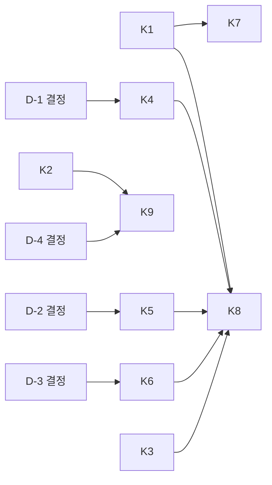

# hk 6033 — 모의·데모 베뉴 실시간 호가·내 체결 스트림 연결 설계

기준: auto_trader `origin/main` @ `46fdf9fb7`, fillwire @ `50c1aea`(읽기만). 이 문서는 **설계**다 — 코드, env, allowlist, 스케줄러, 브로커, DB를 만들지 않는다. 운영자 목표는 "호가 기반 실행 로직을 모의/데모에서 먼저 검증한 뒤 Upbit 실계좌로 간다"이고, 이 문서는 그 순서와 경계를 정한다.

## 0. 결론 요약

|#|결론|
|---|---|
|1|모의·데모 스트림은 **배관·가드 검증**에 쓴다. **가격 개선 판정에는 쓰지 않는다.** 어떤 모의 체결 모형도 대기 주문의 큐를 재현한다는 증거가 없고, touch 체결 가정은 수동 주문을 실제보다 좋게 만든다. 가격 개선의 권위는 실호가 녹화 + `through`/`touch` 규칙(hk 6024, fillwire `cmd/execsim -venue upbit`) 하나다.|
|2|**1순위 베뉴 = KIS 모의 KR.** Go 실행기(E2) → E1 의도 게이트웨이 → 브로커 어댑터의 **생산 경계를 그대로** 지나고, 호가(H0STASP0)·체결(H0STCNT0)·내 체결통보(H0STCNI9)와 `book:kis:<symbol>` Redis 호가, `execmock -live-book`이 이미 있다. 이 경로만 **호스트 allowlist 변경 0**으로 끝난다.|
|3|**2순위 = Binance Spot Demo.** Upbit와 같은 자산군·연속 세션·소수 수량이다. 데모 호가는 live와 "유사"할 뿐이고 [S1], 스트림 호스트(`demo-stream`, `demo-ws-api`)는 현재 레포 allowlist에 없다. 호스트 결정(D-1) 없이는 녹화 파일 재생(K3)으로만 쓴다.|
|4|Alpaca paper는 US 주식에 **깊이 스트림이 없고**, 체결이 NBBO 도달 시 수량·큐를 무시하므로 [S16] 실행기 검증에는 3순위다. crypto orderbook 채널은 있다 [S19]. Kiwoom 모의는 10단계 호가·내 주문 스트림이 있으나 [S12][S13] 레포에 소비 코드가 0이고 mock WS 포트가 새 호스트 결정(D-3)이다.|
|5|D11(확정 취소 노출 해제)은 **캡 계약 변경**이다(ROB-1440 "cancel frees nothing"). 결정(D-4) 없이는 코드 ticket을 열지 않는다.|

## 1. 범위·전제

- **대상**: auto_trader(`mgh3326/auto_trader`)와 fillwire(`mgh3326/fillwire`). 새 저장소 없음.
- **이 문서가 정하는 것**: 베뉴별 스트림 능력, 실제성, 검증 순서와 통과 조건, ticket 경계, 1순위 권고.
- **정하지 않는 것**: 주문·게이트·캡·allowlist의 실제 변경(운영자 결정), 스케줄러 등록, 실계좌 전환.
- 태그: `[사실]` = 이 문서에서 인용한 출처로 확인, `[unverified]` = 공식 문서에 없거나 확인 못 함, `[추정]` = 근거 있는 추론, `[모름]` = 모름.
- 용어: **E1** = auto_trader 의도 게이트웨이(`app/services/execution_intent_gateway`, ROB-1440/hk 5441), **E2** = fillwire Go 실행기(`internal/exec`, `cmd/execmock`, `cmd/execupbit`), **호가 피드** = 공개 오더북 스트림, **내 체결 스트림** = 계좌 인증이 필요한 주문/체결 푸시.

## 2. 지금 레포에 있는 것

### 2.1 auto_trader

|자산|상태|
|---|---|
|KIS 호가/체결 WS|`app/services/brokers/kis/mock_scalping_ws/market_stream.py` — H0STCNT0·H0STASP0 구독, read-only, `WEBSOCKET_ENDPOINT_HOSTS`로 `kis_live:21000`/`kis_mock:31000` 분리, approval key는 `kis_websocket_internal/approval_keys.py`(live/mock Redis namespace 분리), PINGPONG 응답·재연결. [사실]|
|KIS 내 체결통보|`app/services/kis_websocket_internal/` — `H0STCNI0`(실전)/`H0STCNI9`(모의), AES 복호화, `review.execution_ledger` 인제스트(모니터 경로). [사실]|
|KIS 모의 주문|`place_order(is_mock=True)` 경로, E1 `kis_mock` forwarder(`app/services/execution_intent_gateway/kis_mock_forwarder.py`), 발송 예약 `order_send_intents`, `review.kis_mock_order_ledger`. [사실]|
|KIS 모의 실행기(별도 레인)|`mock_scalping_exec/` — WS TriggerEvent → 주문 → **REST 일별주문 행으로 체결 확인** → 원장. 내 체결통보 스트림은 쓰지 않는다. [사실]|
|Binance 데모 주문|`app/services/brokers/binance/spot_demo/`·`futures_demo/`, `review.binance_demo_order_ledger`, `demo_strategy_loop/`, `trend/`. 시세는 REST/도메인 계산이고 **데모 WS 소비 없음**. 공개 WS 클라이언트(`binance/ws_client.py`)는 `PUBLIC_HOSTS`(live)만 허용한다. [사실]|
|Alpaca paper|`app/services/brokers/alpaca/paper_adapter.py` REST만. WS 소비 없음. [사실]|
|Kiwoom 모의|`app/services/brokers/kiwoom/` REST(KR kt10000-3, US ust20000-3), `kiwoom_mock_order_ledger`, 대사 CLI. WS 소비 없음. [사실]|
|Upbit live|`app/services/upbit_websocket.py`(MyOrder, private), `upbit_market_websocket.py`(ticker/orderbook/trade), 배포 유닛 `at-upbit-ws`. [사실]|
|E1 게이트웨이|계좌 `kis_mock`·`upbit_live`만. `cancel`은 캡을 풀지 않는다(ROB-1440). [사실]|

### 2.2 fillwire

|자산|상태|
|---|---|
|KIS 호가 녹화/재생|`cmd/bookrec` + `internal/book/recorder.go` — H0STASP0/H0STCNT0 프레임을 append-only 증거로 기록, gap/stale/reconnect 라인. 네트워크·주문 없음. [사실]|
|KIS 호가 → Redis|`internal/bookfeed/producer.go` — 기존 fillwire KIS 세션에 H0STASP0 1종목 구독을 더해 `book:kis:<symbol>`에 5단계 스냅샷 XADD. mock은 4초 무수신 시 2초 간격 REST 호가 폴백. [사실]|
|E2 실행기|`internal/exec` + `cmd/execmock` — E1 `/execution-intents/children`으로 submit/amend/cancel, 로컬 journal, 캡 mirror, `-live-book`(Redis 호가), stale 2초, 호가 침묵 30초 → 취소·정지. [사실]|
|KIS 모의 broker edge|`internal/kismockedge` — `kis_mock`(VTS)와 `alpaca_paper_crypto` 한정 place/cancel/resolve, command_id UNIQUE, POST 직전 `UNKNOWN` 커밋, 재전송 없음. [사실]|
|Upbit 그림자 실행기|`cmd/execupbit` + `internal/exec/upbit` — 공개 호가만, 주문 없음(E1 클라이언트 링크 금지), 테이커 가격·band·만료·추격 상한(`max_requotes`), 취소는 지시 출력만. [사실]|
|Upbit 재생|`cmd/execsim -venue upbit` + `internal/exec/sim` — 녹화 호가에 `through`(엄격 통과)·`touch`(접촉) 두 규칙. 큐 순서는 모사하지 않는다. [사실]|
|Toss 시세 tap|`internal/quote` — Toss ws → `quotes:toss`, 100구독/연결, 60초 ping, 서버 180초 무통신 종료. 모의 대상 아님(참고 패턴). [사실]|

### 2.3 능력 행렬

**A. 공개 시세 스트림**

|베뉴|공개 호가 (깊이·주기·호스트)|공개 체결|출처|
|---|---|---|---|
|Binance Spot Demo|`<sym>@depth` 차분 1000ms(기본)/100ms, `<sym>@depth5\|10\|20` 부분 1000ms/100ms, `<sym>@bookTicker` 실시간; `wss://demo-stream.binance.com/ws`·`/stream`(443·9443) [S1][S2]|`<sym>@aggTrade`·`<sym>@trade` 실시간 [S2]|[S1][S2]|
|Binance USD-M Futures Demo|`<sym>@depth@{100ms\|250ms\|500ms}`, `<sym>@depth{5\|10\|20}@…` 부분, `<sym>@bookTicker` 실시간; 문서의 testnet WS base `wss://demo-fstream.binance.com` [S5][S6]. 2026 라우트 분리(`/public`·`/market`·`/private`)가 demo-fstream에도 있는지 [unverified]|[S6]|[S5][S6]|
|KIS 모의 KR|H0STASP0 10단계(ASKP1-10/BIDP1-10), `ops.koreainvestment.com:31000`, approval `openapivts.koreainvestment.com:29443` [S9][S11]|H0STCNT0 실시간 체결 [S9]|[S9][S11]|
|KIS 모의 US|HDFSASP0 — 미국 실시간 **1호가 무료**, 10단계는 유료 시세 [S10]; 모의 계정 지원 여부 [unverified]|HDFSCNT0 해외주식 실시간지연체결가 — 미국은 0분 지연 무료, 최우선 호가(PBID1/PASK1) 포함 [S10]|[S10]|
|Kiwoom 모의 KR|0D 주식호가잔량 10단계(+KRX 매도/매수 잔량), 0C 최우선호가, 0E 시간외호가; `wss://mockapi.kiwoom.com:10000/api/websocket` [S12][S13]|0B 주식체결 [S14]|[S12][S13][S14]|
|Kiwoom 모의 US|[unverified] — 모의 도메인이 KRX만이라는 안내가 조건검색 문서에 있다 [S15]|[unverified]|[S15]|
|Alpaca paper US|**깊이 없음** — `quotes`(NBBO)·`trades`·`bars`, `wss://stream.data.alpaca.markets/v2/{iex\|sip}` [S18]; paper-only 계정은 IEX만 [S16]|`trades` [S18]|[S18]|
|Alpaca paper crypto|`orderbooks`(`T:"o"`, `r:true` 전량 스냅샷 후 diff) + `quotes`·`trades`, `wss://stream.data.alpaca.markets/v1beta3/crypto/{us\|us-1\|eu-1}` [S19]|`trades` [S19]|[S19]|
|Upbit (기준선)|`orderbook` count 1/5/15/30(기본 30), `trade`·`ticker`, `wss://{region}-api.upbit.com/websocket/v1` [S21]|`trade` [S21]|[S21]|

**B. 내 주문·체결 스트림, 취소/정정, 한도**

|베뉴|내 주문/체결 (인증·호스트·keepalive)|REST 취소/정정|한도|출처|
|---|---|---|---|---|
|Binance Spot Demo|WebSocket API `userDataStream.subscribe`(API key), `wss://demo-ws-api.binance.com/ws-api/v3`, 이벤트 `executionReport`·`outboundAccountPosition`; session 인증·ping/pong [S31]. 데모에서의 동작 [unverified]|`DELETE /api/v3/order`, `POST /api/v3/order/cancelReplace`|`exchangeInfo.rateLimits`(RAW_REQUESTS/REQUEST_WEIGHT/ORDERS), 429/418. 데모는 IP 한도·미체결 주문 수·필터가 live와 **정확히 같다**고 문서화|[S1][S3][S4][S31]|
|Binance USD-M Futures Demo|`POST /fapi/v1/listenKey`(60분, POST가 연장·DELETE가 종료) → `wss://demo-fstream.binance.com/private/ws/<listenKey>` [S5][S7]; 연결 24시간 상한; `ORDER_TRADE_UPDATE`·`ACCOUNT_UPDATE`·`TRADE_LITE`|`DELETE /fapi/v1/order`, `PUT /fapi/v1/order`|`exchangeInfo.rateLimits`; 문서 예시 REQUEST_WEIGHT 2400/min·ORDERS 1200/min|[S5][S7][S8]|
|KIS 모의 KR|H0STCNI9(모의; `CNTG_YN` 1=접수, 2=체결), approval key, `ops.koreainvestment.com:31000`, PINGPONG 응답; 세션은 앱키당 1개(OPSP8996 점유)|국내 주문/정정취소 REST, 모의 V-TR. AT의 KR 모의 정정 실행은 `kis_mock_modify_unavailable`로 거부(hk 3745)|주문 TR 프로세스 로컬 8/s + 게이트웨이 초당 거부(EGW00201/EGW00215) 분류; 공식 초당 한도 수치는 [unverified]|[S9][S24]|
|KIS 모의 US|H0GSCNI9(모의)·H0GSCNI0(실전) [S10]; approval key·세션 규칙 동일 [S9]|해외 주문/정정취소 REST, 모의 V-TR [S25]|동일(앱키 기준) [unverified]|[S10][S25]|
|Kiwoom 모의 KR|`00` 주문체결 — 계좌 단위, item 등록 없이 접수·체결·정정·취소·거부 수신 [S12]; `wss://mockapi.kiwoom.com:10000/api/websocket`, ACCESS TOKEN 인증|`kt10002` 정정·`kt10003` 취소 REST [repo constants]; 공식 페이지 [unverified]|실시간 시세 **200종목(국내·미국 합산)** [S12]; 모의 REST api-id별 1.2초 [repo hk 5419]|[S12]|
|Kiwoom 모의 US|[unverified](모의 WS 도메인 KRX 한정 안내 [S15])|`ust20002`/`ust20003` [repo]|[unverified]|[S15]|
|Alpaca paper|`trade_updates` — `wss://paper-api.alpaca.markets/stream`, **바이너리 프레임**, key/secret 인증 메시지, 이벤트 `new`·`fill`·`partial_fill`·`canceled`·`expired`·`replaced` 등 [S17]|`DELETE /v2/orders/{id}` [S26], `PATCH /v2/orders/{id}` [S27]|Trading API 200 req/min/계좌 [S20]; Market Data 연결/심볼은 플랜별 [S18]|[S17][S20]|
|Upbit (기준선)|private `wss://{region}-api.upbit.com/websocket/v1/private`, `myOrder`(JWT) [S22]; private 연결 동시 상한은 계정 단위 [S23]|cancel [S28], cancel-and-new [S29]|order 8/s, order-cancel-all 1/2s, default 30/s; WS handshake 5/s, 연결당 요청 5/s·100/min [S23]|[S22][S23]|

### 2.4 출처

|ref|URL|
|---|---|
|S1|https://developers.binance.com/en/docs/products/spot/demo-mode/general-info|
|S2|https://developers.binance.com/en/docs/catalog/core-trading-spot-trading/api/ws-streams/~|
|S3|https://developers.binance.com/en/docs/products/spot/user-data-stream|
|S4|https://developers.binance.com/en/docs/products/spot/rest-api|
|S5|https://developers.binance.com/en/docs/products/derivatives-trading-usds-futures/general-info|
|S6|https://developers.binance.com/en/docs/products/derivatives-trading-usds-futures/websocket-market-streams/Connect|
|S7|https://developers.binance.com/en/docs/products/derivatives-trading-usds-futures/user-data-streams|
|S8|https://developers.binance.com/en/docs/products/derivatives-trading-usds-futures/common-definition|
|S9|https://github.com/koreainvestment/open-trading-api/blob/main/examples_user/domestic_stock/domestic_stock_functions_ws.py|
|S10|https://github.com/koreainvestment/open-trading-api/blob/main/examples_user/overseas_stock/overseas_stock_functions_ws.py|
|S11|https://apiportal.koreainvestment.com/|
|S12|https://openapi.kiwoom.com/guide/apiguide/14/00|
|S13|https://openapi.kiwoom.com/guide/apiguide/14/0D|
|S14|https://openapi.kiwoom.com/guide/apiguide/14/0B|
|S15|https://openapi.kiwoom.com/guide/apiguide?jobTp=FS_JOB_TP&jobTpCode=14|
|S16|https://docs.alpaca.markets/docs/paper-trading|
|S17|https://docs.alpaca.markets/docs/websocket-streaming|
|S18|https://docs.alpaca.markets/docs/streaming-market-data|
|S19|https://docs.alpaca.markets/docs/real-time-crypto-pricing-data|
|S20|https://alpaca.markets/support/usage-limit-api-calls|
|S21|https://global-docs.upbit.com/reference/websocket-orderbook|
|S22|https://global-docs.upbit.com/reference/websocket-myorder|
|S23|https://global-docs.upbit.com/reference/rate-limits|
|S24|https://github.com/koreainvestment/open-trading-api/blob/main/examples_user/domestic_stock/domestic_stock_functions.py|
|S25|https://github.com/koreainvestment/open-trading-api/blob/main/examples_user/overseas_stock/overseas_stock_functions.py|
|S26|https://docs.alpaca.markets/reference/deleteorderbyorderid-1|
|S27|https://docs.alpaca.markets/reference/patchorderbyorderid-1|
|S28|https://global-docs.upbit.com/reference/cancel-order|
|S29|https://global-docs.upbit.com/reference/cancel-and-new-order|
|S31|https://developers.binance.com/en/docs/products/spot/web-socket-api|

## 3. 실제성(realism)과 가격 개선

### 3.1 한 표

|베뉴|호가 원천|큐 우선순위|부분 체결|수동 지정가 체결|가격 개선 판정|
|---|---|---|---|---|---|
|Binance Spot Demo|데모 자체 호가. 문서: 가격·호가는 live와 "유사"하며 live와 같지 않다 [S1]|[unverified]|[unverified]|[unverified]|**불가** — 호가가 live가 아니다|
|Binance USD-M Futures Demo|testnet 독립 호가·얇은 유동성 [추정 — spot testnet 문서의 독립성 서술에서 유추]|엔진 큐는 있으나 의미 없음 [추정]|가능 [unverified]|[unverified]|**불가**|
|KIS 모의 KR|H0STASP0 호가가 실 KRX 호가인지 [unverified]. 체결은 VTS 가상 매칭 [모름]|[unverified]|[unverified]|[unverified]|**불가**|
|KIS 모의 US|1호가만 무료, 10단계 유료 [S10]|[unverified]|[unverified]|[unverified]|**불가**(깊이 부족)|
|Kiwoom 모의 KR|10단계 [S13]; 모의 호가가 실 KRX인지 [unverified]|[unverified]|[unverified]|[unverified]|**불가**|
|Alpaca paper US|NBBO quotes만, 깊이 없음 [S18]; 매매 가능(NBBO 도달) 시 체결, **NBBO 수량 무시**, 10% 확률 랜덤 부분체결, 큐·지연 슬리피지·가격 개선 없음 [S16]|없음(문서 명시)|랜덤 10%|touch/NBBO 도달 즉시|**불가** — 문서가 가격 개선·큐 없음을 명시|
|Alpaca paper crypto|Alpaca/Kraken orderbook [S19]; paper 체결 모형 세부 [unverified]|[unverified]|[unverified]|[unverified]|**불가** — Upbit 호가가 아니다|
|Upbit (기준선)|실호가 [S21]|실제 큐|실제|through만 채점(큐는 재생 규칙 밖)|**가능** — 녹화 + through/touch(hk 6024)|

### 3.2 왜 "touch 시뮬레이터는 수동 주문을 좋게 만드나"

지정가가 최우선 호가에 닿기만 하면 전량 체결로 처리하는 규칙(`touch`)은 (a) 그 가격에 우리 앞에 있던 큐, (b) 같은 가격에서의 부분 체결, (c) 도달했지만 우리 순번 전에 소진된 유동성을 모두 무시한다. 그래서 수동(대기) 주문의 체결률과 가격 개선이 실제보다 좋게 나온다. fillwire `execsim`은 이 편향을 없애려고 `through`(주문 가격을 **엄격히** 통과한 체결 수량만)를 기본 판정으로 두고 `touch`를 상한으로만 병기한다(`internal/exec/sim/sim.go`, 5852 §7.2 규칙 3). 모의 베뉴의 체결 모형이 touch에 가깝다면 그 베뉴로 수동 주문의 가격 개선을 판정할 수 없다.

### 3.3 베뉴별 판단

- **Binance Spot Demo**: 데모 모드의 가격·호가는 live와 유사하지만 같은 것이 아니고, IP 한도·미체결 주문 수·거래소 필터는 live와 정확히 같다 [S1]. 따라서 **주문 형상·필터·한도 검증은 전이되지만 유동성·가격 개선은 전이되지 않는다**. 데모 매칭 엔진이 데모 고유 호가에 대해 실제 엔진 큐를 쓰는지, 부분 체결이 일어나는지는 문서에 없다 [unverified].
- **Binance USD-M Futures Demo**: 문서의 "Testnet API Information"이 `demo-fapi`/`demo-fstream`을 testnet으로 부른다 [S5]. testnet 호가는 독립이고 보통 얇다. 마켓 주문·reduceOnly 왕복(H5/trend가 이미 쓰는 경로)에는 충분하지만, 대기 주문의 큐·부분 체결을 판정할 유동성이 없다.
- **KIS 모의 KR**: 호가는 H0STASP0 10단계로 충분하고, 내 체결통보(H0STCNI9)도 있다 [S9]. 그러나 VTS 가상 매칭의 체결 규칙(가격·수량·부분 체결·우선순위)은 공식 문서에 없다 [모름]. 현재 레포의 모의 실행기는 체결을 REST 일별주문 행으로만 확인한다(`mock_scalping_exec/fill_evidence.py`) — 스트림과 REST의 지연 차이를 재는 대상은 있지만 실제성은 미검증이다.
- **KIS 모의 US**: 무료 호가가 1호가뿐이라 [S10] 호가 기반 실행기에는 부족하다. 10단계는 유료 시세다.
- **Kiwoom 모의 KR**: 0D가 10단계, 00이 계좌 단위 주문/체결, 0B가 체결이다 [S12][S13][S14]. 스트림 표면은 충분하지만 매칭 모형은 미문서 [모름]이고, 모의 WS가 KRX만인지 [unverified]다.
- **Alpaca paper**: US 주식은 깊이가 없고 [S18], 체결은 "NBBO 도달 시, 수량 무시, 10% 랜덤 부분 체결, 큐·가격 개선·지연 슬리피지 없음"으로 문서가 명시한다 [S16]. **가격 개선 판정 불가**가 문서 차원에서 확정이다. crypto orderbook 채널은 깊이가 있으나 [S19] Upbit 호가가 아니다.
- **Upbit live**: 실호가·실큐·실체결이다. 가격 개선은 여기서만 측정 가능하고, 방법은 hk 6024의 녹화 재생(through/touch)이다 [S21].

### 3.4 싸구려 프로브 (설계 세션이 키를 쥐고 실행; 이 ticket은 아무것도 실행하지 않는다)

|ID|베뉴|절차|읽는 것|합격 기준(사전 선언)|
|---|---|---|---|---|
|P1|KIS 모의 KR|같은 종목을 모의 approval key와 실계좌(또는 공개 시세)로 10분 동시 구독(H0STASP0/H0STCNT0)|최우선 호가·체결 시각·가격 일치율|모의 호가가 실호가면 일치율 ≥99%; 아니면 VTS 고유 호가로 분류|
|P2|KIS 모의 KR|스프레드 ≥2틱일 때 최우선 매수호가 **1틱 아래** 1주 지정가, 5분간 해당 가격 이하 체결 프레임 0|체결 발생 여부|체결 0 → through 모형. 체결 발생 → touch/가격 기반, 수동 주문 판정 불가|
|P3|KIS 모의 KR|최우선 매도호가에 **표시 수량보다 큰** 지정가 매수 1건|체결 수량 vs 표시 수량|표시 수량 초과 체결 → 사이즈 무시(touch형)|
|P4|KIS 모의 KR|대기 지정가 1건 제출 후 취소, 체결통보와 REST 일별주문의 취소 확인 시각 기록|취소 확인 지연, 취소 후 체결 유무|취소 후 체결 0, 확인 증거 존재|
|P5|Binance Spot Demo|데모 `@depth20`과 live `@depth20`을 1시간 동시 수집, 중간가·이벤트 수 비교|가격 괴리·이벤트율|괴리가 선언 임계(예: 중간가 50bp) 이내면 "유사", 아니면 별개|
|P6|Binance Spot Demo|최우선 매수호가에 1랏 지정가, 해당 가격 **터치** 체결과 **관통** 체결을 구분해 관찰|터치 시 체결 여부|터치만으로 체결 → touch형, 수동 판정 불가|
|P7|Binance Spot Demo|`userDataStream.subscribe` 연결, 주문 1건과 REST `GET /api/v3/order` 응답 시각 비교|스트림 도착 시각 vs REST|스트림이 REST보다 빠르고 필드 일치|
|P8|Binance Futures Demo|testnet `@depth20`·`@aggTrade` 이벤트율과 live 비교|이벤트율·스프레드|testnet이 live의 선언 비율 이상이면 큐 판정 후보, 아니면 배관 전용|
|P9|Alpaca paper US|crypto/US 각각 `trade_updates`와 REST `GET /v2/orders/{id}` 지연 비교; NBBO 크기보다 큰 지정가 1건|스트림 지연, 체결 수량|문서대로 수량 무시·랜덤 부분 체결이면 가격 개선 판정 제외 확정|
|P10|Alpaca paper crypto|BTC/USD orderbook 채널 구독 후 paper 지정가 1건, 체결가와 Alpaca quote 비교|체결가 출처|체결가가 Alpaca/Kraken 어느 쪽인지 분류|
|P11|Kiwoom 모의 KR|0D/0B/00 구독, 시장가/지정가 1건, `kt00007`/`kt00009` 조회 시각 비교|스트림 지연, 체결 수량·가격|00 도착이 REST보다 빠르고 수량 일치|
|P12|Kiwoom 모의 US|US 모의 토큰으로 0D/00 구독 시도|수신 여부|수신 0 → US는 REST 전용으로 확정|

프로브 결과는 **티켓 K8**(문서 기록)로만 남긴다. 프로브는 주문을 낼 수 있는 베뉴에서 운영자 동석·명시 confirm으로만 하고, 이 설계 ticket은 프로브를 실행하지 않는다.

## 4. 모의에서 먼저 검증할 것 (순서와 통과 조건)

각 항목은 **앞 항목이 통과해야** 다음으로 간다. 실패는 "그 베뉴로 그 주장을 할 수 없다"는 뜻이고, 다음 베뉴로 넘어간다.

|#|검증|베뉴·도구|통과 조건|실패의 뜻|
|---|---|---|---|---|
|V1|실행기 ↔ E1 ↔ 브로커 배관, intent당 1회 전송|KIS 모의 KR, `execmock -config … -live-book -dry-run` → `-send` 1건|E1 child 행 1개/키, POST 1회, `accepted`+브로커 주문번호, journal `send`→`outcome` 각 1|전송 경계·journal·캡 mirror 중 하나가 틀림|
|V2|내 체결 스트림 지연 vs REST|`execmock` + H0STCNI9 → fillwire ingest → `execution_ledger` → E1 `/fills`; VTS `VTTC8001R` 재조회|스트림→원장 p95 ≤ 2초(제안 목표) **그리고** 모든 체결에서 스트림 경로가 REST 재조회보다 빠름; 중복 원장 행 0; 누적 수량 일치|스트림 증거를 못 쓰거나 REST가 더 빠름 → 실행기 체결 대기는 REST 유지|
|V3|취소와 종결 증거|KIS 모의: 대기 지정가 → E1 cancel → 브로커 readback(`cncl_yn=Y` 또는 무체결 종결)|취소 접수·브로커 종결 증거·원장 무체결이 같은 주문을 가리킴; 취소 후 체결이 원장에 정상 기록됨|증거 정렬 불가 → D11 논의 중단|
|V4|확정 취소 노출 해제(D11)|E1 읽기 뷰(K2) + 결정(D-4)|현재 캡은 취소로 풀리지 않음이 그대로 보이고, 해제 flag(on)에서만 **종결 증거 1회**로 정확히 1회 해제; 증거 없으면 해제 0|캡 계약 위반 또는 이중 해제 → flag off 유지|
|V5|stale book·재연결·kill|fillwire bookfeed 중지/재시작, `execmock` 실행 중 ws 절단|stale 동안 새 child 0; 호가 침묵 30초에 working 취소·`stale_book` 정지; gap 창의 비행 child `void_gap`; kill은 새 child만 막고 취소는 계속|가드 우회 → 실행기 검증 중단|
|V6|추격/chase 경계|KIS 모의는 amend 불가(hk 3745) → no-chase 경로; Upbit는 `execsim` 재생|intent당 submit 1회, 불리한 이동은 cancel-and-finish, 대역 밖 가격 0, amend 횟수 상한 이하|추격이 캡·만료를 넘음|
|V7|불명 결과는 재전송 없음|fake gateway로 POST 경계 뒤 5xx/타임아웃 주입|journal에 send 1·uncertain 1, 같은 키 재전송 0, 그 intent 정지; `/intents/<id>`가 미해소면 계속 정지|재전송 발생 → 즉시 중단|
|V8|스트림 체결의 원장 대사|fillwire own-fill/`book:` 증거 vs `execution_ledger` vs 브로커 readback|누적 수량 동일, supersede(#1379)·격리(#1175) 규칙 유지, 종결은 브로커 증거로만|대사 불가 → 그 스트림을 증거로 쓰지 않음|
|V9|실제성 프로브(P1–P12)|§3.4|선언한 임계로 분류 완료; 가격 개선 판정 가능 베뉴 0을 확인|프로브가 "가능"을 보이면 그 근거를 K8에 기록|

**가격 개선은 V1–V8의 대상이 아니다.** V1–V8은 "주문이 의도대로 나가고, 증거가 제때 오고, 가드가 막는가"만 본다. 개선 폭은 Upbit 녹화 재생(hk 6024)과 Upbit live shadow만 답한다.

## 5. 티켓 분해

원칙: **PR 1개 = 표의 한 행**. 어떤 ticket도 호스트 allowlist나 캡을 넓히지 않는다 — 호스트의 추가는 **D-1..D-3 결정문의 내용**이고, ticket은 승인된 그 한 호스트를 쓰는 읽기 전용 소비 코드만 만든다. 결정이 없으면 **녹화 파일 재생(K3)** 으로 대체한다. 스케줄러 등록은 어떤 ticket에도 없다(하드룰 6).

### 5.1 운영자 결정 (ticket 아님)

|ID|결정|왜 필요한가|없을 때 대체|
|---|---|---|---|
|D-1|Binance Spot Demo 읽기 전용 스트림 호스트 `demo-stream.binance.com`·`demo-ws-api.binance.com` 허용(데모 전용 allowlist, 기본 off)|[S1] 데모 스트림을 레포가 소비하려면 필요|K3 외부 녹화 재생|
|D-2|Alpaca Market Data `stream.data.alpaca.markets` + paper `trade_updates`(`paper-api.alpaca.markets/stream`) 허용(읽기 전용, 기본 off)|[S18][S17] 레포에 Alpaca WS가 0|K3 외부 녹화 재생|
|D-3|Kiwoom 모의 WS `wss://mockapi.kiwoom.com:10000/api/websocket` 허용(읽기 전용, 기본 off)|[S12] 같은 호스트의 다른 스킴·포트|REST 대사만 유지|
|D-4|E1 캡 계약: 확정된 취소가 노출을 해제해도 되는가(현행 "cancel frees nothing" 변경)|[ROB-1440] 캡은 안전 계약이다. D11은 그 계약을 바꾼다|현행 유지(해제 없음), V3 증거만 측정|

### 5.2 표

|ID|repo|T|grade|무엇을 하는가|선행|건드리는 하드룰/게이트|
|---|---|---|---|---|---|---|
|K1|fillwire|T2|A|`execmock`에 **내 체결 증거 지연 보고** 추가: child별 POST 시각, KIS 체결통보 수신 시각, E1 `/fills` 최초 관측 시각, VTS readback 시각을 한 줄 JSON으로. 주문 경로·캡·전송 없음|없음|fillwire `noorder_test.go` 불변; E1 캡 불변; 네트워크는 기존 경로만|
|K2|auto_trader|T2|A|E1 `GET /intents/<id>`에 **읽기 전용** `exposure` 블록: lineage별 high-water 수량/명목, 캡 잔여, 확정 취소 증거(브로커 종결+원장 무체결). 계산은 `decisions._exposure_by_order` 재사용, 캡 판정은 불변|없음|E1 journal 트리거 불변; 응답은 추가 필드만(계약 테스트); 쓰기 0|
|K3|fillwire|T2|A|`execsim`에 **외부 녹화 재생 프로파일**: `-venue binance_spot_demo\|alpaca_paper\|kiwoom_mock` + 고정 JSONL 스키마(호가/체결). through/touch와 실행기 결정만 출력, 네트워크 0, 주문 0. 픽스처로만 검증|없음|`noorder_test`; 호스트·E1 미접촉|
|K4|auto_trader|T2|A|Binance Spot Demo 읽기 전용 수집기: `@depth20`·`@bookTicker`·`@aggTrade`·`userDataStream.subscribe` → `book:binance_spot_demo:<sym>`·`fills:binance_spot_demo`, 전용 env 기본 off|**D-1**|하드룰 4 무관(주문 경로 0); 주문 모듈 import 금지(정적 가드); scheduler 0|
|K5|auto_trader|T2|B|Alpaca paper 읽기 전용 수집기: `trade_updates`(binary)와 crypto `orderbooks` → Redis/JSONL, 기본 off, 체결을 원장에 쓰지 않음|**D-2**|주문 경로 0; `ALPACA_*` 게이트 불변|
|K6|auto_trader|T2|B|Kiwoom 모의 읽기 전용 리더: 00/0B/0D → `book:kiwoom_mock:<sym>`·`fills:kiwoom_mock`, 200종목 상한, REST 대사와 지연 비교, 기본 off|**D-3**|주문 경로 0; 기존 Kiwoom REST 페이싱·원장 불변|
|K7|fillwire|T2|A|`execupbit` 체결 증거를 Upbit myOrder 스트림 우선으로: hk 5758 shadow 공급자와 AT `execution_ledger`를 대조해 대기 시간을 줄이고, 불일치·지연 시 기존 REST/E1 조회로 폴백. 전송 로직 불변|hk 5758, K1|E2 one-submit·no-resend 불변; Upbit live 스위치·게이트 불변|
|K8|auto_trader|T1|B|P1–P12 결과와 능력 행렬 갱신을 `docs/contracts/`에 버전 기록. 코드 0|K1–K6(가능한 것만)|없음(문서)|
|K9|auto_trader|T3|**S**|D11 해제 구현: env `EXECUTION_INTENT_GATEWAY_RELEASE_ON_CONFIRMED_CANCEL` 기본 **false**, on일 때만 브로커 종결+원장 무체결 1회 증거로 해제. 캡 상한·`LOCKED_ENVELOPE`·손실매도 가드 불변, DB 트리거로 이중 해제 거부|**D-4**, K2|하드룰 4(게이트웨이 경유 주문), ROB-1440 캡 계약, 마이그레이션, 하드룰 18 GRANT|
|K10|auto_trader|T1|B|이 문서의 "알았지만 건드리지 않은 것"과 D-1..D-4 결정 요청을 운영자 결정 큐에 올린다(문서/결정 요청만)|없음|없음|

### 5.3 의존 관계

K3는 결정 없이 지금 착수 가능하다. K1·K2도 결정 없이 착수 가능하다. K4–K6은 결정 전 착수 금지다.

### 5.4 ticket별 경계 메모

- **K1**: `execmock`은 지금도 E1 `/fills`를 폴링한다(최대 30분 지연, 5438 §1.5). 이 ticket은 그 대기 시간을 **측정**할 뿐 줄이지 않는다. 주문이 나가는 경로·키·캡에 손대지 않는다.
- **K2**: 응답 필드는 additive다. 기존 클라이언트(E2)는 모르는 필드를 거부하므로(`e1/client.go`), E2는 **같은 PR에서** 새 필드를 무시하도록 계약 테스트를 갱신해야 한다. 캡 판정 함수는 호출만 하고 결과를 바꾸지 않는다.
- **K3**: 입력 JSONL 스키마는 이 ticket에서 고정한다(venue, symbol, ts_exchange, ts_received, bids/asks 5단계, trade price/qty, gap 표식). 외부 녹화는 설계 세션이 레포 밖에서 만든다.
- **K4**: `PUBLIC_HOSTS`를 넓히지 않는다. 데모 전용 **새 allowlist 상수** 하나와 그 상수만 쓰는 read-only 클라이언트를 둔다. 주문·원장·E1 import 금지.
- **K5**: `trade_updates`는 binary frame이다 [S17]. `fill`/`partial_fill`을 **원장 증거로 쓰지 않는다** — 대조용 관측일 뿐이다. paper 계좌의 주문 제출은 이 ticket에 없다.
- **K6**: 0D 10단계만 저장한다. 00을 원장에 쓰지 않는다. `KIWOOM_MOCK_US`는 P12가 통과할 때만 같은 모듈에 분기로 더한다.
- **K7**: hk 5758이 아직 shadow 공급자다. 이 ticket은 그 출력을 읽기만 하고, 대조 불일치·지연 시 기존 경로로 폴백한다. Upbit 주문·게이트·allowlist 불변.
- **K9**: 캡을 **넓히지 않는다**. 해제는 "증명된 취소"에 한정되고, 증거가 없으면 0이다. flag off에서 응답·판정이 바이트 동일해야 한다. 이 ticket은 이 설계에서 유일하게 캡 계약 자체를 건드리므로 grade S·T3다.
- 어떤 ticket에도 스케줄러·cron·Prefect 등록이 없다(하드룰 6).

## 6. 권고: KIS 모의 KR 먼저

1. **생산 경계가 같다.** Upbit live의 설계 경로는 Go 실행기 → E1 게이트웨이(`ExecutionIntentV1` child) → forwarder다(live 스위치는 기본 off, hk 5441). KIS 모의는 그 경계를 **이미** 지난다(`execmock` + `kis_mock` forwarder + `order_send_intents` + journal). 다른 베뉴는 실행기 쪽에 새 클라이언트나 새 E1 계좌를 먼저 만들어야 한다.
2. **두 스트림이 이미 있다.** H0STASP0 10단계 호가가 `book:kis:<symbol>`로, H0STCNI9 내 체결통보가 fillwire ingest→`execution_ledger`로 들어온다. V2(스트림 vs REST)와 V7(불명 재전송 금지)을 코드 추가 없이 측정할 수 있다.
3. **호스트 변경이 0이다.** `ops.koreainvestment.com:31000`과 `openapivts.koreainvestment.com:29443`은 이미 AT 코드·fillwire bookfeed가 쓰는 호스트다. D-1..D-3 없이 착수 가능한 유일한 완전 경로다.
4. **취소·종결 증거가 브로커 readback으로 닫힌다.** V3/D11의 전제(취소 접수 + 브로커 종결 + 원장 무체결)를 KIS 모의가 제공한다. Upbit forwarder의 취소 규칙(hk 5441)과 같은 모양이다.
5. **한계를 알고 쓴다.** KR 주식이라 크립토 마이크로구조(24/7, 소수 수량, crypto tick)는 검증하지 못하고, 체결 모형은 [모름]이라 가격 개선은 못 한다. 그래서 **2순위 Binance Spot Demo**가 크립토 형상 검증을 맡는다. Upbit live 전환은 그 뒤에도 여전히 운영자 결정(5438 §9.2, D3)이다.

## 7. 하지 않는 것

- 어떤 베뉴에서도 **가격 개선**을 모의 체결로 판정하지 않는다.
- 스케줄러·cron·Prefect 등록 없음.
- 새 주문 게이트·캡·allowlist를 이 설계에서 열지 않는다.
- `execmock`/`execupbit`의 one-submit·no-resend 규칙, E1 저널 트리거, 격리(#1175)·supersede(#1379) 규칙을 바꾸지 않는다.
- 실계좌(Upbit live 포함) 전환·활성화 없음.

## 8. 알았지만 건드리지 않은 것

- **Binance Spot Demo의 데모 주문 경로**(`spot_demo`, `demo_strategy_loop`)는 REST·원장이 이미 있고 시세가 없다. 이 설계는 시세 스트림 ticket(K4)만 제안하고, 데모 주문 로직 변경은 제안하지 않는다.
- **fillwire `internal/quote`(Toss)** 는 같은 "venue 시세 → Redis" 패턴의 선례다. Toss는 모의 베뉴가 아니므로 능력 행렬에서 제외했다.
- **KIS 모의 실행기(`mock_scalping_exec`)** 는 이미 WS 트리거로 주문하지만 체결을 REST로만 확인한다. V2의 비교 대상으로만 인용하고, 그 레인을 이 설계에서 바꾸지 않는다.
- **Kiwoom 모의 US**는 REST 경로(ust20000-3)가 있으나 WS 지원이 [unverified]다. P12 전에는 ticket을 만들지 않는다.
- **Upbit private WS 동시 연결 상한**의 정확한 수치는 문서에 "계정 단위 상한"만 있고 숫자가 없다 [S23]. hk 5758이 그 소비자이므로 이 설계는 숫자를 주장하지 않는다.
- **Binance Futures 데모의 `/public`·`/market` 라우트 분리**가 demo-fstream에 적용되는지는 [unverified]다. 적용되지 않으면 K4류 ticket을 만들 때 경로를 다시 확인해야 한다.
- **KIS 모의 US 무료 1호가**는 호가 기반 실행기에 부족하다. 유료 시세 신청은 운영자 결정이고 이 설계 범위 밖이다.
- **Upbit 주문 REST 한도**: 공식 문서는 order 8/s인데 [S23] 5438/5852 계열 문서는 12/s로 적고 있다. 이 설계는 공식 값을 인용하고 기존 문서는 건드리지 않는다(별도 정정 대상).
- **KIS 모의 취소 readback TR**: fillwire `kismockedge`·`kismockread`와 AT 상수는 `VTTC8001R`을 쓴다. e3a 런북의 `VTTC0081R` 표기와 다르며, 이 설계는 코드·문서 어느 쪽도 고치지 않는다.
