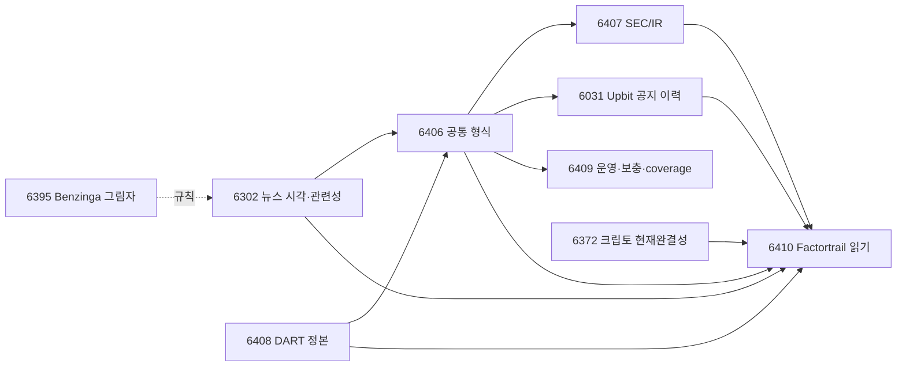

# hk 6400 — 공식 공시·IR·거래소 공지 공통 이벤트 경로 설계

기준: auto_trader `origin/main` @ `b7d72f17b`. 입력: dots 노트 hk 6302 댓글 33207(운영자 요청으로 전달된 의견),
hk 6302·6031·6372·6395, 같은 날짜의 dots 댓글 33192/33232/33252.

이 문서는 **설계**다. 코드·마이그레이션·DAG 등록·env·스케줄러·MCP 표면·브로커 호출을 만들지 않는다.
문서 작업 환경은 읽기 전용이므로(DB·네트워크 호출 금지) §6 검증 샘플은 **절차와 기대 필드**만 정의하고
실제 실행 결과는 옮기지 않는다 — 실행 값이 필요한 곳은 `[unverified]` 로 표시한다.

태그: `[사실]` = 이 문서에서 인용한 코드/공식 문서로 확인, `[unverified]` = 확인하지 못했거나 실행하지 않음,
`[추정]` = 근거 있는 추론.

**정정 (hk 6417, 2026-11-28)**: PR #2569 리뷰에서 미룬 지적 8건을 `auto_trader@7955ef356` 코드와 대조해 고쳤고,
고친 곳에는 `(hk 6417)` 을 달았다. `auto_trader@<sha>` 를 붙인 인용은 그 커밋 기준이며, 뒤따르는
`:NN` 단축 인용은 직전 인용의 파일·커밋을 잇는다. sha 가 없는 인용은 `b7d72f17b` 기준이다. 그 뒤 병합된 변경으로 낡은 곳 중
일부(§0 2·4행, §1.2, §1.6, §1.8, §2.1, §2.2)에는 `대체됨` 표시만 달았고 설계 본문과 소유권·티켓 표는 다시 쓰지 않았다.
**표시가 없는 서술은 현행 코드에서 다시 확인하지 않았다** — 예를 들어 §1.9 의 `retro_timeline` source 목록에는 그 뒤
hk 7005(`508cbee55`)가 `plan` 을 더했다.

**정정 (hk 7091, 2026-11-28)**: PR #2701 리뷰에서 미룬 지적 2건(§3.3 결측 규칙, §4.2 `published_date`)을
`auto_trader@0b05c53b8` 코드와 대조해 고쳤고, 고친 곳에는 `(hk 7091)` 을 달았다.

**정정 (hk 7093, 2026-11-28)**: PR #2704 리뷰에서 미룬 지적 2건(§3.3 증명된 0건의 적용 시점, 범위 한정 수집 `sec`)을
`auto_trader@10ac1ef7c` 코드와 대조해 고쳤고, 고친 곳에는 `(hk 7093)` 을 달았다. 두 규칙의 reader 구현은 이 정정과
같은 PR(hk 7097)에 있으며, 인용한 줄 번호는 그 변경 전 커밋 `10ac1ef7c` 기준이다.

## 0. 결론 요약

|#|결론|
|---|---|
|1|공식 이벤트(공시·IR·거래소 공지)의 저장지는 이미 **시장 이벤트 영역**(`market_events`, `market_event_values`, `market_event_ingestion_partitions`) 하나다. 이 영역은 브로커·계좌·주문 권한이 없다 — `app/services/market_events/` 는 `brokers`·`order_proposals`·`execution_ledger` 를 import 하지 않는다(패키지 내 grep 0건). 새 저장소·새 레포를 만들지 않고 이 영역을 확장한다.|
|2|지금 형식은 **"이벤트 1건 = 원천 1건"** 이다. `b7d72f17b` 에는 §2 가 요구하는 최초 수신·수정·효력 시각, 관련성(direct/sector/market + 미확인), 원천 묶음, 개정 판본이 모두 없었고, **(hk 6417)** `fetched_at` 은 **생산자가 없어 전 행 NULL — 최초 수신 시각 없음** 이었다(`app/models/market_events.py:102` 에 server_default 없음, `app/services/market_events/repository.py:58` 은 upsert 갱신 열 후보 목록일 뿐). 현행(`대체됨`): 저장 열·표는 hk 6513(`d9c32123d`)·6406(`cdb088116`)이 추가했다. 다만 원천 묶음 `market_event_sources` 에 쓰는 수집기는 아직 없다(`auto_trader@7955ef356 app/services/market_events/repository.py:514` `append_source` 의 `app/`·`scripts/` 호출자 0건). `first_received_at` 은 insert 때만 쓰인다(`auto_trader@7955ef356 app/services/market_events/repository.py:328-329`). `first_received_at`·`fetched_at` 을 둘 다 쓰는 생산자는 Benzinga 캘린더(`auto_trader@7955ef356 app/services/benzinga_calendars/normalizers.py:207-208`, hk 6513), Benzinga Pro(`auto_trader@7955ef356 app/services/invest_momentum_events/benzinga_pro.py:136-137`, hk 6579 `ae7c1300d`), KIS KSD(`auto_trader@7955ef356 app/services/market_events/kis_ksd_dividends.py:228-229`, hk 6583 `425f3c9d6`), 네이버 공시(`auto_trader@7955ef356 app/services/market_events/naver_disclosures.py:208-209`, hk 6777 `9213bea64`), 거래소 공지(`auto_trader@7955ef356 app/services/market_events/crypto_notices.py:207-208`, hk 6787 `1ea80c2f9`)다. DART 공시 수집은 `first_received_at` 만 쓰고(`auto_trader@7955ef356 app/services/market_events/ingestion.py:428`, hk 6968 `540f2cf76`), Finnhub·WiseFn·ForexFactory·TradingView 경로는 둘 다 쓰지 않는다. 6406 마이그레이션은 `fetched_at` 을 `first_received_at` 으로 백필하지 않았다. `fetched_at` 은 위 생산자가 쓰지 않은 행에서는 NULL 이고 upsert 갱신 열이기도 하므로(`auto_trader@7955ef356 app/services/market_events/repository.py:319`) **백필 원천이나 최초 수신 시각으로 쓰지 않는다.**|
|3|뉴스 시각 결함(hk 6302)은 코드로 확인된다. Naver 의 `+09:00` 오프셋은 `replace(tzinfo=None)` 로 버려지고(`symbol_news_store.py:105`), Finnhub epoch 는 **호스트 로컬 naive** 로 변환된다(`finnhub_news.py:360`). 같은 naive 컬럼(`models/news.py:93`)에 서로 다른 시간대 의미가 섞인다.|
|4|Upbit 공지는 **저장되지 않는다** — MCP 호출마다 라이브 fetch 만 한다(`upbit_public_read_model/notices.py:91`, 소비 `_crypto_catalysts.py:124`). 유의·주의 상태는 유니버스 스냅샷의 **마지막 관측 1개**만 남고 지정·해제 이력이 없다(`upbit_symbol_universe_service.py:211-216`). hk 6031 소관. **(hk 6417) 공지 저장 부분은 `대체됨`**: hk 6787(`1ea80c2f9`)이 Upbit·Bithumb 공지를 `market_events` 에 저장하는 수동 CLI 를 추가했다(`auto_trader@7955ef356 app/services/market_events/crypto_notices.py:1-6`). MCP 조회는 여전히 라이브 fetch 다(`auto_trader@7955ef356 app/mcp_server/tooling/fundamentals/_crypto_catalysts.py:124`).|
|5|미국 공식 공시(SEC EDGAR)·기업 IR 보도자료 수집 코드는 없다. 미국은 Finnhub 실적(`market_events`)과 Finnhub 뉴스(`news_articles`/`symbol_news_relevance`)뿐이다. → 신규 hk 6407.|
|6|Factortrail 은 `retro_timeline` 에 시장 이벤트가 없고 source enum 이 닫혀 있다(`retro_timeline.py:82`, `contracts/retro/v1/openapi.yaml:2117-2125`). 공통 형식 확장 뒤 **새 operation**(`retro_symbol_events`)으로 호환 확장 순서대로 붙인다 → 신규 hk 6410.|
|7|소유: 뉴스 시각·관련성 = hk 6302, Upbit 공지 이력 = hk 6031, 크립토 현재 상태 완결성 = hk 6372, Benzinga 그림자 = hk 6395, 나머지 공백 = 신규 hk 6406(공통 형식)·6407(SEC/IR)·6408(DART 정본)·6409(운영·보충)·6410(Factortrail 읽기). 중복 티켓은 만들지 않는다(§5).|

## 1. 원천별 인벤토리

### 1.1 요약

|원천|구현|쓰기 위치|상태|
|---|---|---|---|
|KR DART 공시|`scripts/ingest_market_events.py:66-68` → `market_events/ingestion.py:292` → `market_events/normalizers.py:132`|[사실] `market_events`·`market_event_ingestion_partitions`|저장됨. 접수 **시각** 없음(날짜만), 원천 스크래핑, 개정 판본 없음|
|KR 공시(라이브 조회)|`app/services/disclosures/dart.py:245`, MCP `get_disclosures`(`analysis_tool_handlers.py:639`)|[사실] 쓰기 없음|조회 성공·미저장. 저장 경로와 별개 코드|
|US 실적(Finnhub)|`market_events/ingestion.py:117` → `market_events/normalizers.py:37`|[사실] `market_events`|저장됨. 일정·실적 값 중심, 공시 원문 아님|
|US 공식 공시(SEC EDGAR)|없음|—|**missing**|
|US 기업 IR(보도자료)|없음|—|**missing**|
|US/KR 뉴스(Finnhub·Naver)|`finnhub_news.py:172`, `naver_finance/news.py:47` → `symbol_news_store.py:81`|[사실] `news_articles`, `symbol_news_relevance`|저장됨. 원천 시각 timezone 손실, revised 없음|
|Upbit 공지|`upbit_public_read_model/notices.py:91`, 소비 `_crypto_catalysts.py:106`|[사실] 쓰기 없음|조회 성공·미저장(호출 시점만)|
|Upbit 유의·주의 상태|`upbit_market_event.py:99` 파싱, `upbit_symbol_universe_service.py:134-145` 기록|[사실] `upbit_symbol_universe.market_event`|현재값만. 지정·해제 이력 없음|
|경제 이벤트(ForexFactory·TradingView)|`market_events/normalizers.py:296` (ForexFactory), `market_events/ingestion.py:460`/`561`|[사실] `market_events`|수동 전용. 기대 원천 아님(`expected_sources.py:33-39`)|
|Factortrail 타임라인|`retro_v1/retro_timeline.py:549`|[사실] 쓰기 없음|이벤트 없음(closed SOURCES:82)|

### 1.2 KR DART 공시 — 저장 경로

> **(hk 6417) `대체됨` — 이 절은 `b7d72f17b` 기준이다.** hk 6408(`ea12e0916`)이 시장 전체 목록을 공식
> `list.json` 으로 바꿨고(`auto_trader@7955ef356 app/services/market_events/dart_helpers.py:235`), 시각 없는 행에는
> 날짜 정밀도 발행 열을 쓰며, 정정 묶음 `group_key` 를 더했다
> (`auto_trader@7955ef356 app/services/market_events/normalizers.py:188-204`, `:275-280`). 접수 시각은 스크래핑 보강으로만
> 얻고, 수집 실패는 닫힌 코드로 남긴다(`auto_trader@7955ef356 app/services/market_events/ingestion.py:512-514`).
> 현행 정본은 `docs/agent-contracts/market-data-and-screener-contracts.md` 의 "DART 일일 목록" 항목이다.

- 수집: `app/services/market_events/dart_helpers.py:190` `fetch_dart_filings_for_date` — `OpenDartReader.list_date_ex()` 로
  `dart.fss.or.kr` 를 **스크래핑**한다(`dart_helpers.py:3` 주석이 명시). 캐시는 `target_date < today_kst()` 일 때만
  (`dart_helpers.py:216`), 오늘 날짜는 매번 실제 요청이다.
- 정규화: `market_events/normalizers.py:132` — `rcept_no` → `source_event_id`, `rcept_dt` → `event_date`, `report_nm` →
  `title`, 종목은 `stock_code`(없으면 corp registry 이름 정확 일치 — **(hk 6417)** 이 해석은 registry 로더가 아니라
  정규화 함수 안에 있다: `app/services/market_events/normalizers.py:155-178`, 현행
  `auto_trader@7955ef356 app/services/market_events/normalizers.py:230-253`; hk 7031 `7b051d0dc`·hk 6408 `ea12e0916` 이후
  줄 이동), `source_url` 은
  `dart.fss.or.kr/dsaf001/main.do?rcpNo=…`, 해석 실패 사유는 `raw_payload_json.symbol_resolution_reason`
  (`no_registry_match`/`unlisted`/`ambiguous_corp_name`/`registry_unavailable`).
- 분류: `market_events/normalizers.py:122` `classify_dart_category` — 보고서명 키워드로 `earnings`/`disclosure` 를 가른다.
- 저장: `market_events/repository.py:32` `upsert_event_with_values` — 유니크 키는 `(source, category, market, source_event_id)`
  (`models/market_events.py:36-43`) 또는 `source_event_id` 없을 때 자연키.
- 진행 상태: `market_events/ingestion.py:292` — 오늘/미래 날짜의 0건은 `pending`(미완결)이고(`market_events/ingestion.py:370` 부근,
  `market_events/repository.py:199` `mark_partition_pending`), 지난 날짜의 확정 세션 0건만 실패다. `hk 3845` 규칙.
- 누락:
  1. **접수 시각이 없다.** `release_time_utc`/`release_time_local` 는 항상 `None`(`market_events/normalizers.py:198-199`),
     `time_hint="unknown"`(`:201`). 날짜만 있는 `event_date` 뿐이라 "장 시작 전/후" 판단 근거가 없다.
  2. **원천이 비공식 스크래핑**이다. OpenDART 공식 API 키(`settings.opendart_api_key`)는 이미 있으나
     시장 전체 목록은 스크래퍼(`list_date_ex`)로 받는다.
  3. **개정(정정공시) 판본이 없다.** 정정공시는 새 `rcept_no` 로 오고, 같은 사건의 이전 판본과 연결이 없다.
  4. **유니크 키에 `category` 가 들어간다.** 보고서명 키워드 분류가 바뀌면 같은 `rcept_no` 가 다른 키가 되어
     행이 둘이 될 수 있다(`models/market_events.py:36-43`). [추정] 실제 충돌 여부는 6408 이 데이터로 확인한다.
  5. `mark_partition_failed` 가 **원문 예외 문자열**을 `last_error` 에 최대 2000자 저장한다(`market_events/repository.py:228`) —
     다른 영역이 닫힌 코드를 쓰는 것과 다르다.

### 1.3 KR 공시 — 라이브 조회(저장 없음)

`app/services/disclosures/dart.py:245` `list_filings(symbol, days, limit, report_type)` 는 종목별로 DART 를 직접
읽어 즉시 반환하고 아무것도 저장하지 않는다. MCP `get_disclosures`(`analysis_registration.py:248`,
`analysis_tool_handlers.py:639`)가 이 경로를 쓴다. 1.2 의 저장 경로와 **코드가 다르고**, 같은 공시가
"저장된 행"과 "라이브 응답" 두 곳에서 서로 다른 필드 집합으로 보인다.

### 1.4 US 실적(Finnhub, 저장됨)

`market_events/ingestion.py:117` `ingest_us_earnings_for_date` → `finnhub_helpers` fetch → `market_events/normalizers.py:37`
`normalize_finnhub_earnings_row`. **(hk 6417)** 이 함수는 발표 시각을 만들지 않는다. `release_time_utc` 와
`release_time_local` 은 둘 다 `None` 이고 `source_timezone` 은 `America/New_York` 이다
(`auto_trader@7955ef356 app/services/market_events/normalizers.py:66-68`). 시점 정보는 Finnhub `hour` 를 옮긴 `time_hint` 버킷
(`before_open`/`after_close`/`during_market`/`unknown`, `:17-22`, `:53-54`)뿐이다. 값 행은 EPS·매출의
`actual`/`forecast`/`unit` 만 넣고 `previous` 는 넣지 않는다(`:84-106`). MCP `get_earnings_calendar` 는 라이브
Finnhub 성공 시 그 값을, 실패 시 저장분을 `degraded=true`+`fallback_source="market_events"` 로 내려준다
(`fundamentals_handlers.py:227-238`, `fundamentals/_financials.py:350`). KR 분기(`_financials.py:255`)는
저장된 `market_events`(WiseFn/DART)만 읽는다. 도구 설명 자체가 "KR 주주총회·배당락·IR·컨퍼런스는 아직 미포함"
이라고 밝힌다(`fundamentals_handlers.py:234-237`)[사실].

### 1.5 US 공식 공시(SEC)·기업 IR — missing

`edgar|sec\.gov|efts|8-k|10-k|press release|investor relations|company_ir` 를 `app/`·`scripts/` 전체에서
검색했고, 히트는 `financial_fundamentals_snapshots/builder_us.py:9,41` 의 "10-K 제출 기한" 주석과
`market_news_noise.py:52` 의 노이즈 키워드뿐이다 — **수집 코드 없음**. 따라서:

- SEC 제출 문서(8-K/10-Q/10-K, accession number), 기업 IR 보도자료 어느 것도 저장되지 않는다.
- NVDA 같은 미국 종목의 "공식 발표"는 오늘 Finnhub 뉴스(비공식 집계)와 Finnhub 실적 일정으로만 보인다.
- 어느 원천을 쓸지(EDGAR 공식 API, IR 페이지 스크래핑 여부)는 **운영자 결정**이 필요한 지점이며 6407 이 정한다.
  스크래핑은 robots/약관 문제가 있어 EDGAR 공식 API 를 기본으로 둔다(§5).

### 1.6 Upbit 공지 — 라이브 read model

> **(hk 6417) `대체됨` — "저장 0, 이력 0, 사건 분류 0" 은 `b7d72f17b` 기준이다.** hk 6787(`1ea80c2f9`)이 별도 수집기
> `auto_trader@7955ef356 app/services/market_events/crypto_notices.py:1-6` 로 공지를 저장하고 개정을 남긴다. 아래의 라이브
> read model 과 MCP 소비 경로는 그 저장분을 읽지 않는다.

`app/services/upbit_public_read_model/notices.py:91` `fetch_upbit_notices(days=14)`:

- 엔드포인트는 `https://api-manager.upbit.com/api/v1/announcements`(`notices.py:20`) — **비공식**이며 응답 형태가
  바뀔 수 있다고 모듈 docstring 이 밝힌다. `per_page=30`, 1페이지만 읽는다(`notices.py:21`).
- 반환은 `{state: fresh|unavailable, fetched_at, items[{id,title,category,listed_at,first_listed_at,...}]}`.
  실패는 예외가 아니라 `state="unavailable"` + `errorReason`(`notices.py:112-118`).
- 소비: MCP `get_crypto_catalysts`(`_crypto_catalysts.py:124`)가 호출 시점에 fetch 하고, 종목 지정 시
  **제목 부분문자열 매칭**으로 거른다(`_crypto_catalysts.py:94-105`) — 공지 ID → 마켓/종목 연결이 저장되지
  않는다.
- 누락: 저장 0, 이력 0, 중복 방지 0, "유의 지정/해제" 사건 분류 0. hk 6031 이 채운다.

### 1.7 Upbit 유의·주의 상태 — 저장되나 이력 없음

`app/services/upbit_market_event.py:99` `parse_market_event` 가 Upbit `/v1/market/all` 의
`market_event{warning,caution{...}}` 를 엄격 파싱하고, `upbit_symbol_universe_service.py:134-145` 가
`observed_at = datetime.now(UTC)` 를 붙여 스냅샷에 담는다. **(hk 6417)** 이 시각은 스냅샷을 만들 때마다 새로
찍힌다(`:113`, `:145`). `_apply_snapshot`(`:165`)은 `market_event`(`:212-214`)와
`market_event_observed_at`(`:215-217`)을 따로 비교하므로, **값이 같아도 `market_event_observed_at` 은 매 sync 갱신되어
변경 시각을 알 수 없고, 값이 바뀌면 이전 관측이 덮인다**(스냅샷에 있는 마켓 기준). 즉:

- 남는 것: 마지막 관측 상태 + 마지막 sync 시각(상태가 바뀐 시각이 아니다). 판독은
  `upbit_market_event.py:177` `load_market_event_states`.
- 없는 것: 유의 지정 시각, 해제 시각, 그 사이 이력, 공지 원문 링크. "언제 처음 알았나"는 회고에 쓸 수 없다.
- 상태 어휘: `none|warning|caution:<TYPE,…>|unknown|stale`, 36시간 초과는 stale(`upbit_market_event.py:58`).
  `unknown`(Upbit 이 말하지 않음)과 `none`(정상)은 구분된다 — 이 원칙을 6031 저장에도 그대로 쓴다.

### 1.8 뉴스(Finnhub·Naver) — 시각 결함

- 쓰기: `symbol_news_service.py:375`(Finnhub)·`:227`(Naver) → `symbol_news_store.py:81`
  `upsert_feed_articles` → `news_articles`(원문 단위, URL 유니크) + `symbol_news_relevance`(기사×종목 링크).
- 시각:
  - Naver `datetime` 은 `YYYYMMDDHHMM` KST 이고 `+09:00` 오프셋을 붙여 반환한다(`naver_finance/news.py:47-59`).
    저장 시 `.replace(tzinfo=None)` 로 오프셋을 **변환 없이 제거**한다(`symbol_news_store.py:105`) → 컬럼에는
    KST 벽시계가 naive 로 들어간다.
  - Finnhub `datetime` 은 epoch 이고 `datetime.fromtimestamp(epoch)` 로 변환한다(`finnhub_news.py:360`) →
    **호스트 로컬 시간대** naive. 컨테이너가 UTC 면 UTC 벽시계.
  - 컬럼 자체가 naive 이고 `source_timezone` 이 없다(`models/news.py:93-95`).
- 최초 수신: 기사 단위 `scraped_at`(`models/news.py:96`), 기사×종목 링크 단위 `first_seen_at`
  (`models/symbol_news_relevance.py:83`, 쓰기 `symbol_news_store.py:139`). 링크가 새로 생기면 그 시각이다.
- 없는 것: `revised_at`, 재배포 권한 표시, 사건 유형, direct/sector/market 관련성(링크의
  `relationship` 은 `direct|material_indirect|incidental|unrelated` 로 **기사↔종목** 판단이고
  사건↔시장 판단이 아니다, **(hk 6417)** 어휘 CHECK `models/symbol_news_relevance.py:47-49`, 컬럼 `:87`),
  원천 article id 저장(URL 해시만).
- **(hk 6417) `대체됨`** — 위 시각·"없는 것" 항목은 `b7d72f17b` 기준이다. 현행 `news_articles` 에는 hk 6674
  (`fe28b451c`)의 시간대 있는 `published_at`·`published_precision`·`first_received_at` 과 hk 6302(`ebe3d4edd`)의
  `published_offset`·`revised_at`·`provider_article_id` 가 있다(`auto_trader@7955ef356 app/models/news.py:99-119`).
  hk 6302 는 기사×종목 `news_article_related_symbols.relation_type` `direct`/`sector`/`market`(NULL 허용)도
  추가했다(`:163-165`, `:202`).

### 1.9 Factortrail 타임라인 — 이벤트 없음

`app/services/retro_v1/retro_timeline.py:82` `SOURCES` 는 `observation_log|pick_log|decision|proposal|order|fill`
로 닫혀 있고 계약 enum 도 같다(`contracts/retro/v1/openapi.yaml:2117-2125`). 시장 이벤트는 어느 단계에도 없다.
`data_gaps.py:476` 는 데이터 소스 신선도만 본다.

## 2. 공통 이벤트 형식 (hk 6302 ↔ hk 6031)

### 2.1 필드

한 사건(event)은 원천이 달라도 같은 사건이면 하나로 묶이고, 각 원천의 관측은 별도 provenance 행으로 남는다.

**(hk 6417)** "오늘" 열은 `b7d72f17b` 기준이다(`대체됨`: hk 6406 `cdb088116` 이 저장 열을 추가했다. 정본은
`docs/agent-contracts/market-data-and-screener-contracts.md` 의 "공식 이벤트 공통 형식 v2").

|필드|형식|의미|오늘|
|---|---|---|---|
|`event_ref`|불투명 `evt-<sha256 앞 20>`|공개 식별자. 원천 ID·계좌·주문번호 비노출|없음(retro ref 규칙 재사용)|
|`source`|닫힌 어휘|`dart`, `sec`, `company_ir`, `upbit`, `finnhub`, `benzinga`, …|`market_events/taxonomy.py:41` 일부만|
|`source_event_id`|text|원천 원문 ID: `rcept_no`, accession number, 공지 ID, article id|`models/market_events.py:94`|
|`source_url`|text|원문 링크(없으면 null, 추측 생성 금지)|`models/market_events.py:95`|
|`market`|`kr`/`us`/`crypto`/`global`|**(hk 6417)** `market_events/taxonomy.py:27` (현행 `auto_trader@7955ef356 app/services/market_events/taxonomy.py:44`, `d9c32123d`·`ae7c1300d`·`c9132e1b7` 의 카테고리 추가로 이동)|있음|
|`instrument_type`|`equity_kr`/`equity_us`/`crypto`/`index`/`fx`|가격 축과 맞추는 단위|없음|
|`symbols[]`|text[] (0..n)|직접 관련 종목. 0건은 시장 전체 사건|단일 `symbol`(`models/market_events.py:76`)뿐|
|`event_type`|닫힌 어휘|`market_events/taxonomy.py:8` 카테고리(`disclosure`,`earnings`,`crypto_exchange_notice`,`regulatory`,…) 확장|있음(원천별 부분 사용)|
|`relevance`|`direct`/`sector`/`market`|이 사건이 종목에 직접/업종/시장 수준인가|없음|
|`relevance_state`|`known`/`unknown`|판단이 확정인지 미확인인지 — 모르면 `unknown`|없음|
|`relevance_basis`|`recorded`/`inferred`|원천이 말했는지 우리가 추론했는지|없음|
|`published_at`|timestamptz|원천 발표 시각을 **UTC 로 정규화한 값**|`release_time_utc` 있음(`models/market_events.py:81`), DART는 null|
|`published_offset`|text|원본 표기 오프셋/시간대(예: `+09:00`, `America/New_York`)|`source_timezone`(`models/market_events.py:85`) 부분|
|`published_precision`|`datetime`/`date`|시각까지 아는지 날짜만 아는지|없음(DART 날짜만)|
|`first_received_at`|timestamptz, **불변**|우리 서버가 처음 관측한 시각|**(hk 6417)** 없음 — `fetched_at` 은 생산자가 없어 전 행 NULL(최초 수신 시각 없음). 현행은 §0 2행|
|`revised_at`|timestamptz|원천이 수정을 알린 시각|없음(`status='revised'` 값만 존재)|
|`effective_at`|timestamptz|효력 시작(유의 지정·입출금 중단 시작·상장폐지일 등)|없음|
|`status`|닫힌 어휘|`scheduled`/`released`/`revised`/`cancelled`/`tentative`|`market_events/taxonomy.py:31`|
|`group_key`|text|같은 사건의 여러 원천을 묶는 키|없음|
|`redistributable`|bool|계약상 재배포 가능 필드인지(hk 6395 규칙)|없음|

원칙:

- **원천 시각과 우리 시각을 섞지 않는다.** `published_at`(원천) / `first_received_at`(우리) / `revised_at`(원천이
  주장한 수정) / `known_at`(우리가 개정을 안 시각, §2.5)은 서로 다른 값이다. 공급자 시각을 수신 시각으로
  대체하지 않는다.
- **모르는 값은 0/null 로 채우지 않고 `unknown` 사유를 남긴다.** 예: DART 는 `published_precision="date"`.
- **같은 사건의 여러 원천은 묶되 개별 시각을 보존한다.** `group_key` 는 묶음이고, 발표 시각·최초 수신은
  원천별 provenance 행에 각각 남는다.

### 2.2 저장 위치(제안)

**(hk 6417) `대체됨`**: 1–3 의 열·표는 hk 6513(`d9c32123d`)·6406(`cdb088116`)이 추가했고 형태는 아래 제안과 다를 수
있다(계약 문서가 정본). 4 의 유니크 키 전환은 하지 않았다
(`auto_trader@7955ef356 app/models/market_events.py:47-55`).

`market_events` 를 기준 행으로 유지하고 additive 확장한다(새 저장소 없음):

1. `market_events` 추가 컬럼: `first_received_at`, `published_at`(timestamptz; 기존 `release_time_utc` 와
   동일 의미로 통합), `published_offset`, `published_precision`, `revised_at`, `effective_at`, `relevance`,
   `relevance_state`, `relevance_basis`, `instrument_type`, `group_key`, `redistributable`.
   기존 `release_time_utc/local`·`source_timezone` 은 유지(백필 없음, reader 는 새 컬럼 우선·없으면 기존 컬럼).
2. `market_event_sources`(신규): `(event_id, source, source_event_id, source_url, published_at,
   published_offset, published_precision, first_received_at, revised_at, raw_hash)`,
   `UNIQUE(source, source_event_id)`. 원천별 provenance.
3. `market_event_revisions`(신규, append-only): `(event_id, seq, known_at, changed_fields jsonb,
   source_revision_id)`. 개정 판본. `raw_payload_json` 은 지금처럼 저장 전 redaction 을 거치되, 개정 스냅숏에는
   **파생 필드만** 둔다(원문 전체 복제 금지).
4. 유니크 키: `(source, category, market, source_event_id)` → `(source, source_event_id)` 로 좁힌다.
   `source_event_id IS NULL` 자연키는 그대로 둔다. 마이그레이션은 기존 행에서 새 키 충돌이 하나라도 있으면
   **fail-closed 로 중단**한다(자동 해소·자동 삭제 금지).
5. 어휘: `taxonomy.py` 의 `CATEGORIES`/`SOURCES` 확장은 코드 상수 + 계약 테스트로 고정한다. 이미
   `crypto_exchange_notice`·`regulatory`·`upbit` 은 어휘에 있으나 **생산자가 0**이다(1.6). `sec`·`company_ir`
   같은 새 값은 6407 이 추가한다.

쓰기 규칙은 지금처럼 `MarketEventsRepository` 하나만 쓴다(`market_events/repository.py:28`). 브로커·계좌·주문·잔고 접근 0.

### 2.3 식별·중복

- 원천 1건 = provenance 1행. 키는 `(source, source_event_id)`. **카테고리를 키에 넣지 않는다**(1.2 누락 4).
- 기사·공지처럼 원천이 ID 를 주지 않으면 canonical URL 해시를 `source_event_id` 로 쓴다
  (뉴스의 `_url_hash`, `symbol_news_service.py:188` 규칙 재사용). 이 경우 URL 변경은 새 사건이 아니라
  **정정**으로 다루려면 `group_key` 를 명시적으로 준다 — 추측하지 않는다.
- 같은 사건이 두 원천에서 오면 `group_key` 로 묶고 각 provenance 는 그대로 둔다. 자동 병합(제목 유사도 등)은
  이 설계 범위 밖이며, `group_key` 값은 원천이 준 연결(예: Upbit 공지 ID 인용) 또는 사람 기록만 쓴다.

### 2.4 "조회 성공·미저장 / 수집 실패 / 공지 없음" 구분

세 상태를 데이터로 구분한다:

|상태|어디에|의미|
|---|---|---|
|`stored`|`market_event_ingestion_partitions.status='succeeded'` + `event_count>0`|조회 성공, 행 저장됨|
|`no_notice`|`status='succeeded'` + `event_count=0` + 아래 zero 규칙|조회 성공, **그 원천이 그 범위에 공지가 없음**(실패 아님)|
|`incomplete`|`status='pending'`|조회는 됐지만 미완결(오늘 날짜 등) — 0건을 "없음"으로 읽지 않는다|
|`failed`|`status='failed'`|수집 실패. 사유는 **닫힌 코드**(`http_4xx`/`http_5xx`/`timeout`/`transport`/`bad_response`/`unparseable`/`quota`)|
|`read_ok_not_stored`|라이브 read 응답(예: Upbit notices 블록, MCP `get_disclosures`)|읽었으나 저장하지 않음 — 응답에 이 상태를 명시|

**zero-filings 규칙 (hk 6417)** — `status`·`event_count` 만으로는 "공지 없음"이 증명되지 않는다.

- 오늘의 DART 는 확정 XKRX **비세션일**의 0건만 `succeeded` 다
  (`auto_trader@7955ef356 app/services/market_events/ingestion.py:58-64`). 아직 끝나지 않은 세션일의 0건은
  `pending`(`:65-72`, `:465-477`), 지난 세션일의 0건은 `failed`(`:73-76`), 달력 미상은 `failed`(`:77-81`)다. 즉 세션일의
  "정상 0건"은 DART 에서 표현되지 않는다. 이 DART 가드는 바꾸지 않는다.
- Finnhub 실적은 반환 0행뿐 아니라 전 행이 파싱 불가여도 `succeeded` + 0 이 된다
  (`auto_trader@7955ef356 app/services/market_events/ingestion.py:147-157`, `:263-274`). 이 값만으로 `no_notice` 라고 읽지 않는다.
- 새 원천(6407·6031)은 **완전한 목록 + 0건** 과 수집 실패를 분리한다. `succeeded` + 0 은 원천 응답이 완전한 목록임이
  증명되고(정상 응답, 선언된 페이지를 끝까지 읽음, 파싱 실패 0) 그 범위에서 0건이 정상일 때만 쓴다. 완전성을
  증명하지 못하면 `failed`, 아직 끝나지 않은 범위는 `pending` 이다. 0건이 정상인 원천에 DART 의 세션 가드를 복사하지
  않는다 — 복사하면 §3.3 `gaps[]` 에 가짜 gap 이 생긴다.
- 파티션을 쓰지 않는 수집기(`7955ef356` 의 `upbit_notice`·`bithumb_notice`·`naver_disclosure`·`kis_ksd`·`benzinga_pro`)는
  파티션 투영으로 `no_notice` 를 판정할 수 없다. 위 규칙대로 파티션을 쓰기 전에는 `unknown` 이다.
- `docs/agent-contracts/market-data-and-screener-contracts.md` 의 v2 "수집 결과" 행은 건수로만
  `stored`/`no_notice` 를 나눈다. 그 투영을 구현하는 티켓(6409·6410)은 이 규칙을 함께 적용해야 한다.

- `last_error` 는 원문 예외 문자열 대신 닫힌 코드를 저장하고, 원문은 로그/Sentry 로만 보낸다(1.2 누락 5).
- Upbit notices 블록은 지금 `state=fresh` 만 있고 "저장하지 않음"이 드러나지 않는다(`notices.py:152-157`) —
  `read_ok_not_stored` 를 명시 필드로 추가한다.

### 2.5 소급 수집·개정 규칙

- **소급(backfill) 행의 `first_received_at` 은 실제 수신 시각**이다. `published_at` 과 다르며, 발표 시각으로
  소급하지 않는다. 소급 행에는 `backfilled=true` 를 남긴다(파생 필드; 표 열 또는 provenance 메타).
- 결과: 소급해서 채운 과거 이벤트는 **(hk 6410)** `known_cutoff` 가 수집 시점보다 이르면 §4 의 컷오프 규칙에 의해 **그 시점 판단
  근거에 나타나지 않는다**. 이것이 정상이고, 회고는 "언제 알 수 있었나"를 그대로 보여준다.
- 개정: 원천이 수정을 알리면(`revised_at`) 새 `market_event_revisions` 행을 `known_at=now()` 로 append 한다.
  경쟁 규칙은 `(event_id, seq)` 유니크 + advisory lock 이며, 과거 행을 덮어쓰지 않는다.
- `market_events` 의 현재 필드는 **최신 판**을 유지한다(읽기 빠른 경로). 회고는 revision 표로 시점 판본을
  재구성한다.

## 3. 운영

### 3.1 Dagu 사본(등록하지 않는다)

기존 창구: `deploy/dagu/at-batch/at-batch1-dart-0700.yaml`, `…-dart-1830.yaml`, `…-market-events-daily.yaml`
은 **PROPOSAL 사본**이고 레포는 아무것도 등록하지 않는다(하드룰 6, `docs/runbooks/dagu-batch1-cutover.md`).

신규 원천(공식 공시·IR·Upbit 공지)은 `deploy/dagu/at-official-events/` 에 사본으로 둔다:

- `official-events-kr.yaml` — DART 창 `[오늘-1, 오늘]`(07:00 KST) + `[오늘]`(18:30 KST), 기존
  `scripts.ingest_market_events` CLI 그대로.
- `official-events-us.yaml` — SEC/IR(6407) + Finnhub 실적. 창 `[오늘-7, 오늘+60]`(기존 규약).
- `official-events-crypto.yaml` — Upbit 공지(6031)·유의 상태 스냅숏. 유니버스 동기화(`at-batch2`) 뒤.
- 각 step 은 `--dry-run` 기본이 아니라 **스케줄 실행에서만 쓰기**하고, 실패는 기존 `handler_on` 규약대로
  journal 1줄 + 선택적 healthchecks 핑을 쓴다(배치 1/2 와 동일 관례).

🔴 `deploy/dagu/**` 는 mergewake `deploy_approval` 대상이다. 이 문서는 어떤 DAG 도 등록하지 않으며, 등록은
운영자 결정과 런북 절차로만 한다. 레포 코드가 스스로 타이머·유닛을 설치하지 않는다.

### 3.2 한정형 보충 요청

요청은 **범위가 닫힌 내부 CLI** 하나로 만든다(스케줄 아님):

```
scripts/request_market_event_backfill.py \
  --source dart|sec|company_ir|upbit|finnhub \
  --market kr|us|crypto \
  [--symbol 005930] \
  --from-date 2026-11-01 --to-date 2026-11-20 \
  --reason "<운영자 사유>" [--dry-run | --commit]
```

- 닫힌 범위: `--source` 는 `taxonomy.SOURCES` 중 수집기가 있는 값만, `--market` 은 원천이 지원하는 시장만,
  `--from-date/--to-date` 는 최대 31일(제안값, 6409 가 확정)·`from <= to`, 미래 날짜 금지.
- 중복 방지: `request_hash = sha256(source|market|symbols|from|to|reason_code)` 로 한 번만 기록한다
  (`UNIQUE(request_hash)`; 같은 요청 재실행은 기존 행을 돌려준다).
- 출처별 쿼터: 원천별 UTC 일 1회·행 상한(제안: DART 31일/요청, SEC 5 req/s 이하[unverified], Upbit 1회)을
  요청 시점과 실행 시점 **양쪽**에서 검사한다. 초과는 거부이며 부분 실행하지 않는다.
- 저장: `review.market_event_backfill_requests`(append-only, `at_app` SELECT·INSERT만, 하드룰 18 조건부 GRANT).
  필드: `request_ref`, `source`, `market`, `symbols`, `from_date`, `to_date`, `reason`, `requested_by`,
  `request_hash`, `state`(`requested|rejected|done|failed`), `created_at`.
- 실행: **기존 수집 경로만** 쓴다(`scripts.ingest_market_events.py`, upbit 공지는 6031 CLI). 요청 행은 작업을
  깨우지 않는다 — 운영자(또는 6409 가 정한 한정 실행기)가 실행하고 결과를 같은 행에 기록한다.

### 3.3 수집 범위·결측 사유 읽기

Factortrail 이 보는 `collection` 블록은 새 계산이 아니라 `market_event_ingestion_partitions` 의 투영이다:

- `latest_collected`: 원천별 `MAX(partition_date)` where `status='succeeded'` 이고 (`event_count>0` 또는 증명된 0건).
  **(hk 7091)** 증명되지 않은 0건은 휴장일·주말의 행이라도 `latest_collected` 를 전진시키지 않는다.
- `gaps[]`: 최근 N일 안에서 `failed`/`pending`/행 자체 없음(`not_yet_run`)/증명되지 않은 `succeeded`+0
  (`unproven_zero`)을 닫힌 사유로 나열. **(hk 7091)** 증명된 0건만 gap 에서 뺀다(`no_notice`, §2.4 zero 규칙).
  **(hk 7093)** 범위 한정 수집 원천의 `pending` 행은 예외로 나열하지 않는다(아래 "범위 한정 수집").
- 기대 여부는 `expected_sources.expected_sources_for_date`(세션 달력) 재사용 — 휴장일·주말은 결측이 아니다.
- **증명된 0건 (hk 7091)**: 파티션 행에는 완전성 증거 열이 없다
  (`auto_trader@0b05c53b8 app/models/market_events.py:337-353`). reader 는 §2.4 zero 규칙(완전한 목록, 선언된
  페이지를 끝까지 읽음, 파싱 실패 0)을 지킨 때에만 `succeeded`+0 을 쓰는 원천의 **닫힌 목록**을 두고, 목록 밖 원천의
  0건은 `unproven_zero` 로 읽는다. `0b05c53b8` 기준 이 목록은 비어 있다. Finnhub
  (`auto_trader@0b05c53b8 app/services/market_events/ingestion.py:147-157`, `:263-274`)·WiseFn(`:556-565`)·
  ForexFactory(`:645-656`)·TradingView(`:723-734`)·Benzinga 캘린더
  (`auto_trader@0b05c53b8 app/services/benzinga_calendars/ingestion.py:74-84`, `:209-214`)는 파싱 불가 행을 건너뛰고
  `succeeded` 를 쓸 수 있다. DART 도 파싱 불가 행을 건너뛴 채 확정 비세션일에 `succeeded`+0 을 쓸 수 있어
  (`auto_trader@0b05c53b8 app/services/market_events/ingestion.py:420-427`, `:465-467`, `:492`) 목록에 넣지 않는다 —
  비세션일은 기대일이 아니므로 gap 은 늘지 않는다. 수집기는 위 규칙을 지키고 테스트로 고정한 뒤 목록에 더한다.
- **증명된 0건의 적용 시점 (hk 7093)**: 목록의 각 항목은 원천 이름과 **적용 시점(cutover)** 의 쌍이다. cutover 는
  규칙을 지키는 수집기가 배포돼 돌기 시작한 시각이다. `succeeded`+0 행은 그 원천이 목록에 있고
  `finished_at >= cutover` 일 때만 증명된 0건이고, 그 밖(그보다 이른 행, `finished_at` 이 NULL 인 행, 목록 밖
  원천)은 `unproven_zero` 이며 `latest_collected` 를 전진시키지 않는다. 원천 이름만으로 정하면 옛 코드가 전 행을
  건너뛰고 쓴 과거 0건까지 증명된 것이 되고, 그 행은 기본 실행으로 다시 쓰이지 않는다 — Finnhub 범위 경로
  (`auto_trader@10ac1ef7c app/services/market_events/ingestion.py:178-193`)와 Benzinga 캘린더
  (`auto_trader@10ac1ef7c app/services/benzinga_calendars/ingestion.py:105`, `:123-125`)의 기본값이
  `skip_succeeded=True` 다. 행 단위 증거 열은 만들지 않았다(마이그레이션 없음).
- **cutover 의 전제 (hk 7093)**: `finished_at` 은 완전성 증거가 아니라 마지막으로 `succeeded` 를 **쓴** 시각이다
  (`auto_trader@10ac1ef7c app/services/market_events/repository.py:695-705`). 이미 `succeeded` 인 날을 범위 한정
  실행이 복원하면 원천을 다시 완전하게 읽지 않고도 `finished_at` 이 새로 찍힌다 — Benzinga `--symbols` 강제 재조회
  (`auto_trader@10ac1ef7c app/services/benzinga_calendars/ingestion.py:199-214`)와 SEC 복원
  (`auto_trader@10ac1ef7c app/services/market_events/sec_edgar.py:910-917`). 그런 경로가 있는 원천은 복원이 원래
  `finished_at` 을 보존하게 고친 뒤에만 목록에 더한다. 준수하지 않는 이전 수집기로 롤백하면 그 항목을 빼거나
  cutover 를 다시 준수 수집기를 배포한 시각으로 옮긴다.
- **범위 한정 수집 — `sec` (hk 7093)**: SEC 실행은 모두 symbol/CIK 범위라 정상 실행도 그날 파티션을 `pending` 으로
  남기고 새 `succeeded` 를 쓰지 않는다
  (`auto_trader@10ac1ef7c app/services/market_events/sec_edgar.py:789-796`, `:896-944`). coverage 서비스도 지난
  `sec` `pending` 행을 정체로 세지 않는다
  (`auto_trader@10ac1ef7c app/services/invest_coverage_service.py:109-113`). reader 규칙:
  - `sec` 의 `latest_collected` 가 `null` 이면(이 수집기에서는 늘 그렇다) `unknowns` 사유는 `missing_data` 가 아니라
    닫힌 값 `scoped_collection` 이다. 실행 여부와 무관하며 "공시가 없었다"는 뜻이 아니다. 증명된 `succeeded` 행이
    있으면 다른 원천처럼 그 날짜를 낸다. 파티션 읽기가 실패하면 이 사유 대신 `collection` 의 읽기 실패 사유만 낸다.
  - `sec` 의 `pending` 행은 `gaps[]` 에 **내지 않는다** — 내면 모든 실행일이 영구 gap 이 된다. 중간에 죽은 실행도
    `pending` 으로 남아 구별되지 않지만, 어느 경우에도 그 날의 완료를 주장하지 않는다. `failed`(닫힌 실패 코드),
    `running`·`partial`, `unproven_zero` 행은 그대로 낸다. `sec` 는 기대 원천이 아니므로
    (`auto_trader@10ac1ef7c app/services/market_events/expected_sources.py:33-38`) 행 부재도 gap 이 아니다.
  - 이 규칙은 `sec` 에만 적용한다. Benzinga 의 symbol 필수 카테고리 `pending` 행은 지금처럼 gap 으로 남는다.
- **파티션을 쓰지 않는 원천 (hk 7091)**: 행 부재를 `not_yet_run` 으로 세지 않되, 결측이 없는 것처럼 두지도 않는다.
  `collection.latest_collected.<source>` 는 `null` 이고 `unknowns` 에
  `{"field": "collection.latest_collected.<source>", "reason": "no_partition"}` 을 낸다. `0b05c53b8` 에서 파티션을
  쓰는 곳은 `market_events/ingestion.py`·`market_events/sec_edgar.py`·`benzinga_calendars/ingestion.py` 뿐이라 §2.4
  의 파티션 없는 다섯 원천은 그대로다.
- **Factortrail 은 잡을 기다리거나 실행하지 않는다.** 읽기는 지금 상태만 답하고, 결측은 사유로만 표현한다.

## 4. Factortrail 읽기 계약 — `retro_symbol_events`

**(hk 6410)** 이 절의 §4.1–§4.3 은 구현에 맞춰 다시 썼다. 처음 안은 요청의 `as_of` 를 컷오프로 쓰고 그대로
돌려주었지만, retro/v1 에서 `as_of` 는 **응답 생성 시각**이다. 컷오프는 별도 요청 필드 `known_cutoff` 다. 정본 계약은
`contracts/retro/v1/openapi.yaml` 과 `docs/agent-contracts/mcp-and-analysis-contracts.md` 의 `retro_symbol_events` 절이다.

### 4.1 새 operation(호환 확장)

`GET /trading/api/retro/v1/retro_symbol_events?symbol=<sym>&known_cutoff=<RFC3339 UTC, Z>&from=<date>&to=<date>&market=&limit=&cursor=`

- 기존 `retro_timeline` 을 고치지 않는다: 그 operation 은 KST 하루·상태머신·closed source enum 이고, 여기에
  이벤트를 섞으면 기존 열거와 상태 판정이 바뀐다(`retro_timeline.py:82`, 계약 `contracts/retro/v1/openapi.yaml:2117-2125`). 새 operation 은
  **추가**이며 기존 경로·필드는 바이트 동일하게 둔다.
- `known_cutoff` 는 필수이고 `Z` 로 끝나는 RFC 3339 UTC 시각이다(KST 날짜는 받지 않는다). `from`/`to` 는 봉의 시장
  현지 세션 날짜와 사건의 원천 `event_date` 를 고른다(양끝 포함, 최대 366일).
- 인증·게이트는 기존 retro/v1 과 같다: `RETRO_API_ENABLED`(기본 false) → `RETRO_API_READ_TOKEN` 미설정 403 →
  `X-Retro-Read-Token` 401(`app/middleware/auth.py:205`, `app/routers/retro_v1.py`).
- 읽기는 `REPEATABLE READ READ ONLY`·statement timeout 8초 안의 SELECT 뿐이다(이벤트 영역은 원장을 읽지 않는다).

### 4.2 응답(닫힌 projection)

retro/v1 공통 envelope 를 쓴다. 봉과 사건은 `data` 한 배열에 날짜·시각 순으로 섞이고 `row_type` 으로 구분한다.

```json
{
  "as_of": "2026-11-28T00:00:00Z",
  "known_cutoff": "2026-11-23T00:00:00Z",
  "symbol": "005930",
  "market": "kr",
  "data": [
    {"row_type": "event", "date": "2026-11-20", "event_ref": "evt-…", "event_type": "disclosure",
     "source": "dart", "status": "released", "symbols": ["005930"],
     "published_at": "2026-11-20T07:31:00Z", "published_date": null, "published_offset": "+09:00",
     "published_precision": "minute", "first_received_at": "2026-11-20T08:00:00Z",
     "revised_at": null, "effective_at": null, "relevance": null, "relevance_state": null,
     "relevance_basis": null, "version_seq": null, "version_state": "unchanged_since_cutoff",
     "superseded_later": false, "sources": [{"source": "dart", "first_received_at": "…"}], "reason": null},
    {"row_type": "bar", "date": "2026-11-20", "venue": "KRX", "close_price": "70500", "source": "kis",
     "adjusted": null, "bar_end_at": "2026-11-20T11:00:00Z", "stored_at": "2026-11-21T01:00:00Z",
     "availability_basis": "last_stored_write"}
  ],
  "excluded_after_cutoff": {"events": 1, "bars": 1},
  "excluded_unproven": {"events": 0, "bars": 0},
  "collection": {
    "basis": "current_partitions",
    "latest_collected": {"dart": "2026-11-18", "naver_disclosure": null},
    "gaps": [{"source": "dart", "category": "disclosure", "date": "2026-11-20", "reason": "not_yet_run"}],
    "gaps_truncated": false
  },
  "unknowns": [{"field": "collection.latest_collected.naver_disclosure", "reason": "no_partition"},
               {"field": "data.0.effective_at", "reason": "missing_data"}]
}
```

- `as_of` 는 응답 생성 시각이고 `known_cutoff` 는 호출자의 컷오프를 UTC 로 돌려준 값이다.
- 돈·수량·가격은 정확한 decimal 문자열, 시각은 UTC RFC 3339 다. **(hk 6417)** 원본 오프셋·시간대는 `published_offset`
  으로만 전달한다(retro/v1 규칙, 계약 `format: date-time`). 날짜 정밀도 발표는 `published_date` 에만 있다.
- `reason`/`unknowns` 는 닫힌 어휘만. 제목·원문 메시지·계좌번호·브로커 주문번호·원천 payload 는 내보내지 않는다.
  `source_event_id`·`source_url` 은 공개 문서 ID 모양과 원천 자기 호스트의 https 링크일 때만 키가 있다.
- 원천은 공식 원천만이다: KR `dart`·`naver_disclosure`, US `sec`·`benzinga`, crypto `upbit_notice`·`bithumb_notice`.
  종목에 직접 연결된 사건만 싣는다. Finnhub·KIS KSD·Benzinga Pro·경제 캘린더와 시장 전체 사건은 범위 밖이다.
- **(hk 7091)** `published_date` 는 `published_precision="date"` 일 때만 값이 있는 `YYYY-MM-DD` 문자열이고, 이때
  `published_at` 은 `null` 이다. 저장된 날짜를 그대로 내며 시각을 붙이거나 UTC 로 바꾸지 않는다.
  `datetime`/`minute`/`second` 이면 `published_date` 는 `null` 이다. 정밀도가 기록되지 않은 행은 두 필드가 모두
  `null` 이고 `event_date` 로 채우지 않으며 `unknowns` 에 `not_recorded` 로 남긴다. 저장 규칙은
  `ck_market_events_publication` 이다(`auto_trader@0b05c53b8 app/models/market_events.py:35-41`,
  `app/services/market_events/repository.py:73-85`). 날짜만 있는 DART·SEC 행이 `date` 형태다
  (`auto_trader@0b05c53b8 app/services/market_events/normalizers.py:197-204`,
  `app/services/market_events/sec_edgar.py:483-489`). 접수 시각을 얻은 DART 행은 발행 열을 쓰지 않아
  (`auto_trader@0b05c53b8 app/services/market_events/normalizers.py:197-198`) "정밀도가 기록되지 않은 행"에 해당한다 —
  그 시각을 어떻게 낼지는 여기서 정하지 않는다(hk 6410).
- **(hk 6410)** 위에서 남긴 DART 접수 시각은 `get_disclosures` 와 같은 규칙으로 `published_at`(UTC)·
  `published_offset=+09:00`·`published_precision=minute` 로 낸다. `release_time_utc` 는 대신 쓰지 않는다 — 발행 열이
  없는 다른 행(Upbit·Bithumb 공지, Benzinga)은 두 필드가 모두 null 이고 `not_recorded` 다.

### 4.3 컷오프 술어

1. **포함**: `first_received_at <= known_cutoff` 인 사건만 넣는다. 원천 발표 시각이 더 이르더라도 우리가 수신한
   시점이 컷오프 뒤면 **그때의 판단 근거에 없던 것**이므로 제외한다. 수신 시각이 없는 행은 `excluded_unproven` 이다.
2. **판본**: 사건의 표현은 `known_at`(`market_event_revisions.observed_at`) `<= known_cutoff` 인 마지막 revision 이다.
   그 뒤 개정이 있으면 `superseded_later=true` 만 표시하고, 저장된 그 revision 이 증명하는 값만 다시 만든다(나머지는
   null). 미래 판본의 값은 내보내지 않는다. 개정 로그가 없는 원천(`dart`)에서 현재 행이 컷오프 뒤에 다시 쓰였으면
   바뀔 수 있는 값은 null 이고 `version_state="rewritten_after_cutoff"`, `superseded_later=null` 이다. `naver_disclosure`
   는 삽입 전용이다. 컷오프 시점의 판본이나 종목 연결을 증명할 수 없으면 `excluded_unproven` 이다.
3. **가격**: 일봉에는 최초 수신 열이 없다. 마지막 저장 시각 `ingested_at` 만 증거이므로
   `세션 종료 <= ingested_at <= known_cutoff` 인 봉만 넣는다. KR·US 일봉 동기화는 최근 10개 세션을 다시 쓰므로,
   과거 컷오프 직전의 봉은 보통 제외되어 개수만 남는다.
4. **집계**: `excluded_after_cutoff` 와 `excluded_unproven` 은 **개수만** 낸다. 회고용이며 "당시 알 수 있었다"는
   주장의 근거가 아니다. 셀 수 없으면 0 이 아니라 null 과 `count_unavailable` 이다.
5. 결손·읽기 실패는 `unknowns` + `collection.gaps` 로 남기고 0 으로 채우지 않는다(`retro/v1` 공통 규칙).
   `collection` 은 컷오프 시점이 아니라 **생성 시점**의 파티션 상태다(파티션 행은 재실행이 덮어쓴다).

### 4.4 소비자 핀 절차

새 operation·새 enum 값은 **호환 확장**이다. 순서는 `docs/runbooks/retro-consumer-pin.md` 그대로:
호환 확장 배포 → 소비자(factortrail) 커밋 → `contracts/retro/v1/consumers.lock` 핀 갱신 → 구버전 퇴역.
소비자 게이트(`scripts/ci/run_retro_consumer_gate.py`)는 기존 8개 호출을 그대로 검증한다.

## 5. 소유권

### 5.1 기존 작업 — 지금 무엇을 소유하는가

|작업|소유 범위|선행|완료 기준|
|---|---|---|---|
|**hk 6302** 뉴스 시각·관련성|뉴스 영역(`news_articles`, `symbol_news_relevance`)의 시각·관련성·원천 ID. `published_at` 원본 오프셋 보존(aware 저장 또는 `published_offset` 동봉), `first_received_at`/`revised_at` 분리, provider article id 저장, direct/sector/market 관련성과 `unknown` 상태, 교차 소스 동일 사건 provenance 유지, Benzinga(6395) 저장 규칙의 정본|없음(§2 형식 확장 6406 과 필드명 일치 필요)|① 같은 기사에 대해 Naver `+09:00`·Finnhub epoch 이 **UTC 로 정규화**되어 저장되고 원본 오프셋이 남는다 ② `first_received_at` 이 기사×종목 링크에 불변으로 남는다 ③ 관련성 3수준 + `unknown` 이 저장·조회된다 ④ `get_news` 출력에 `published_at`(UTC)·`published_offset`·`first_received_at`·`relevance` 가 실린다 ⑤ Benzinga 그림자 JSONL 이 같은 필드 이름을 쓴다|
|**hk 6031** Upbit 공지 시점 기록|Upbit 공지의 **사건 이력**: 공지 ID·마켓·종목 연결, 최초 관측·수정·효력 시각, 유의 지정/해제 판본. 저장 위치는 §2 형식|6026(유의·주의 상태), 6030(일봉 컷오프), **6406**(형식), 6372 와 경계(아래)|① 공지 1건이 `source_event_id`(notice id)·`source_url`·`published_at`(원본 TZ)·`first_received_at`·`effective_at`·`symbols[]` 로 저장된다 ② 유의 지정/해제가 **두 사건**으로 남고 이전 상태가 사라지지 않는다 ③ 소급 수집 시 `first_received_at` 이 실제 수신 시각이다 ④ 조회는 `collection` 블록으로 결측 사유를 낸다 ⑤ §6.3 샘플이 MCP 응답까지 통과한다|
|**hk 6372** 크립토 비가격 완결성|**현재 상태의 총체**: 전 종목 `market_event`(유의·주의), 네트워크별 입출금 상태, 공급(언락) 일정, 판단 보류 사유 코드|6026, 6406(상태 저장 형식), Tokenomist 대체 출처 결정(운영자)|① 전 종목 현재 상태를 한 번에 읽는 계약이 있고 "공지 없음 ≠ 정상"이 상태로 표현된다 ② 입출금 상태는 원천별로 읽기 실패와 정상이 구분된다 ③ 판단 보류 사유가 닫힌 코드다|
|**hk 6395** Benzinga 그림자|유료 후보의 **읽기 전용 그림자**: 권한·쿼터·반환 범위, NVDA/AMD 5거래일 누락률·지연·중복·무관률, as-of 재현 비교|운영자 키(이미 Infisical `BENZINGA_API_KEY`), 6302 저장 규칙|① JSONL 그림자 산출 ② Finnhub 비교 요약 ③ 키·URL 마스킹 확인 ④ DB ingest 는 6302/6406 뒤(현재 범위 아님)|

경계(중복 금지):

- 6302 는 **뉴스**의 시각·관련성이다. 공시·공지 원천의 저장은 6302 가 아니다(6406/6408/6031).
- 6031 은 **공지 사건 이력**이고, 6372 는 **현재 상태 완결성**이다. 같은 `market_event` 필드를 읽되 6031 은
  "언제 지정/해제됐나", 6372 는 "지금 전 종목이 어떤가"를 답한다.
- 6395 는 저장 규칙만 6302 를 따르고 저장 자체는 하지 않는다(그림자).

### 5.2 신규 티켓(공백만)

|티켓|제목|선행|완료 기준|
|---|---|---|---|
|**hk 6406**|공식 이벤트 공통 형식 v2 (market_events 확장, additive)|없음|① §2.1 필드가 저장된다 ② `first_received_at` 이 upsert 로 덮이지 않는다 ③ `market_event_sources`/`market_event_revisions` append-only ④ 유니크 키 전환이 충돌 시 fail-closed ⑤ 기존 reader 출력(HTTP router, get_earnings_calendar) 바이트 동일 ⑥ 백필 없음(과거 행 `first_received_at` NULL + `unknown` 사유)|
|**hk 6407**|US SEC EDGAR + 기업 IR 수집(읽기 전용)|6406|① `source='sec'`, `source_event_id`=accession number, `published_at`(EDGAR acceptance, ET→UTC)+`published_offset` ② `category ∈ {disclosure, regulatory}` ③ 사용자 에이전트·호출 한도 준수 ④ IR 은 공식 API/피드가 없으면 **수집하지 않고** `unsupported` 사유만 남긴다(스크래핑은 운영자 결정) ⑤ §6.2 샘플|
|**hk 6408**|DART 수집 정본화(접수 시각·정정 판본·공식 API)|6406|① 시장 전체 목록이 공식 API(가능하면)로 바뀌거나, 불가하면 `[unverified]` 근거와 함께 스크래퍼 유지 사유가 기록된다 ② 접수 시각을 얻으면 `published_precision='datetime'`, 못 얻으면 `'date'` + `unknown` ③ 정정공시가 이전 판본과 `group_key` 로 연결된다 ④ 유니크 키에서 `category` 제거 후 재분류가 중복 행을 만들지 않는다 ⑤ `last_error` 가 닫힌 코드다|
|**hk 6409**|운영: Dagu 사본 + 한정 보충 요청 + 수집 범위/결측 읽기|6406|① `deploy/dagu/at-official-events/*.yaml` 사본(미등록) + 정적 테스트 ② 보충 요청 CLI·표·쿼터·dedupe ③ `collection` 블록(닫힌 사유) ④ 스케줄러 등록 0 ⑤ Factortrail 이 잡을 깨우는 경로 0|
|**hk 6410**|Factortrail `retro_symbol_events`(symbol+known_cutoff)|6406, 생산자(6407/6408/6031/6302) 중 존재하는 것|① §4 계약대로 새 operation(기존 경로 바이트 동일) ② `first_received_at > known_cutoff` 제외·개정 판본 컷오프 ③ decimal 문자열·닫힌 ref ④ 계약 테스트 + 소비자 핀 절차 ⑤ §6 의 store→query→retro 추적이 샘플별로 닫힌다|



## 6. 첫 검증 샘플

전제: 이 문서 작업은 DB·네트워크를 호출하지 않았다(브리프 환경 규칙). 아래는 **실행 절차**이며, 실행 값은
담당 티켓이 채운다. 실행하지 않은 값은 `[unverified]` 다.

### 6.1 삼성전자(005930) DART 공시 1건 — 저장 경로(오늘 존재)

1. 저장: `uv run python -m scripts.ingest_market_events --source dart --category disclosure --market kr
   --from-date <D> --to-date <D>` → `ingest_kr_disclosures_for_date`(`market_events/ingestion.py:292`).
2. 확인(SQL, 읽기 전용): `market_events` 에 `source='dart'`, `source_event_id=<rcept_no>`,
   `event_date=<D>`, `raw_payload_json.symbol_resolution_reason` 유무, `first_received_at` 값(**(hk 6417)** hk 6968
   `540f2cf76` 이후 새로 삽입된 DART 행에만 있다. DART 경로는 `fetched_at` 을 쓰지 않으므로 NULL 이 정상). 같은
   `rcept_no` 행이 1개인지(카테고리 재분류 중복 여부) 확인.
3. 조회: `GET /trading/api/market-events/range?...&category=disclosure&market=kr`(`app/routers/market_events.py:66`).
   행에 `release_time_utc=null`, `time_hint="unknown"` 이 보이는지 — 1.2 누락 1 의 증거.
4. MCP 실제 응답: `get_disclosures(symbol="005930", days=3)` → 같은 `rcept_no` 가 라이브 목록에 있는지.
   **저장 행과 라이브 응답은 서로 다른 코드 경로**이므로, 같은 공시가 한쪽에만 있으면 그 자체가 §1.3 의 공백 증거다.
5. 회고: 오늘은 불가 — `retro_timeline` 에 시장 이벤트가 없다(1.9). 6410 이 생기면 `retro_symbol_events` 로
   같은 `event_ref` 가 `known_cutoff` 이후 수신이면 제외되는지 확인한다. **(hk 6410)** CI DB 테스트
   `tests/services/retro_v1/test_retro_symbol_events_db.py` 의 `test_sample_1_…` 이 합성 행으로 이 추적을 닫는다.

### 6.2 NVDA IR/SEC 1건 — 오늘은 부분만

1. 저장(SEC/IR): **불가** — 코드 없음(1.5). 6407 이 `source='sec'`, accession number 로 행을 만든 뒤에야
   §4 추적이 성립한다. [unverified]
2. 오늘 확인 가능한 대체 증거: `get_news("NVDA")`(Finnhub 뉴스, `fundamentals/_news.py:117`)와
   `get_earnings_calendar(symbol="NVDA")`(Finnhub 실적 + 실패 시 `market_events` 폴백,
   `fundamentals_handlers.py:227-238`). 뉴스 응답에서 `published_at` 이 **host 로컬 naive** 로 흔들리는지
   (`finnhub_news.py:360`) 대조한다 — 6302 의 재현 절차.
3. 회고: 6410 전에는 없음. **(hk 6410)** `test_sample_2_…`(같은 테스트 파일)가 합성 SEC 제출로 저장→조회→
   `retro_symbol_events` 개정 컷오프를 닫는다. 운영 NVDA 값은 [unverified].

### 6.3 Upbit 유의 지정·해제 1건

1. 저장(상태): `uv run python -m scripts.sync_upbit_symbol_universe` → `upbit_symbol_universe.market_event`
   + `market_event_observed_at`(`upbit_symbol_universe_service.py:134-145`).
2. 조회(MCP 실제 응답): `get_crypto_catalysts(symbol="KRW-<base>")` →
   `catalysts.market_warnings`(`upbit_public_read_model/market_warnings.py`)에서 `state`·`caution_types`·
   `observed_at`, `catalysts.upbit_notices`(`notices.py:91`)에서 공지 `id`·`title`·`listed_at`.
3. 회고: 오늘은 이력이 없다 — 상태 스냅숏이 마지막 관측만 남기므로(1.7) 지정/해제 시각을 복원할 수 없다.
   6031 이 저장을 만들고 6410 이 읽으면 `effective_at`(지정/해제) 과 `first_received_at` 이 분리되어
   `known_cutoff` 가 적용되는지 확인한다. **(hk 6410)** `test_sample_3_…`(같은 테스트 파일)가 합성 지정·해제 공지로
   이 추적을 닫는다. 공지 수집기는 `effective_at` 을 기록하지 않아 null 이다. 운영 값은 [unverified].
4. 경계 확인: 같은 응답에서 `state="unknown"`(Upbit 미고지)과 `state="none"`(정상)이 구분되는지, 그리고
   공지 없음(`no_notice`)과 수집 실패(`unavailable`)가 구분되는지.

### 6.4 이 문서가 검증하지 않은 것

- 어떤 MCP/HTTP 실제 응답도 이 문서에서 실행하지 않았다(환경 규칙). 위 3개 샘플의 값·필드 존재는
  담당 티켓의 CI/운영 스모크가 채운다.
- EDGAR·IR 원천의 응답 형태, DART 접수 시각 취득 가능성, Upbit 공지 엔드포인트의 안정성은 모두
  `[unverified]` 다.
